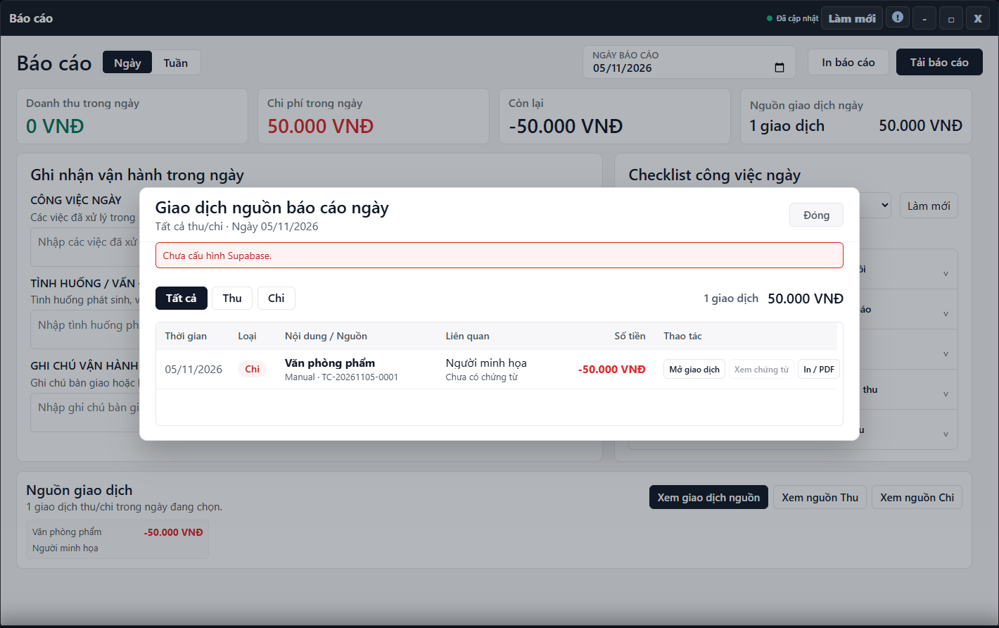

---
{
  "id": "BC-001",
  "title": "Đọc báo cáo ngày, tuần và giao dịch nguồn",
  "summary": "Xem báo cáo theo ngày hoặc tuần và đối chiếu những giao dịch tạo nên số liệu.",
  "modules": [
    "bao-cao"
  ],
  "order": 37,
  "revision": 2,
  "status": "EDITORIAL_PENDING",
  "keywords": [
    "Đọc báo cáo ngày, tuần và giao dịch nguồn"
  ],
  "questions": [
    "Xem báo cáo ngày hoặc tuần ở đâu?",
    "Doanh thu báo cáo lấy từ đâu?",
    "Đối chiếu báo cáo với giao dịch Thu chi thế nào?"
  ],
  "related": [
    "HP-006",
    "TC-001",
    "DD-002",
    "BC-002"
  ]
}
---

## Mục đích

Xem báo cáo theo ngày hoặc tuần và đối chiếu những giao dịch tạo nên số liệu. Báo cáo tổng hợp không phải nơi sửa một khoản tiền.

## Trước khi bắt đầu

- Đúng cơ sở và kỳ cần xem; nguồn Thu chi, học viên và điểm danh liên quan phải tải thành công.
- Phân biệt khoản thu mới với tiền đã thu trước khi dùng iChess. Dữ liệu nguồn ban đầu không tự thành doanh thu của ngày hiện tại.

## Các bước thực hiện

1. Mở **Báo cáo**, chọn **Ngày** hoặc **Tuần**.
2. Với Ngày, chọn **Ngày báo cáo**. Với Tuần, dùng ngày chọn tuần, nút tuần trước/sau hoặc **Tuần hiện tại**.
3. Đọc doanh thu, chi phí và phần còn lại theo kỳ. Khoản Thu/Chi được tổng hợp từ giao dịch, không cộng toàn bộ giá gói đã gán cho học viên vào doanh thu.
4. Ở báo cáo Tuần, đọc phần điểm danh cùng trạng thái nguồn. Khi nguồn chưa tải được, không diễn giải số chưa có là tất cả học viên đều vắng.
5. Chọn **Xem giao dịch nguồn**, **Xem nguồn Thu** hoặc **Xem nguồn Chi**. Đọc phạm vi kỳ và số giao dịch trong hộp nguồn.
6. Phần đối chiếu chứng từ chưa có hướng dẫn hoàn chỉnh. **Mở giao dịch** dẫn tới Sổ quỹ Thu chi; **Xem chứng từ** và **In / PDF** cần dữ liệu chứng từ thực có. Nếu báo lỗi, dừng đối chiếu phần này, không coi đã kiểm tra xong.
7. Khi phát hiện sai, sửa ở đúng nguồn theo quyền rồi kiểm tra lại báo cáo. Không sửa ghi chú vận hành để thay cho việc điều chỉnh giao dịch.

## Kết quả mong đợi

Bạn đọc được số liệu đúng ngày hoặc tuần và biết khoản nào cần đối chiếu tại Sổ quỹ Thu chi. Phần chứng từ chưa có hướng dẫn đối chiếu hoàn chỉnh; khi không tải được, chưa kết luận đã kiểm tra đủ số liệu.

## Lỗi thường gặp

- **Không khớp tổng Thu chi:** đối chiếu cùng cơ sở, ngày/kỳ, bộ lọc và trạng thái nguồn.
- **Học phí trả trước iChess không có trên báo cáo:** không tạo thu mới để làm xuất hiện; xem [HP-006](HP-006.md).
- **Nguồn chưa sẵn sàng:** kiểm tra lại sau làm mới theo thông báo trên màn hình, không dùng bản thiếu dữ liệu làm kết luận vận hành.

## Bài liên quan

- [TC-001 · Tra cứu Thu chi và xuất CSV](TC-001.md)
- [HP-006 · Tiếp quản học phí từ dữ liệu ban đầu](HP-006.md)
- [DD-002 · Tìm buổi học, đọc số buổi và xuất bảng](DD-002.md)
- [BC-002 · Ghi nhận vận hành và in báo cáo](BC-002.md)
