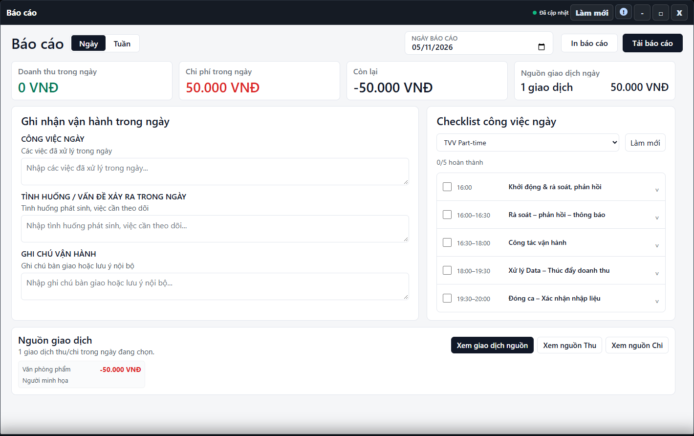

---
{
  "id": "BC-002",
  "title": "Ghi nhận vận hành và in báo cáo",
  "summary": "Chuẩn bị phần ghi nhận công việc cho bản báo cáo cần xuất.",
  "modules": [
    "bao-cao"
  ],
  "order": 38,
  "revision": 3,
  "status": "EDITORIAL_PENDING",
  "keywords": [
    "Ghi nhận vận hành và in báo cáo"
  ],
  "questions": [
    "Ghi chú bàn giao trong báo cáo có được lưu chung không?",
    "In hoặc tải báo cáo ở đâu?"
  ],
  "related": [
    "BC-003",
    "BC-001"
  ]
}
---

## Mục đích

Chuẩn bị phần ghi nhận công việc cho bản báo cáo cần xuất. Các ô ghi nhận này là bản nháp trên phiên ứng dụng; không dùng như hồ sơ bàn giao đã lưu chung cho mọi người.

## Trước khi bắt đầu

- Chọn đúng cơ sở và ngày báo cáo, kiểm tra số liệu nguồn.
- Chuẩn bị nội dung thực cần bàn giao. Giữ bản nội dung riêng nếu cần lưu lâu dài trước khi tải lại trang.

## Các bước thực hiện

1. Mở **Báo cáo → Ngày**, chọn **Ngày báo cáo**.
2. Trong **Ghi nhận vận hành trong ngày**, nhập **Công việc ngày**, **Tình huống / vấn đề xảy ra trong ngày** và **Ghi chú vận hành**.
3. Rà soát lại nội dung và ngày trước khi xuất. Form này không có nút lưu báo cáo chung; nội dung đang nhập chỉ là bản nháp của phiên làm việc.
4. Chọn **In báo cáo** để vào luồng in hoặc **Tải báo cáo** để xuất nội dung. Kiểm tra tệp/bản xem trước thuộc đúng kỳ và có nội dung cần dùng.
5. Đóng bản in khi chưa đúng. Khi đổi ngày hoặc quay lại báo cáo, đọc lại nội dung nháp; không giả định đây là ghi chú riêng đã được lưu theo từng ngày.
6. Chỉ coi đã có bản bàn giao khi đã kiểm tra bản xuất và thực hiện việc lưu/chia sẻ phù hợp; ứng dụng không tự gửi báo cáo từ thao tác nhập này.

## Kết quả mong đợi

Bản xuất cần đúng cơ sở, kỳ và nội dung ghi nhận đã chuẩn bị. Mở tệp kiểm tra trước khi lưu hoặc chia sẻ. Các ô ghi nhận chỉ là bản nháp trong phiên đang làm việc, không phải báo cáo đã lưu chung cho mọi người.

## Lỗi thường gặp

- **Tải lại trang rồi mất nội dung:** bản nháp không phải bản lưu chung; chuẩn bị và kiểm tra bản xuất trước.
- **Nút xuất bị khóa:** kiểm tra nguồn dữ liệu cần cho báo cáo, không bỏ qua số liệu còn thiếu.
- **Muốn đánh dấu công việc đã xong:** dùng [BC-003](BC-003.md), không coi gõ một dòng là đã hoàn thành checklist.

## Bài liên quan

- [BC-001 · Đọc báo cáo ngày, tuần và giao dịch nguồn](BC-001.md)
- [BC-003 · Checklist công việc ngày](BC-003.md)
