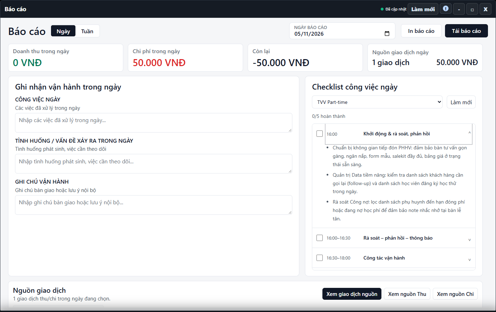

---
{
  "id": "BC-003",
  "title": "Checklist công việc ngày",
  "summary": "Đọc checklist theo mẫu ca và hiểu cách ghi hoàn thành từng việc.",
  "modules": [
    "bao-cao"
  ],
  "order": 39,
  "revision": 2,
  "status": "EDITORIAL_PENDING",
  "keywords": [
    "Checklist công việc ngày"
  ],
  "questions": [
    "Xem công việc theo ca Part-time hoặc Full-time ở đâu?",
    "Đánh dấu checklist có cần bấm Lưu không?"
  ],
  "related": [
    "BC-001",
    "BC-002"
  ]
}
---

## Mục đích

Đọc checklist theo mẫu ca và hiểu cách ghi hoàn thành từng việc. Checklist khác ba ô ghi chú vận hành: bấm dấu hoàn thành có thể gửi lưu ngay.

## Trước khi bắt đầu

- Chọn đúng cơ sở và ngày báo cáo. Checklist ngày tương lai chỉ để xem.
- Cần quyền ghi, checklist đã tải và không có mục đang lưu để cập nhật trạng thái.
- Chỉ đánh dấu sau khi công việc thực sự hoàn thành.

## Các bước thực hiện

1. Mở **Báo cáo → Ngày → Checklist công việc ngày**.
2. Chọn mẫu **TVV Part-time** hoặc **TVV Full-time**. Kiểm tra lại ngày/mẫu sau khi dữ liệu tải; mỗi mẫu có danh sách việc riêng.
3. Bấm tên việc hoặc mũi tên để đọc yêu cầu chi tiết. Mở chi tiết chỉ là thao tác đọc.
4. Khi đủ quyền và dữ liệu sẵn sàng, bấm ô chọn của đúng việc để đánh dấu. Mỗi dấu chọn được gửi lưu riêng ngay, không có bước **Lưu tất cả**.
5. Chờ hết **Đang lưu…** và kiểm tra số mục hoàn thành, người/thời điểm trên mục sau thành công. Nếu báo lỗi, chưa được coi dấu chọn là đã ghi nhận.
6. Bỏ dấu hoàn thành là lần cập nhật khác, không phải hủy nháp chung. Chỉ sửa khi có căn cứ; không đổi ngày/mẫu để né mục đang lưu.

## Kết quả mong đợi

Sau khi lưu thành công, mục công việc hiển thị đúng trạng thái và thông tin người/thời điểm hoàn thành. Nếu báo lỗi hoặc còn Đang lưu…, chưa coi dấu chọn là kết quả đã ghi nhận.

## Lỗi thường gặp

- **Ô chọn bị khóa:** kiểm tra ngày tương lai, trạng thái tải, quyền và thao tác đang lưu.
- **Chưa tải được checklist:** dùng **Làm mới** khi phù hợp, không đoán kết quả hoàn thành.
- **Đổi mẫu thấy số khác:** kiểm tra đúng mẫu và ngày, không so hai tập công việc như cùng một bảng.

## Bài liên quan

- [BC-001 · Đọc báo cáo ngày, tuần và giao dịch nguồn](BC-001.md)
- [BC-002 · Ghi nhận vận hành và in báo cáo](BC-002.md)
