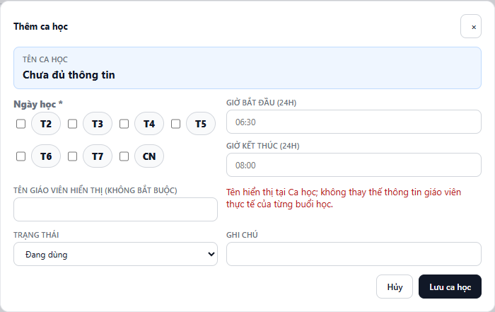

---
{
  "id": "CD-001",
  "title": "Tạo hoặc chỉnh sửa Ca học",
  "summary": "Quản lý ngày và giờ học tại Cài đặt cơ sở trước khi phân lịch cho học viên.",
  "modules": [
    "cai-dat-co-so",
    "thoi-khoa-bieu"
  ],
  "order": 2,
  "revision": 1,
  "status": "EDITORIAL_PENDING",
  "keywords": [
    "ca học",
    "tạo ca",
    "sửa ca",
    "thêm ca",
    "khung giờ",
    "lớp học",
    "cài đặt cơ sở"
  ],
  "questions": [
    "Tạo ca học ở đâu?",
    "Làm sao sửa giờ của ca học?",
    "Vì sao không chọn được ba ngày cho một ca?"
  ],
  "related": [
    "HV-001",
    "HV-002",
    "DD-001"
  ]
}
---

## Mục đích

Tạo danh mục ca học dùng chung trong cơ sở, hoặc chỉnh thông tin của một ca đã có. Đây là danh mục để phân lịch học viên và lập lịch; không phải hồ sơ đăng ký riêng của một học viên.

## Trước khi bắt đầu

- Kiểm tra cơ sở đang làm việc và quyền quản lý Cài đặt cơ sở.
- Chuẩn bị một hoặc hai ngày trong tuần, giờ bắt đầu và kết thúc trong cùng ngày.
- Trước khi sửa ca đang dùng, kiểm tra học viên và lịch liên quan. Nếu chỉ đổi lịch cho một học viên, dùng [Đổi lịch học định kỳ](HV-002.md).

## Các bước thực hiện

1. Mở **Cài đặt cơ sở → Ca học / Lớp**.
2. Dùng tìm kiếm và bộ lọc trạng thái để kiểm tra danh mục, tránh tạo thêm một ca đã tồn tại.
3. Để tạo mới, chọn **+ Thêm ca học**. Để chỉnh sửa, chọn **Sửa** tại đúng dòng ca.
4. Trong **Ngày học**, chọn ít nhất một, tối đa hai ngày. Nhập **Giờ bắt đầu (24H)** và **Giờ kết thúc (24H)**; giờ kết thúc phải sau giờ bắt đầu.
5. Kiểm tra **Tên ca học** tự sinh từ ngày và giờ. Không cần tự đặt một tên khác.
6. Có thể nhập **Tên giáo viên hiển thị** và ghi chú. Tên này không thay thế phân công giáo viên thực tế của từng buổi học. Chọn trạng thái **Đang dùng** cho ca cần tiếp tục phân lịch.
7. Chọn **Lưu ca học** khi tạo mới hoặc **Lưu thay đổi** khi sửa. Chờ phản hồi; nếu có thông báo lỗi, giữ form và sửa đúng nội dung được báo.
8. Tìm lại ca trong danh mục, kiểm tra ngày, giờ và trạng thái. Khi dùng ca cho học viên, mở Học viên và kiểm tra các ô lịch tương ứng.

## Kết quả mong đợi

Ca xuất hiện với tên tự sinh và thông tin vừa lưu. Ca đang dùng có thể được chọn khi đăng ký lịch học phù hợp. Chỉnh sửa ca không phải thao tác ghi điểm danh hoặc thu học phí.

## Lỗi thường gặp

- **Chọn quá hai ngày:** mỗi ca chỉ hỗ trợ tối đa hai ngày; điều chỉnh lại lựa chọn theo kế hoạch thực tế.
- **Tên ca báo chưa đủ thông tin:** nhập đủ ngày và hai mốc giờ hợp lệ.
- **Giờ kết thúc không sau giờ bắt đầu:** sửa về khoảng giờ trong cùng ngày; không dùng ca qua nửa đêm.
- **Không thể xóa vì có dữ liệu liên quan:** dùng **Ngưng dùng** nếu muốn dừng sử dụng và giữ lịch sử. Không xóa các dữ liệu liên quan chỉ để xóa ca.
- **Ca đã ngưng không xuất hiện khi thêm lịch:** kiểm tra bộ lọc và trạng thái của ca trước khi đăng ký học viên.

## Bài liên quan

- [HV-001 · Thêm học viên mới](HV-001.md)
- [HV-002 · Đổi lịch học định kỳ](HV-002.md)
- [DD-001 · Điểm danh một buổi](DD-001.md)
