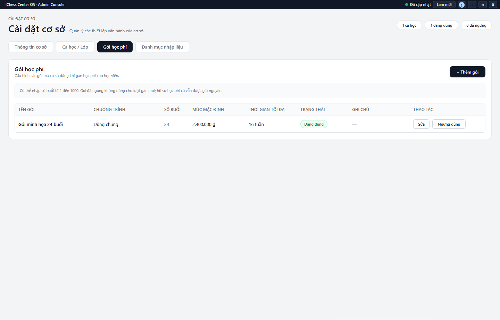

---
{
  "id": "CD-002",
  "title": "Ngưng dùng ca và quản lý danh mục gói",
  "summary": "Ngưng sử dụng một ca hoặc một gói trong danh mục mà vẫn giữ lịch sử.",
  "modules": [
    "cai-dat-co-so"
  ],
  "order": 45,
  "revision": 2,
  "status": "EDITORIAL_PENDING",
  "keywords": [
    "Ngưng dùng ca và quản lý danh mục gói"
  ],
  "questions": [
    "Ngưng dùng ca học khác xóa ca thế nào?",
    "Vì sao không xóa được ca có học viên?",
    "Ngưng gói học phí có đổi gói học viên đang học không?"
  ],
  "related": [
    "HP-004",
    "CD-001",
    "HP-001"
  ]
}
---

## Mục đích

Ngưng sử dụng một ca hoặc một gói trong danh mục mà vẫn giữ lịch sử. Không dùng xóa ca hay sửa giá danh mục để thay đổi dữ liệu học viên đã phát sinh.

## Trước khi bắt đầu

- Đúng cơ sở, có quyền cập nhật Cài đặt và nguồn danh mục đã tải.
- Kiểm tra học viên, lịch và dữ liệu liên quan trước khi ngưng/xóa ca. Kiểm tra kỳ học phí hiện có trước khi sửa hoặc ngưng gói.

## Các bước thực hiện

1. Mở **Cài đặt cơ sở → Ca học / Lớp**, tìm đúng ca bằng tên và trạng thái.
2. Để dừng dùng ca, kiểm tra lại ngày/giờ và học viên liên quan trước **Ngưng dùng**. Đây là thao tác ghi trạng thái riêng, không phải nháp chờ một nút Lưu chung.
3. **Xóa** chỉ khả dụng khi các điều kiện kiểm tra dữ liệu liên quan cho phép. Nếu có học viên hoặc lịch sử, đọc lý do bị chặn và dùng cách ngưng phù hợp; không xóa dữ liệu liên quan để mở khóa nút.
4. Sau thao tác được xác nhận thành công, lọc **Đã ngưng** để kiểm tra. Khi kích hoạt lại, rà soát điều kiện và trạng thái thực sau lệnh; không coi ca ngưng là bị xóa vĩnh viễn.
5. Mở **Gói học phí** để quản lý danh mục gói. **Sửa** mở tên, chương trình, số buổi, mức mặc định, thời gian tối đa và trạng thái. Chọn **Lưu thay đổi** hoặc **Hủy** trong form.
6. **Ngưng dùng** gói loại gói khỏi lượt gán mới; **Kích hoạt** cho dùng lại theo điều kiện. Kiểm tra đúng dòng trước khi bấm vì đây là lệnh riêng.
7. Gói đã ngưng không làm mất hồ sơ học phí cũ. Muốn thay đổi một kỳ đã gán, kiểm tra tại Học phí theo [HP-004](HP-004.md), không chỉ sửa danh mục.

## Kết quả mong đợi

Sau thông báo thành công, ca hoặc gói xuất hiện đúng trạng thái trong danh mục. Ngưng dùng không xóa lịch sử; gói ngưng không còn được chọn để gán mới. Luôn mở lại đúng dòng để kiểm tra kết quả.

## Lỗi thường gặp

- **Không xóa được ca:** lý do dữ liệu liên quan là điều kiện cần tuân thủ, không phải lỗi cần né.
- **Gói không xuất hiện khi gán:** kiểm tra trạng thái Đang dùng, cơ sở và dữ liệu tải.
- **Đổi giá danh mục nhưng kỳ cũ khác giá:** kỳ có dữ liệu riêng; không coi đó là lý do tạo lại học phí.

## Bài liên quan

- [CD-001 · Tạo hoặc chỉnh sửa Ca học](CD-001.md)
- [HP-001 · Thiết lập và gán gói học phí](HP-001.md)
- [HP-004 · Đổi gói trước buổi đầu và kết thúc kỳ](HP-004.md)
