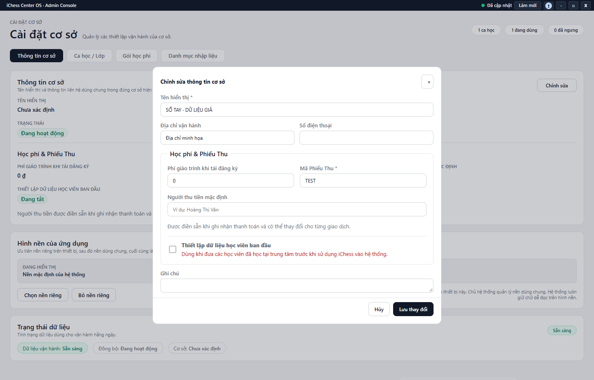

---
{
  "id": "CD-003",
  "title": "Thông tin cơ sở và thiết lập Phiếu Thu",
  "summary": "Cập nhật thông tin vận hành và mặc định học phí/Phiếu Thu của cơ sở đang làm việc.",
  "modules": [
    "cai-dat-co-so"
  ],
  "order": 46,
  "revision": 2,
  "status": "EDITORIAL_PENDING",
  "keywords": [
    "Thông tin cơ sở và thiết lập Phiếu Thu"
  ],
  "questions": [
    "Sửa tên địa chỉ cơ sở ở đâu?",
    "Đổi mã Phiếu Thu hoặc người thu mặc định thế nào?",
    "Bật nhập dữ liệu học viên ban đầu ở đâu?"
  ],
  "related": [
    "HP-006",
    "HP-005",
    "CD-004"
  ]
}
---

## Mục đích

Cập nhật thông tin vận hành và mặc định học phí/Phiếu Thu của cơ sở đang làm việc. Không dùng thay đổi cài đặt để sửa ngầm một giao dịch hoặc chứng từ đã phát sinh.

> Phần lưu thông tin cơ sở và mặc định Phiếu Thu chưa có hướng dẫn vận hành được duyệt. Cần đối chiếu thêm tên cơ sở hiển thị, dữ liệu sau lưu và chứng từ mới. Chỉ kiểm tra thông tin; không lưu hoặc bật nhập dữ liệu ban đầu theo bài này.

## Trước khi bắt đầu

- Xác nhận đúng cơ sở trên Taskbar, quyền ghi và dữ liệu Cài đặt đã tải.
- Chuẩn bị tên, địa chỉ, liên hệ, phí giáo trình tái đăng ký, mã Phiếu Thu và người thu mặc định đã thống nhất.
- Việc bật nhập dữ liệu học viên ban đầu chỉ phù hợp khi tiếp quản dữ liệu thực; xem [HP-006](HP-006.md).

## Các bước thực hiện

### Chỉ tra cứu và chuẩn bị

1. Kiểm tra đúng cơ sở trên Taskbar, rồi mở **Cài đặt cơ sở → Thông tin cơ sở**.
2. Nếu có quyền và dữ liệu đã tải, **Chỉnh sửa** mở form để xem tên hiển thị, địa chỉ và điện thoại. Khi phần tóm tắt và form khác nhau, dừng và kiểm tra thông tin thật; không điền giá trị đoán.
3. Trong **Học phí & Phiếu Thu**, đọc phí giáo trình khi tái đăng ký, mã Phiếu Thu và người thu mặc định. Phí là số nguyên không âm; mã gồm 2–6 chữ cái không dấu hoặc chữ số.
4. **Thiết lập dữ liệu học viên ban đầu** chỉ mở một khả năng thao tác, không tự nhập học viên, số buổi hay tiền. Đọc [HP-006](HP-006.md); chưa bật công tắc theo bài này.
5. Dùng **Hủy** để rời form xem mà không gửi phần nhập. Việc sửa dữ liệu và kiểm tra chứng từ sau lưu cần quy trình được duyệt; không dùng thay đổi mặc định để sửa ngầm chứng từ cũ.

## Kết quả mong đợi

Bạn tìm được các mặc định và nhận ra thông tin chưa nhất quán cần kiểm tra. Chưa có hướng dẫn xác nhận lưu cài đặt hoặc chứng từ sau đổi trong bài này; các dữ liệu đang có được giữ nguyên.

## Lỗi thường gặp

- **Mã Phiếu Thu không hợp lệ:** bỏ dấu/khoảng trắng và kiểm tra độ dài, không đổi mã của cơ sở khác.
- **Bật nhập ban đầu rồi không có học phí mới:** công tắc chỉ mở khả năng thao tác, không tạo dữ liệu tự động.
- **Nguồn chưa tải hoặc thiếu quyền:** giữ bản nhập cần thiết và kiểm tra thông báo trước khi gửi lại.

## Bài liên quan

- [HP-006 · Tiếp quản học phí từ dữ liệu ban đầu](HP-006.md)
- [HP-005 · Thông báo học phí và Phiếu Thu](HP-005.md)
- [CD-004 · Hình nền, danh mục tham khảo và nhật ký Owner](CD-004.md)
