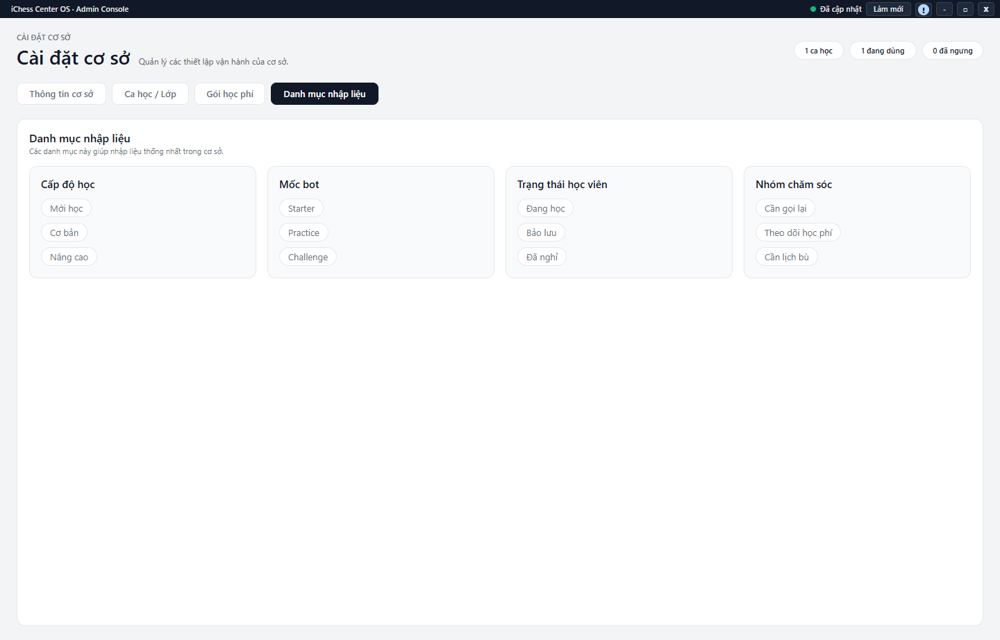

---
{
  "id": "CD-004",
  "title": "Hình nền, danh mục tham khảo và nhật ký Owner",
  "summary": "Tra cứu phạm vi hình nền, danh mục nhập liệu và nhật ký dành cho Owner.",
  "modules": [
    "cai-dat-co-so"
  ],
  "order": 47,
  "revision": 2,
  "status": "EDITORIAL_PENDING",
  "keywords": [
    "Hình nền, danh mục tham khảo và nhật ký Owner"
  ],
  "questions": [
    "Đặt hình nền riêng có ảnh hưởng người khác không?",
    "Sửa danh mục nhập liệu ở đâu?",
    "Ai xem được nhật ký điểm danh?"
  ],
  "related": [
    "CD-003",
    "HV-004",
    "DD-001"
  ]
}
---

## Mục đích

Tra cứu phạm vi hình nền, danh mục nhập liệu và nhật ký dành cho Owner. Đây không phải công cụ đổi quyền người dùng hay sửa lịch sử điểm danh.

> Chỉ dẫn dưới đây giới hạn ở đọc phạm vi hình nền và danh mục. Phần đổi nền chung và xem chi tiết nhật ký chưa có hướng dẫn hoàn chỉnh được duyệt. Nhật ký cần tài khoản Owner có tư cách thành viên đang hoạt động tại đúng cơ sở; Admin thường không thấy công cụ này.

## Trước khi bắt đầu

- Kiểm tra cơ sở, tài khoản và trạng thái dữ liệu.
- Hình nền riêng chỉ áp dụng cho tài khoản và thiết bị hiện tại; nền dùng chung phụ thuộc quyền quản lý riêng.

## Các bước thực hiện

### Chỉ tra cứu và chuẩn bị

1. Mở **Cài đặt cơ sở → Thông tin cơ sở → Hình nền của ứng dụng** để đọc nền đang dùng.
2. **Chọn nền riêng** và **Bỏ nền riêng** thuộc lựa chọn cá nhân trên tài khoản/thiết bị hiện tại. Nền riêng được ưu tiên hơn nền chung; không hiểu thay nền riêng là thay cho mọi người. Phần lưu tệp còn cần hướng dẫn bổ sung.
3. Công cụ đổi hoặc bỏ nền chung chỉ xuất hiện khi có quyền phù hợp. Không thấy nút thì không dùng đường dẫn khác để vượt quyền.
4. Mở **Danh mục nhập liệu** để đọc nhóm lựa chọn tham khảo. Trang này chỉ đọc, không có nút sửa danh mục.
5. Một số nhãn tham khảo khác form Học viên, như cấp độ Dolphin/Turtle và trạng thái **Đang theo học / Bảo lưu / Ngưng học**. Khi nhập hồ sơ, dùng lựa chọn trên form thật; không sửa hồ sơ để làm khớp nhãn mẫu.
6. Nhật ký điểm danh dành cho Owner đúng điều kiện, không phải mọi Admin. Phần bộ lọc/chi tiết chưa đủ hướng dẫn; chỉ biết có quyền Owner cũng chưa chứng minh dữ liệu nhật ký đã tải đầy đủ.

## Kết quả mong đợi

Bạn biết nền riêng có phạm vi cá nhân, danh mục tham khảo không sửa tại trang này và nhật ký có giới hạn quyền. Đọc các phần này không sửa điểm danh hoặc thay quyền tài khoản.

## Lỗi thường gặp

- **Không thấy nền của người khác:** nền riêng có phạm vi tài khoản/thiết bị, không phải thay đổi toàn cơ sở.
- **Không sửa được danh mục mẫu:** màn hiện hành chỉ đọc; không sửa hồ sơ để làm khớp mẫu khác thực tế.
- **Không có tab nhật ký:** kiểm tra quyền; không mặc định module bị lỗi hoặc cần tạo tài khoản khác để thử.

## Bài liên quan

- [CD-003 · Thông tin cơ sở và thiết lập Phiếu Thu](CD-003.md)
- [HV-004 · Sửa thông tin và trạng thái học viên](HV-004.md)
- [DD-001 · Điểm danh một buổi](DD-001.md)
