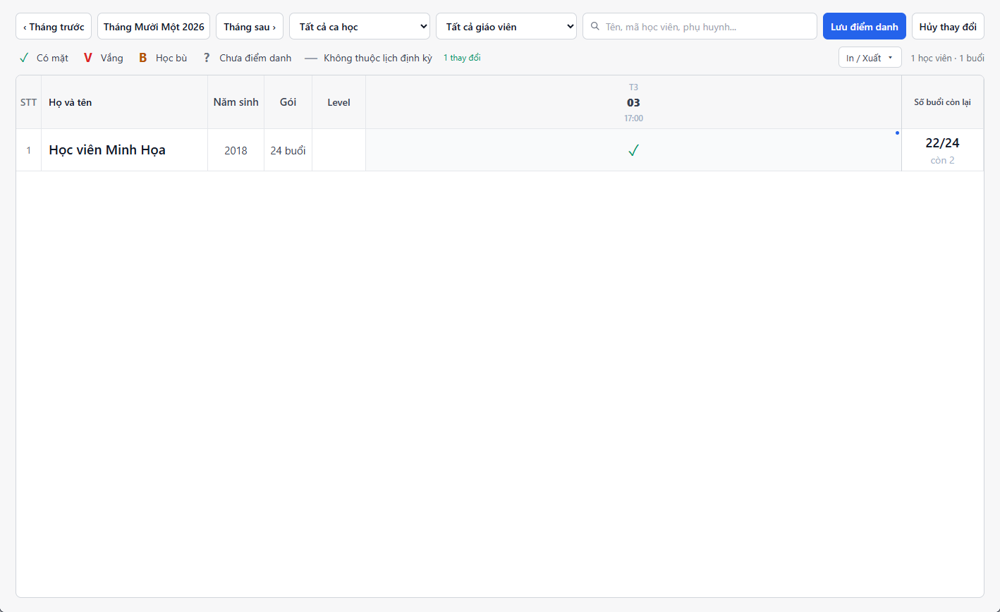

---
{
  "id": "DD-001",
  "title": "Điểm danh một buổi",
  "summary": "Chọn đúng học viên và buổi học, ghi Có mặt hoặc Vắng, rồi lưu điểm danh.",
  "modules": [
    "bang-diem-danh",
    "thoi-khoa-bieu"
  ],
  "order": 5,
  "revision": 2,
  "status": "EDITORIAL_PENDING",
  "keywords": [
    "điểm danh",
    "có mặt",
    "vắng",
    "lưu điểm danh",
    "buổi học",
    "hủy thay đổi"
  ],
  "questions": [
    "Điểm danh một buổi thế nào?",
    "Làm sao ghi nhận có mặt?",
    "Chọn Có mặt đã được lưu chưa?",
    "Sửa điểm danh đã lưu và hủy nháp khác nhau thế nào?"
  ],
  "related": [
    "HV-002",
    "HP-001",
    "HP-002"
  ]
}
---

## Mục đích

Ghi nhận Có mặt hoặc Vắng cho một học viên tại một buổi học trên **Bảng điểm danh**. Chọn trạng thái chỉ tạo thay đổi chờ lưu; cần dùng **Lưu điểm danh** để gửi thay đổi.

## Trước khi bắt đầu

- Kiểm tra cơ sở hiện tại và tài khoản có quyền ghi điểm danh. Nếu màn hình ghi **Chỉ xem**, không thể lưu từ tài khoản/trạng thái đó.
- Buổi học và dữ liệu học viên đã được tải. Xác định đúng ngày, giờ và ca học.
- Chỉ thao tác buổi hôm nay hoặc đã qua mà hệ thống cho phép sửa; buổi tương lai, đã hủy và một số trạng thái lịch sử bị khóa.

## Các bước thực hiện

1. Mở **Bảng điểm danh**, chọn đúng tháng bằng bộ chọn tháng hoặc **Tháng trước/Tháng sau**.
2. Lọc **Ca học**, **Giáo viên** và tìm học viên nếu cần. Kiểm tra tiêu đề ngày và giờ của cột trước khi chọn ô.
3. Bấm ô giao giữa đúng học viên và buổi học. Đọc lại thông tin học viên/ngày/giờ trong bảng chọn.
4. Chọn **Có mặt** nếu học viên có học, hoặc **Vắng** nếu vắng. Với Vắng, nhập lý do đã biết hoặc để trống nếu chưa có thông tin; không điền một lý do giả.
5. Kiểm tra dấu trong ô và số thay đổi chờ lưu. Ảnh minh họa có **1 thay đổi**, nghĩa là chưa lưu vào hệ thống.
6. Chọn **Lưu điểm danh**, chờ kết quả. Khi báo chưa lưu hoặc chưa xác nhận được, giữ bản nháp và xử lý/thử lại theo thông báo; không tiếp tục coi dữ liệu là đã chốt.
7. Sau khi lưu thành công, kiểm tra lại ô, dấu chờ lưu và thông tin số buổi khi dữ liệu học phí đã tải. Không tự cộng hoặc trừ thêm buổi bằng một thao tác khác.

## Kết quả mong đợi

Sau xác nhận lưu thành công và tải lại dữ liệu, ô đúng học viên/buổi học có trạng thái đã ghi nhận. Số thay đổi chưa lưu được xử lý theo kết quả trả về; không còn coi một dấu vừa chọn là dữ liệu chính thức trước khi lưu.

## Lỗi thường gặp

- **Không bấm được ô:** kiểm tra ngày tương lai, buổi hủy, trạng thái lịch sử hoặc quyền ghi; không chuyển qua chức năng dữ liệu nền để vượt khóa.
- **Muốn bỏ các thay đổi chưa lưu:** chọn **Hủy thay đổi** khi nút khả dụng. Nút không dùng để hoàn tác điểm danh đã lưu.
- **Dữ liệu người khác vừa thay đổi:** làm mới và rà soát ô bị xung đột trước khi chọn lại; tránh ghi đè theo trí nhớ.
- **Muốn chọn Học bù:** cần buổi Vắng gốc hợp lệ và quy trình xếp bù. Bài này chỉ xác minh Có mặt/Vắng; không thay Học bù bằng Có mặt để bỏ qua liên kết buổi gốc.
- **Chuyển cửa sổ khi có bản nháp:** ứng dụng có thể hỏi bỏ thay đổi điểm danh chưa lưu. Hoàn tất lưu hoặc chủ động hủy trước khi tiếp tục.

## Bài liên quan

- [HV-002 · Đổi lịch học định kỳ](HV-002.md)
- [HP-001 · Thiết lập và gán gói học phí](HP-001.md)
- [HP-002 · Hiểu ưu đãi định kỳ và gia hạn học phí](HP-002.md)
