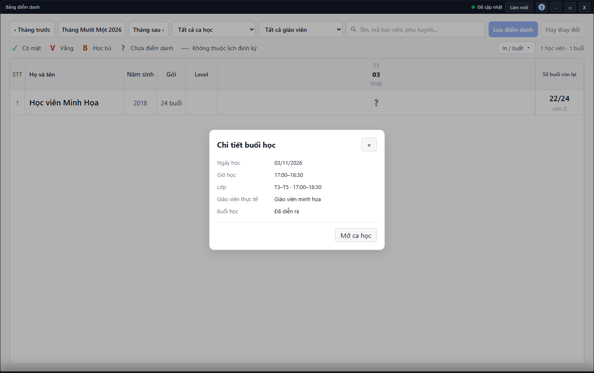

---
{
  "id": "DD-002",
  "title": "Tìm buổi học, đọc số buổi và xuất bảng",
  "summary": "Tìm đúng buổi trong bảng điểm danh, đọc ký hiệu và đối chiếu tiến độ học phí.",
  "modules": [
    "bang-diem-danh"
  ],
  "order": 25,
  "revision": 3,
  "status": "EDITORIAL_PENDING",
  "keywords": [
    "Tìm buổi học, đọc số buổi và xuất bảng"
  ],
  "questions": [
    "Lọc bảng điểm danh theo tháng và ca thế nào?",
    "Tại sao ô điểm danh bị khóa hoặc có dấu gạch?",
    "In hoặc xuất Excel bảng điểm danh ở đâu?",
    "Điểm danh ảnh hưởng số buổi Học phí thế nào?"
  ],
  "related": [
    "DD-001",
    "HV-002",
    "DD-003",
    "HP-003"
  ]
}
---

## Mục đích

Tìm đúng buổi trong bảng điểm danh, đọc ký hiệu và đối chiếu tiến độ học phí. In hoặc xuất bảng là thao tác đọc, không thay thế **Lưu điểm danh**.

## Trước khi bắt đầu

- Kiểm tra cơ sở, tháng cần xem và trạng thái dữ liệu.
- Muốn thay dấu điểm danh thì cần quyền ghi và điều kiện của buổi; đọc [DD-001](DD-001.md).

## Các bước thực hiện

1. Mở **Bảng điểm danh**. Chọn tháng hoặc dùng **Tháng trước**, **Tháng sau**.
2. Lọc **Ca học**, **Giáo viên** và tìm tên học viên để thu hẹp bảng.
3. Đọc cả ngày và giờ ở đầu cột, tránh chọn nhầm hai buổi cùng ngày. Bấm đầu cột để xem thông tin buổi; **Mở ca học** dẫn sang lịch khi có ngữ cảnh phù hợp.
4. Đọc ký hiệu: **✓ Có mặt**, **V Vắng**, **B Học bù**, **? Chưa điểm danh**, **— Không thuộc lịch định kỳ**. Ô tương lai, buổi hủy hoặc dữ liệu chưa sẵn sàng có thể không cho sửa; dấu gạch không tự chứng minh học viên vắng.
5. Đối chiếu cột số buổi với kỳ Học phí. Sau lưu điểm danh thành công, kiểm tra số đã học/còn lại từ dữ liệu kỳ đã cập nhật; không tự cộng số buổi bằng mắt rồi sửa thanh toán.
6. Mở **In / Xuất** để chọn PDF hoặc XLSX. Kiểm tra tháng, ca và học viên đang lọc trước khi xuất; không coi xuất bảng là đã lưu các thay đổi nháp.

## Kết quả mong đợi

Bạn xác định được đúng học viên, ngày, giờ và tình trạng từng buổi. Bản xuất cần khớp tháng và bộ lọc đang chọn; mở tệp để kiểm tra tên và ký hiệu trước khi sử dụng. Excel có thêm cột tiến độ và số buổi còn lại; PDF thể hiện các buổi trong bảng, không có cột tiến độ đó. Xuất bảng không thay cho lưu điểm danh.

## Lỗi thường gặp

- **Bảng trống:** kiểm tra tháng, bộ lọc, lịch định kỳ và nguồn đã tải; không tạo điểm danh ngoài lịch để lấp bảng.
- **Số buổi chưa đổi khi đang chọn dấu:** đó còn là nháp; làm đúng bước lưu và kiểm tra kết quả.
- **Đổi lịch định kỳ không giống học bù:** xem [HV-002](HV-002.md) và [DD-003](DD-003.md) trước khi thay lịch.

## Bài liên quan

- [DD-001 · Điểm danh một buổi](DD-001.md)
- [HP-003 · Đọc kỳ học phí và số buổi](HP-003.md)
- [HV-002 · Đổi lịch học định kỳ](HV-002.md)
- [DD-003 · Học bù và xử lý xung đột điểm danh](DD-003.md)
