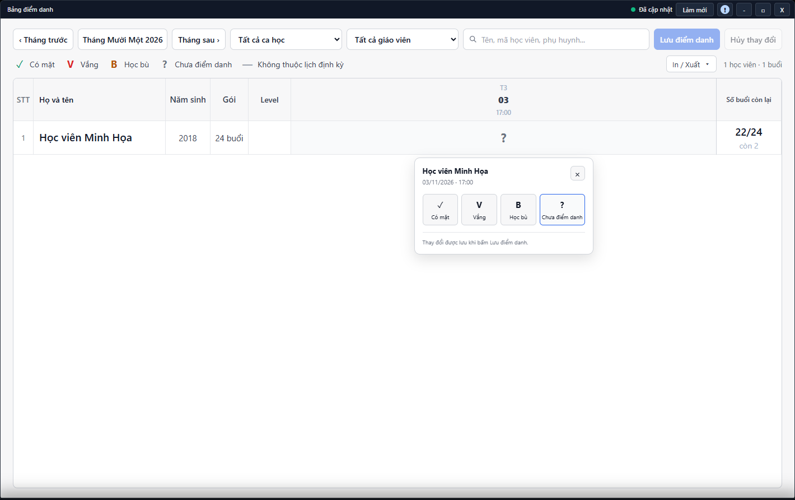

---
{
  "id": "DD-003",
  "title": "Học bù và xử lý xung đột điểm danh",
  "summary": "Nhận biết điều kiện học bù và cách dừng an toàn khi điểm danh chưa rõ kết quả.",
  "modules": [
    "bang-diem-danh"
  ],
  "order": 26,
  "revision": 2,
  "status": "EDITORIAL_PENDING",
  "keywords": [
    "Học bù và xử lý xung đột điểm danh"
  ],
  "questions": [
    "Xếp học bù cho buổi vắng thế nào?",
    "Đổi hoặc hủy lịch học bù ở đâu?",
    "Vì sao không chọn được Học bù?",
    "Điểm danh bị xung đột hoặc chưa rõ đã lưu thì làm gì?"
  ],
  "related": [
    "DD-001",
    "DD-002",
    "LK-004"
  ]
}
---

## Mục đích

Nhận biết điều kiện học bù và cách dừng an toàn khi điểm danh chưa rõ kết quả. Đặt lịch bù, chọn dấu **B** và lưu kết quả tham gia là các việc khác nhau.

> Chưa có hướng dẫn vận hành được duyệt cho đặt, đổi hoặc hủy học bù và xử lý khi lưu bị xung đột. Chưa đối chiếu đủ buổi vắng gốc, lịch bù và kết quả sau ghi. Chỉ dùng bài để kiểm tra thông tin; không đặt lịch, chọn dấu B hoặc gửi lại lệnh theo bài này.

## Trước khi bắt đầu

- Cần học viên, buổi vắng và buổi dự kiến học bù đúng cơ sở; tài khoản có quyền điểm danh.
- Buổi vắng nguồn phải được lưu trước. Buổi nguồn/đích, trạng thái đã học/hủy và việc đã dùng nguồn đó được kiểm tra riêng.

## Các bước thực hiện

### Chỉ tra cứu và chuẩn bị

1. Mở đúng ô trong **Bảng điểm danh**, đọc học viên, ngày, giờ và dấu hiện tại.
2. Phân biệt buổi vắng gốc, buổi dự kiến học bù và kết quả có tham gia buổi bù hay không. Đặt lịch bù, chọn **B** và lưu điểm danh là các việc riêng.
3. Buổi vắng gốc phải được lưu và còn đủ điều kiện sử dụng. Chưa thấy dữ liệu gốc thì dừng; không chọn buổi khác cho vừa điều kiện.
4. Các công cụ **Xếp học bù**, **Đổi buổi** và **Hủy lịch bù** phụ thuộc tình trạng lịch. Bài này chưa hướng dẫn xác nhận các công cụ đó.
5. Nếu màn hình báo dữ liệu thay đổi hoặc chưa rõ đã lưu hay chưa, giữ ngữ cảnh và đọc thông báo. Không bấm thêm nhiều lệnh, hủy nháp hoặc sửa lịch sử để làm lại từ đầu.
6. Đối với Có mặt/Vắng thông thường, đọc [DD-001](DD-001.md). Không thay dấu Học bù bằng Có mặt để bỏ qua kiểm tra buổi gốc.

## Kết quả mong đợi

Bạn xác định được thông tin còn thiếu và biết lúc nào phải dừng. Bài không xác nhận đã đặt học bù, lưu dấu B hoặc xử lý xong xung đột; những phần này cần hướng dẫn được duyệt riêng.

## Lỗi thường gặp

- **Buổi vắng còn nháp:** lưu và kiểm tra trước khi chọn nguồn bù.
- **Nguồn đã dùng hoặc buổi đích đã hủy:** chọn nguồn/đích đúng nghiệp vụ sau khi xác minh, không sửa lịch sử để né chặn.
- **Đang ghi hoặc kết quả chưa rõ:** giữ ngữ cảnh hiện tại, đọc thông báo; không bấm lặp nhiều lệnh khác nhau.

## Bài liên quan

- [DD-001 · Điểm danh một buổi](DD-001.md)
- [DD-002 · Tìm buổi học, đọc số buổi và xuất bảng](DD-002.md)
- [LK-004 · Buổi đột xuất và thông tin ca học](LK-004.md)
