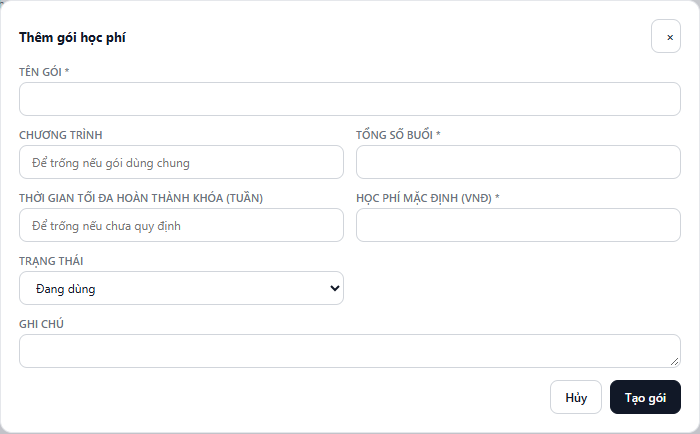
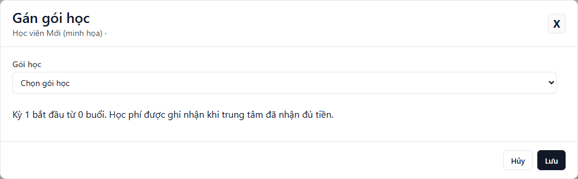

---
{
  "id": "HP-001",
  "title": "Thiết lập và gán gói học phí",
  "summary": "Tạo danh mục gói, rồi gán gói cho học viên mới chưa có kỳ học phí.",
  "modules": [
    "hoc-phi",
    "cai-dat-co-so",
    "hoc-vien"
  ],
  "order": 3,
  "revision": 1,
  "status": "EDITORIAL_PENDING",
  "keywords": [
    "gán gói",
    "gói học phí",
    "thiết lập",
    "tạo gói",
    "số buổi",
    "học phí mặc định"
  ],
  "questions": [
    "Gán gói học phí ở đâu?",
    "Làm sao thiết lập gói học phí?",
    "Tạo gói học mới thế nào?"
  ],
  "related": [
    "HV-001",
    "HP-002",
    "DD-001"
  ]
}
---

## Mục đích

Chuẩn bị gói học trong danh mục của cơ sở và gán gói cho học viên mới. Tạo danh mục và gán gói là hai thao tác riêng; gán gói chưa phải ghi nhận tiền đã thu.

## Trước khi bắt đầu

- Học viên đã có hồ sơ trong cơ sở; xem [Thêm học viên mới](HV-001.md).
- Có quyền quản lý gói/học phí và dữ liệu đã tải xong.
- Biết tên gói, tổng số buổi và học phí mặc định đã được cơ sở thống nhất. Số tiền trong ảnh chỉ là dữ liệu minh họa.
- Bài này áp dụng cho học viên mới chưa có kỳ học phí. Nếu màn hình hiển thị **Thiết lập học phí ban đầu**, đó là luồng dữ liệu đã có trước iChess, cần xác minh nguồn trước khi thao tác.

## Các bước thực hiện

1. Mở **Cài đặt cơ sở → Gói học phí**. Nếu gói phù hợp đã có và đang dùng, chuyển đến bước 5.
2. Chọn **+ Thêm gói**, nhập **Tên gói**, **Tổng số buổi** và **Học phí mặc định (VNĐ)**. Tổng số buổi là số nguyên từ 1 đến 1.000; học phí là số nguyên không âm.
3. Điền chương trình, ghi chú và **Thời gian tối đa hoàn thành khóa (tuần)** nếu áp dụng. Số tuần, khi nhập, phải là số nguyên dương. Chọn trạng thái **Đang dùng**.
4. Chọn **Tạo gói**, chờ xác nhận rồi kiểm tra gói trong danh mục. Dùng **Sửa → Lưu thay đổi** nếu cần chỉnh thông tin gói đã có; không suy ra rằng chỉnh danh mục sẽ đổi giá của kỳ đã lập.
5. Mở **Học phí**, tìm đúng học viên và xem cột **Việc cần làm**. Với học viên chưa có gói, chọn **Gán gói**.
6. Trong **Gán gói học**, chọn gói đang dùng. Đối chiếu tên, số buổi và số tiền được hiển thị với kế hoạch đã thống nhất.
7. Chọn **Lưu**. Chờ thông báo **Đã gán gói học.**, rồi kiểm tra chi tiết học phí của học viên.
8. Kiểm tra kỳ đầu bắt đầu từ 0 buổi và đúng tên gói. Chỉ ghi nhận thanh toán qua luồng thanh toán khi trung tâm đã nhận đủ tiền và đã kiểm tra đúng kỳ.

## Kết quả mong đợi

Danh mục có gói đang dùng; học viên được gán kỳ học phí đầu tiên từ 0 buổi. Gán gói không đồng nghĩa đã thanh toán, không tạo Phiếu Thu chỉ vì chọn gói.

## Lỗi thường gặp

- **Không thấy gói trong danh sách chọn:** kiểm tra trạng thái gói và dữ liệu tải tại đúng cơ sở. Gói ngưng dùng không được chọn để gán mới.
- **Không còn nút Gán gói:** đọc kỳ hiện tại; học viên có thể đã có gói hoặc đang cần thiết lập dữ liệu lịch sử. Không tạo lại hồ sơ để làm xuất hiện nút.
- **Báo học phí đã được thiết lập:** làm mới, kiểm tra kỳ vừa có trước khi thử lại.
- **Chưa lưu được học phí:** thông tin nhập được giữ; kiểm tra thông báo và dữ liệu mới nhất. Không tự xác nhận là đã gán thành công.

## Bài liên quan

- [HV-001 · Thêm học viên mới](HV-001.md)
- [HP-002 · Hiểu ưu đãi định kỳ và gia hạn học phí](HP-002.md)
- [DD-001 · Điểm danh một buổi](DD-001.md)
