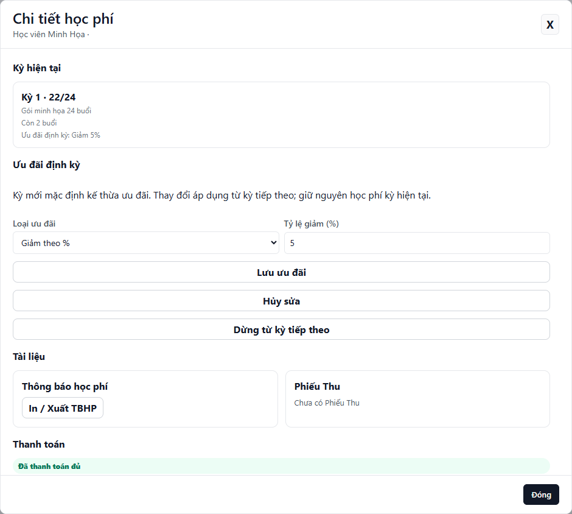

---
{
  "id": "HP-002",
  "title": "Hiểu ưu đãi định kỳ và gia hạn học phí",
  "summary": "Rà soát ưu đãi đã có và chuẩn bị kỳ tiếp theo mà không nhầm với kỳ hiện tại.",
  "modules": [
    "hoc-phi",
    "nhom-tai-chinh"
  ],
  "order": 6,
  "revision": 3,
  "status": "EDITORIAL_PENDING",
  "keywords": [
    "ưu đãi",
    "ưu đãi định kỳ",
    "gia hạn",
    "giảm giá",
    "chiết khấu",
    "kỳ tiếp theo",
    "thanh toán sớm",
    "tái phí"
  ],
  "questions": [
    "Ưu đãi định kỳ áp dụng từ kỳ nào?",
    "Gia hạn học phí thế nào?",
    "Dừng giảm giá ở đâu?",
    "Vì sao không sửa được ưu đãi định kỳ?",
    "Ghi nhận thanh toán học phí ở đâu?"
  ],
  "related": [
    "HP-001",
    "DD-001"
  ]
}
---

## Mục đích

Hiểu chính sách ưu đãi định kỳ đã có trên học viên, chỉnh hoặc dừng từ kỳ tiếp theo và rà soát việc chuẩn bị kỳ học phí mới. Ưu đãi định kỳ khác một khoản giảm riêng cho một kỳ.

## Trước khi bắt đầu

- Mở đúng cơ sở và học viên; chờ Học phí tải xong.
- Kiểm tra kỳ hiện tại, số buổi, trạng thái thanh toán và chính sách đã được cơ sở thống nhất.
- Phần **Sửa / Dừng ưu đãi định kỳ** chỉ xuất hiện khi kỳ phù hợp đã có chính sách định kỳ. Bài này không hướng dẫn tạo mới chính sách khi nút không có.

## Các bước thực hiện

Ba việc dưới đây có mục đích riêng. Chọn phần phù hợp với việc cần làm; chuẩn bị kỳ tiếp theo chưa đồng nghĩa đã ghi nhận thanh toán.

### 1. Sửa hoặc dừng ưu đãi định kỳ

1. Mở **Học phí**, tìm học viên và mở **Chi tiết học phí**. Kiểm tra **Kỳ hiện tại**, tiến độ, số buổi còn lại và dòng **Ưu đãi định kỳ** nếu có.
2. Để chỉnh chính sách đã có, chọn **Sửa / Dừng ưu đãi định kỳ**. Hệ thống kiểm tra lại thông tin; nếu kỳ tiếp theo đã có thanh toán hoặc buổi học, phần sửa sẽ bị khóa.
3. Chọn loại ưu đãi phù hợp: **Giảm theo %**, **Giảm số tiền cố định** hoặc **% rồi voucher anh/chị/em 100.000đ**. Nhập tỷ lệ nguyên từ 0 đến 100 hoặc số tiền nguyên không âm theo loại đã chọn.
4. Chọn **Lưu ưu đãi**, hoặc chọn **Dừng từ kỳ tiếp theo** nếu đã được thống nhất dừng. Kiểm tra thông báo. Thay đổi áp dụng từ kỳ tiếp theo, gồm kỳ đã chuẩn bị nhưng chưa thanh toán/chưa học khi đủ điều kiện; không sửa học phí của kỳ hiện tại.

### 2. Chuẩn bị kỳ tiếp theo

1. Để chuẩn bị kỳ mới sớm, trong **Việc cần làm**, mở **Thanh toán sớm kỳ tiếp theo** khi điều khiển này có sẵn. Chọn gói đang dùng rồi chọn **Xác nhận**. Thao tác này chuẩn bị kỳ tiếp theo; chưa đồng nghĩa đã thu tiền.
2. Kiểm tra phần **Kỳ tiếp theo** sau khi dữ liệu được tải lại. Nếu đã có kỳ chuẩn bị, dùng thông tin kỳ đó thay vì chuẩn bị thêm một kỳ khác.

### 3. Ghi nhận thanh toán

1. Khi trung tâm thực sự đã nhận đủ tiền, mở **Ghi nhận thanh toán** theo việc cần làm. Đối chiếu **Kỳ thanh toán**, gói và **Số tiền thanh toán đủ**; nhập ngày thanh toán, phương thức, người nộp và người thu. Chỉ chọn **Lưu thanh toán** khi thông tin đúng.
2. Chờ xác nhận, kiểm tra trạng thái thanh toán và Phiếu Thu của đúng kỳ. Dùng **In / Xuất TBHP kỳ tiếp theo** khi điều khiển đó xuất hiện để xem thông báo cho kỳ mới.

## Kết quả mong đợi

Kỳ mới kế thừa chính sách định kỳ đã có trừ khi chính sách được sửa/dừng hợp lệ. Kỳ hiện tại giữ nguyên học phí. Chuẩn bị kỳ, in thông báo và ghi nhận thanh toán là các bước riêng; chỉ xác nhận thu tiền sau khi thao tác thanh toán thành công.

## Lỗi thường gặp

- **Không có nút Sửa / Dừng:** không tự suy ra một khoản giảm cũ là chính sách định kỳ. Nhờ quản trị viên kiểm tra chính sách và nguồn dữ liệu.
- **Kỳ tiếp theo đã có thanh toán/buổi học:** UI khóa chỉnh chính sách; có thể sửa khi kỳ đó trở thành kỳ hiện tại, theo điều kiện hiển thị lúc đó.
- **Thông tin ưu đãi hoặc kỳ vừa thay đổi:** hủy sửa, làm mới và mở lại Chi tiết học phí trước khi nhập lại.
- **Nút Thử lưu lại:** có lệnh đang chờ xác nhận; dùng đúng hành động thử lại, không mở nhiều lệnh để đoán kết quả.
- **Nhầm Kết thúc kỳ với gia hạn:** Kết thúc kỳ ghi nhận các buổi còn lại hết hiệu lực. Không dùng nút này chỉ để thu trước hoặc chuẩn bị kỳ tiếp theo.
- **Chỉ nhận một phần tiền:** form hiện hành yêu cầu thanh toán đủ một kỳ; không tự ghi đủ nếu thực tế chưa thu đủ.

## Bài liên quan

- [HP-001 · Thiết lập và gán gói học phí](HP-001.md)
- [DD-001 · Điểm danh một buổi](DD-001.md)
