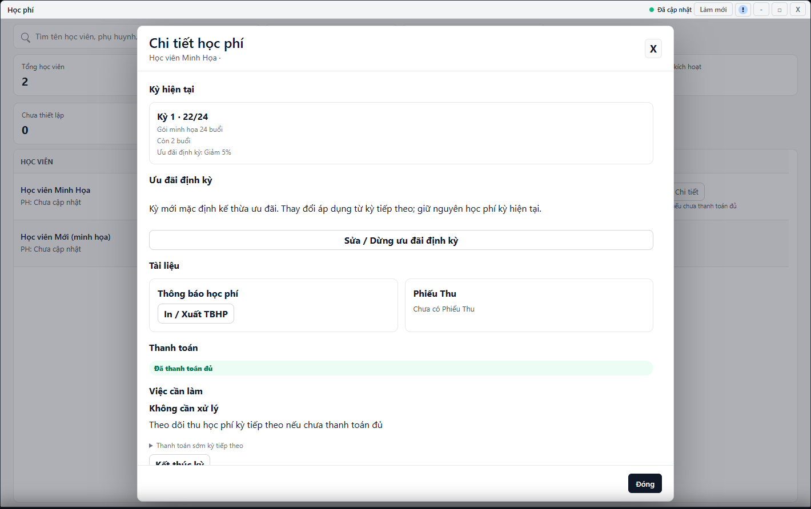

---
{
  "id": "HP-003",
  "title": "Đọc kỳ học phí và số buổi",
  "summary": "Đọc đúng kỳ học, số buổi và trạng thái thanh toán trước khi thao tác.",
  "modules": [
    "hoc-phi"
  ],
  "order": 20,
  "revision": 2,
  "status": "EDITORIAL_PENDING",
  "keywords": [
    "Đọc kỳ học phí và số buổi"
  ],
  "questions": [
    "Tại sao học viên chưa có gói hoặc chưa mở kỳ?",
    "Xem còn bao nhiêu buổi ở đâu?",
    "Vì sao đã thanh toán vẫn sắp hết buổi?",
    "Số buổi vượt gói có tự thành khoản thu không?",
    "Ưu đãi một lần khác ưu đãi định kỳ thế nào?"
  ],
  "related": [
    "HP-001",
    "DD-002",
    "HP-006",
    "HP-002"
  ]
}
---

## Mục đích

Đọc đúng kỳ học, số buổi và trạng thái thanh toán trước khi thao tác. Xem tiến độ không tạo khoản thu và không tự kết thúc kỳ.

## Trước khi bắt đầu

- Đúng cơ sở, dữ liệu Học phí đã tải thành công. Chuẩn bị tên học viên hoặc phụ huynh cần tìm.
- Nếu chưa có gói, đọc [HP-001](HP-001.md); nếu liên quan số buổi đã điểm danh, đối chiếu [DD-002](DD-002.md).

## Các bước thực hiện

1. Mở **Học phí**. Tìm học viên, lọc theo trạng thái hoặc số buổi của gói.
2. Phân biệt **Chưa có gói** với **Chưa mở kỳ**. Chưa có gói cần kiểm tra việc gán; chưa mở kỳ có thể là dữ liệu gói ban đầu chưa trở thành kỳ vận hành. Không bấm thanh toán để “sửa” trạng thái chưa mở kỳ.
3. Chọn **Chi tiết** ở đúng học viên. Đọc số kỳ, tên gói, **Đã học / Tổng số** và **Còn lại**.
4. Đọc phần thanh toán riêng. Hết hoặc sắp hết buổi không có nghĩa còn nợ tiền; đã trả đủ tiền cũng không làm tăng số buổi của kỳ hiện tại.
5. Nếu có cảnh báo số buổi vượt gói hoặc dữ liệu chưa rõ, đối chiếu điểm danh và kỳ trước khi làm tiếp. Phần vượt không tự trở thành một khoản thu.
6. Đọc **Ưu đãi định kỳ** như chính sách dùng cho việc chuẩn bị kỳ theo điều kiện. Số ưu đãi của một kỳ là thông tin riêng của kỳ đó; giao diện hiện hành không cung cấp một nút sửa ưu đãi một lần chung cho mọi kỳ.
7. Kiểm tra **Việc cần làm** và lịch sử trước khi chọn gia hạn, in chứng từ hoặc thanh toán. Khi còn không quá 4 buổi có thể nhắc chuẩn bị thông báo kỳ sau; còn không quá 2 buổi có thể nhắc theo dõi thu, tùy tình trạng kỳ tiếp theo.

## Kết quả mong đợi

Bạn phân biệt được số buổi đã học, số buổi còn lại, tình trạng thanh toán và việc cần làm của đúng kỳ. Nếu một phần dữ liệu chưa tải được, chưa kết luận học viên đã trả hay còn nợ. Xem tiến độ không tạo khoản thu.

## Lỗi thường gặp

- **Chưa tải được dữ liệu thanh toán:** không suy thành chưa trả hoặc số tiền bằng 0.
- **Đã thu trước iChess nhưng không có Phiếu Thu:** đọc [HP-006](HP-006.md), không ghi thu lần nữa để tạo chứng từ.
- **Ưu đãi bị khóa:** không sửa giá gói danh mục để thay đổi kỳ đã thu; xem điều kiện ở [HP-002](HP-002.md).

## Bài liên quan

- [HP-001 · Thiết lập và gán gói học phí](HP-001.md)
- [HP-002 · Ưu đãi định kỳ và gia hạn học phí](HP-002.md)
- [DD-002 · Tìm buổi học, đọc số buổi và xuất bảng](DD-002.md)
- [HP-006 · Tiếp quản học phí từ dữ liệu ban đầu](HP-006.md)
