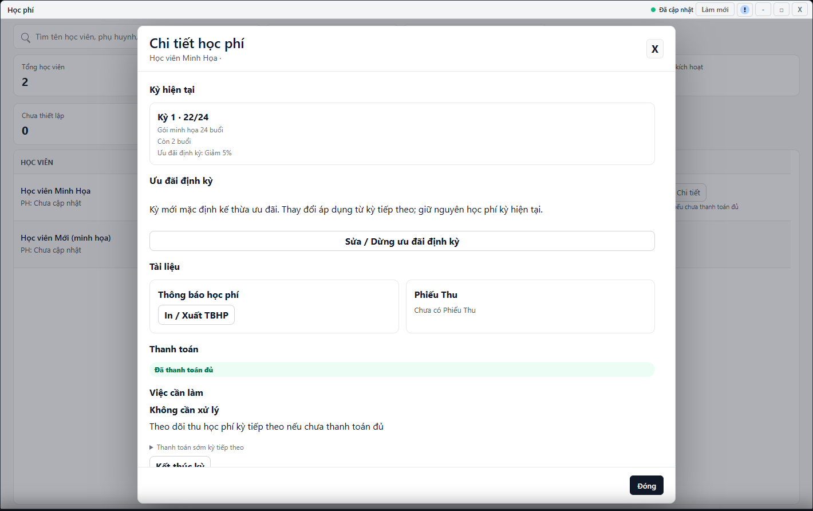

---
{
  "id": "HP-004",
  "title": "Đổi gói trước buổi đầu và kết thúc kỳ",
  "summary": "Phân biệt đổi gói khi kỳ chưa sử dụng với kết thúc kỳ.",
  "modules": [
    "hoc-phi"
  ],
  "order": 21,
  "revision": 2,
  "status": "EDITORIAL_PENDING",
  "keywords": [
    "Đổi gói trước buổi đầu và kết thúc kỳ"
  ],
  "questions": [
    "Đổi gói học phí đã gán được không?",
    "Kết thúc kỳ học phí có giống gia hạn không?"
  ],
  "related": [
    "HP-003",
    "HP-002",
    "DD-002"
  ]
}
---

## Mục đích

Phân biệt đổi gói khi kỳ chưa sử dụng với kết thúc kỳ. **Kết thúc kỳ** không phải nút gia hạn: số buổi chưa học còn lại có thể hết hiệu lực.

> Chưa có hướng dẫn vận hành được duyệt cho đổi gói hoặc kết thúc kỳ. Chưa xác nhận đủ các trạng thái kỳ và hậu quả sau thao tác. Chỉ đọc để phân biệt hai việc; không chọn Xác nhận hoặc Kết thúc kỳ theo bài này.

## Trước khi bắt đầu

- Kiểm tra đúng học viên, kỳ, số buổi đã học và tiền đã thu.
- Tài khoản phải có quyền ghi; dữ liệu kỳ và danh mục gói phải hiện hành. Không thao tác trong lúc dữ liệu báo chưa rõ.

## Các bước thực hiện

### Chỉ tra cứu và chuẩn bị

1. Mở **Học phí → Chi tiết**, kiểm tra đúng học viên, kỳ, số buổi đã học và tiền đã thu theo [HP-003](HP-003.md).
2. **Đổi gói trước buổi học đầu tiên** và **Kết thúc kỳ** phục vụ hai mục đích khác nhau. Đổi gói bị giới hạn khi kỳ đã học, đã thu hoặc đã kết thúc; không sửa lịch sử để làm điều kiện hợp lệ trở lại.
3. Kết thúc kỳ có thể làm hết hiệu lực các buổi chưa học. Không dùng công cụ này để gia hạn hoặc thu tiền kỳ tiếp theo.
4. Muốn chuẩn bị kỳ tiếp theo, đọc [HP-002](HP-002.md). Chưa rõ số buổi thì đối chiếu [DD-002](DD-002.md) trước khi quyết định.
5. Nếu đã mở một hộp xác nhận ngoài phạm vi bài, chọn **Hủy** và kiểm tra lại mục đích. Nếu đã thao tác mà chưa rõ kết quả, kiểm tra chi tiết/lịch sử, không tạo kỳ bù để che sai sót.

## Kết quả mong đợi

Bạn phân biệt được đổi gói, kết thúc kỳ và gia hạn, đồng thời biết thông tin cần kiểm tra. Đọc bài không thay đổi số buổi hay học phí; chưa có quy trình xác nhận đổi/kết thúc kỳ trong bản này.

## Lỗi thường gặp

- **Đã điểm danh hoặc đã thu tiền:** không sửa dữ liệu cũ để làm điều kiện đổi gói trở lại hợp lệ.
- **Bấm nhầm kết thúc:** không tự tạo kỳ bù để che sai sót; phải kiểm tra trạng thái thực và quy trình được phép.
- **Số buổi không khớp:** đối chiếu điểm danh trước khi quyết định kết thúc.

## Bài liên quan

- [HP-003 · Đọc kỳ học phí và số buổi](HP-003.md)
- [HP-002 · Ưu đãi định kỳ và gia hạn học phí](HP-002.md)
- [DD-002 · Tìm buổi học, đọc số buổi và xuất bảng](DD-002.md)
