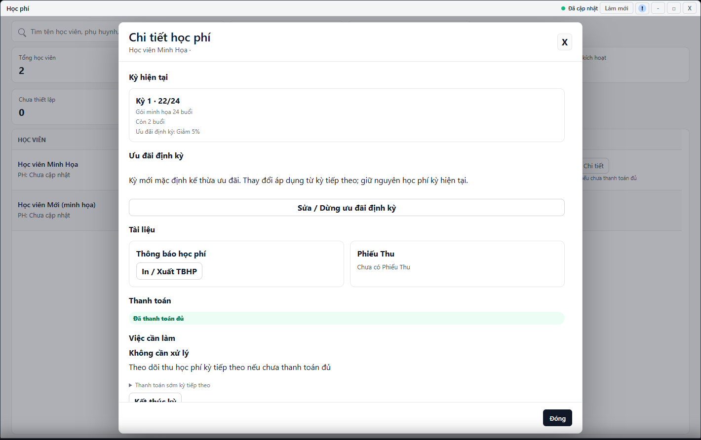

---
{
  "id": "HP-005",
  "title": "Thông báo học phí và Phiếu Thu",
  "summary": "Phân biệt Thông báo học phí (TBHP) với Phiếu Thu.",
  "modules": [
    "hoc-phi"
  ],
  "order": 22,
  "revision": 2,
  "status": "EDITORIAL_PENDING",
  "keywords": [
    "Thông báo học phí và Phiếu Thu"
  ],
  "questions": [
    "In thông báo học phí ở đâu?",
    "In lại Phiếu Thu sau thanh toán thế nào?",
    "Tại sao không có Phiếu Thu dù đã trả trước khi dùng iChess?"
  ],
  "related": [
    "HP-002",
    "HP-006",
    "CD-003"
  ]
}
---

## Mục đích

Phân biệt **Thông báo học phí (TBHP)** với **Phiếu Thu**. Thông báo dùng để trình bày khoản cần thanh toán; Phiếu Thu phải dựa trên khoản thu đã được ghi nhận hợp lệ.

> Phần in Thông báo học phí và Phiếu Thu chưa có hướng dẫn xuất hoàn chỉnh được duyệt. Cần đối chiếu thêm dữ liệu chứng từ và bản in cuối. Bài chỉ giúp phân biệt chứng từ và kiểm tra điều kiện; không tạo thanh toán để làm xuất hiện nút in.

## Trước khi bắt đầu

- Kiểm tra đúng học viên, kỳ học, thông tin cơ sở và trạng thái tiền.
- Dữ liệu chứng từ phải tải thành công. Không dùng số đã thu từ nguồn ban đầu để giả rằng đã có Phiếu Thu trong iChess.

## Các bước thực hiện

### Chỉ tra cứu và chuẩn bị

1. Mở **Học phí**, tìm đúng học viên rồi **Chi tiết**, đọc kỳ hiện tại hoặc kỳ tiếp theo.
2. Phân biệt **Thông báo học phí (TBHP)** với **Phiếu Thu**: thông báo trình bày khoản cần trả; Phiếu Thu gắn với khoản thu đã được ghi nhận hợp lệ.
3. Các công cụ **TBHP**, **In / Xuất TBHP** và **In / Xuất Phiếu Thu** chỉ có ý nghĩa khi dữ liệu tương ứng sẵn sàng. Bài này chưa hướng dẫn hoàn tất xuất chứng từ.
4. Nếu đang xem một chứng từ đã có, đối chiếu tên, kỳ/gói, số tiền, ưu đãi và người thu. Đóng bản xem khi dữ liệu thiếu hoặc không đúng; không tự bổ sung số đoán.
5. Không bấm **Thanh toán** lại chỉ để lấy Phiếu Thu. Kiểm tra khoản đã thu trước iChess theo [HP-006](HP-006.md); nếu thực nhận tiền mới, đọc điều kiện riêng ở [HP-002](HP-002.md).

## Kết quả mong đợi

Bạn biết đang cần thông báo hay chứng từ đã thu và nhận ra dữ liệu còn thiếu. In hay xem chứng từ không xác nhận nhận tiền. Bản chưa đối chiếu đủ không nên dùng để kết luận đã thanh toán.

## Lỗi thường gặp

- **Không có nút hoặc nút bị khóa:** kiểm tra dữ liệu kỳ, quyền và nguồn chứng từ; không tạo khoản thu giả để mở nút.
- **Thông tin cơ sở sai:** kiểm tra [CD-003](CD-003.md); không tự sửa ý nghĩa số tiền trên bản in.
- **TBHP bị hiểu là đã thanh toán:** kiểm tra trạng thái và Phiếu Thu riêng.

## Bài liên quan

- [HP-002 · Ưu đãi định kỳ và gia hạn học phí](HP-002.md)
- [HP-006 · Tiếp quản học phí từ dữ liệu ban đầu](HP-006.md)
- [CD-003 · Thông tin cơ sở và thiết lập Phiếu Thu](CD-003.md)
