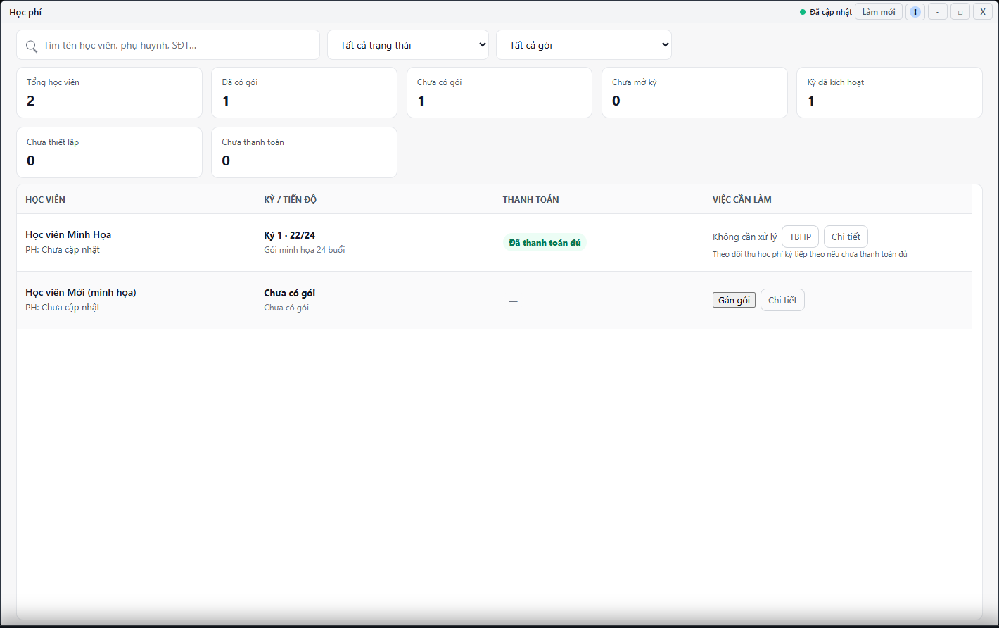

---
{
  "id": "HP-006",
  "title": "Tiếp quản học phí từ dữ liệu ban đầu",
  "summary": "Hiểu dữ liệu học viên đã học hoặc đã trả tiền trước khi cơ sở bắt đầu dùng iChess.",
  "modules": [
    "hoc-phi"
  ],
  "order": 23,
  "revision": 2,
  "status": "EDITORIAL_PENDING",
  "keywords": [
    "Tiếp quản học phí từ dữ liệu ban đầu"
  ],
  "questions": [
    "Nhập số buổi đã học trước khi dùng iChess ở đâu?",
    "Đã thu tiền trước iChess có ghi thanh toán lại không?"
  ],
  "related": [
    "HP-002",
    "CD-003",
    "HP-003",
    "BC-001"
  ]
}
---

## Mục đích

Hiểu dữ liệu học viên đã học hoặc đã trả tiền trước khi cơ sở bắt đầu dùng iChess. Tiếp quản dữ liệu nguồn không phải ghi một khoản thu mới trong ngày.

> Phần nhập dữ liệu học phí ban đầu chưa có hướng dẫn vận hành được duyệt. Chưa đối chiếu đủ các trạng thái tiếp quản và kết quả sau lưu. Chỉ dùng bài để chuẩn bị số liệu thật và phân biệt tiền cũ với khoản thu mới; không lưu thiết lập theo bài này.

## Trước khi bắt đầu

- Cơ sở phải bật **Thiết lập dữ liệu học viên ban đầu** trong Cài đặt; chỉ người có quyền mới được thay đổi.
- Cần gói thật, số buổi đã học trước hệ thống và bằng chứng tình trạng học phí. Không dùng số ước lượng để hoàn tất form.

## Các bước thực hiện

### Chỉ tra cứu và chuẩn bị

1. Mở **Học phí** và đọc trạng thái học viên. **Chưa thiết lập học phí**, **Chưa mở kỳ** và kỳ **Tiếp quản** là các tình huống khác nhau.
2. Chuẩn bị gói, tổng số buổi, số đã học trước iChess và chứng cứ tiền đã nhận. Số đã học phải nằm trong tổng số buổi của gói.
3. Phân biệt đã trả trước iChess với chưa thanh toán. Trường hợp chỉ trả một phần chưa có cách nhập được xác nhận ở form này; không ghi thành đã trả đủ.
4. Chức năng thiết lập ban đầu phụ thuộc cài đặt cơ sở và quyền. Chỉ kiểm tra điều kiện theo [CD-003](CD-003.md); bài này chưa hướng dẫn lưu thiết lập hoặc bật chức năng.
5. Không ghi thanh toán lại cho tiền đã nhận trước iChess. Chỉ ghi khoản mới khi thực nhận tiền mới và kỳ đủ điều kiện theo [HP-002](HP-002.md). Nếu đã mở form để xem, dùng **Hủy** khi dữ liệu chưa đủ.

## Kết quả mong đợi

Bạn tách được số buổi và tiền có trước iChess khỏi giao dịch phát sinh mới. Tiền cũ không tự là khoản thu mới hoặc Phiếu Thu của ngày hiện tại. Việc nhập ban đầu cần quy trình được duyệt trước khi lưu.

## Lỗi thường gặp

- **Không có chức năng thiết lập:** kiểm tra cài đặt cơ sở và quyền, không tự tạo gói khác để thay thế.
- **Đã trả trước nhưng báo cáo ngày không có doanh thu:** báo cáo lấy giao dịch Thu chi thực trong kỳ, không tự cộng số đã thu trước hệ thống.
- **Nguồn chỉ trả một phần hoặc thiếu giá:** giữ trạng thái cần kiểm tra, không suy giá hay giả chứng từ.

## Bài liên quan

- [CD-003 · Thông tin cơ sở và thiết lập Phiếu Thu](CD-003.md)
- [HP-003 · Đọc kỳ học phí và số buổi](HP-003.md)
- [BC-001 · Đọc báo cáo ngày, tuần và giao dịch nguồn](BC-001.md)
