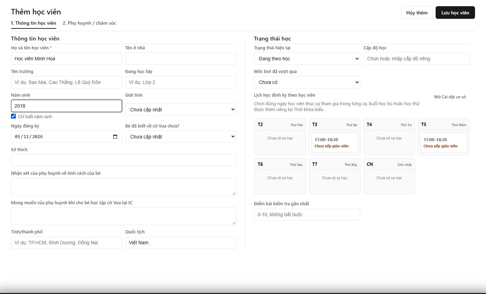

---
{
  "id": "HV-001",
  "title": "Thêm học viên mới",
  "summary": "Kiểm tra ca học, nhập hồ sơ và chọn đúng ngày học của học viên.",
  "modules": [
    "hoc-vien",
    "cai-dat-co-so"
  ],
  "order": 1,
  "revision": 1,
  "status": "EDITORIAL_PENDING",
  "keywords": [
    "thêm học viên",
    "tạo hồ sơ",
    "nhập học sinh",
    "đăng ký",
    "năm sinh",
    "phụ huynh"
  ],
  "questions": [
    "Làm sao thêm học viên?",
    "Thêm học viên mới ở đâu?",
    "Chưa có số điện thoại phụ huynh có tạo học viên được không?"
  ],
  "related": [
    "CD-001",
    "HP-001",
    "HV-002"
  ]
}
---

## Mục đích

Tạo hồ sơ học viên tại đúng cơ sở và đăng ký ngày học định kỳ để các màn hình liên quan sử dụng cùng thông tin.

## Trước khi bắt đầu

- Đăng nhập tài khoản có quyền thêm học viên tại cơ sở đang hiển thị trên Taskbar. Chờ dữ liệu học viên và lịch học tải xong.
- Chuẩn bị họ tên và ít nhất năm sinh. Ngày sinh đầy đủ dùng khi đã biết chính xác; không điền ngày giả để thay cho năm sinh.
- Mở **Cài đặt cơ sở → Ca học / Lớp** trước, kiểm tra ca cần dùng có đúng ngày, giờ và trạng thái **Đang dùng**. Nếu thiếu, làm theo [Tạo hoặc chỉnh sửa Ca học](CD-001.md).

## Các bước thực hiện

1. Mở **Học viên**, dùng ô tìm kiếm kiểm tra hồ sơ trước khi thêm để hạn chế tạo trùng.
2. Chọn **+ Thêm học viên**. Trong **1. Thông tin học viên**, nhập **Họ và tên học viên**.
3. Nhập ngày sinh; nếu chỉ biết năm, chọn **Chỉ biết năm sinh** rồi nhập **Năm sinh**. Bổ sung các thông tin đã biết như tên ở nhà, trường, lớp và ngày đăng ký.
4. Kiểm tra **Trạng thái hiện tại**, cấp độ và các thông tin học tập. Tại **Lịch học định kỳ theo học viên**, chọn đúng ô ngày và giờ học viên thực sự tham gia. Một ca có hai ngày không có nghĩa học viên phải học cả hai ngày.
5. Nếu chưa thấy ca cần dùng, chọn **Mở Cài đặt cơ sở**, kiểm tra lại danh mục. Trở về cửa sổ Học viên bằng Taskbar và rà soát phần đang nhập trước khi lưu.
6. Mở **2. Phụ huynh / chăm sóc**. Có thể để trống thông tin phụ huynh để bổ sung sau. Khi đã nhập tên ba hoặc mẹ, cần nhập số điện thoại tương ứng; khi nhập số điện thoại, cần có tên đi kèm. Số điện thoại cần đủ 10 chữ số.
7. Chọn **Lưu học viên**, chờ hệ thống xác nhận. Nếu có lỗi, sửa trường được báo; không coi việc bấm nút là đã lưu thành công.
8. Tìm lại học viên trong danh sách, mở hồ sơ và kiểm tra tên, năm sinh, trạng thái, ngày và ca học. Sau đó thực hiện [Thiết lập và gán gói học phí](HP-001.md) khi cần.

## Kết quả mong đợi

Hồ sơ xuất hiện trong danh sách của cơ sở; mở lại thấy đúng thông tin đã lưu. Lịch định kỳ phản ánh đúng các ngày đã chọn. Nếu chưa đăng ký ca, học viên được xem là chưa phân lớp; việc thêm hồ sơ không tự gán gói học phí hoặc ghi nhận thanh toán.

## Lỗi thường gặp

- **Thiếu họ tên hoặc năm sinh:** bổ sung trường được đánh dấu. Chỉ biết năm sinh thì dùng lựa chọn tương ứng.
- **Có tên phụ huynh nhưng thiếu SĐT:** hoàn thiện cặp tên–SĐT hoặc để trống cả cặp nếu chưa có thông tin; không dùng dữ liệu giả trong vận hành thật.
- **Chưa có ca học đang sử dụng:** kiểm tra Cài đặt cơ sở và trạng thái ca. Không tự nhập tên ca thay cho lựa chọn lịch.
- **Dữ liệu lịch học chưa tải được:** giữ bản nhập, chờ/làm mới theo thông báo. Không chuyển sang một cơ sở khác để tìm ca.

## Bài liên quan

- [CD-001 · Tạo hoặc chỉnh sửa Ca học](CD-001.md)
- [HP-001 · Thiết lập và gán gói học phí](HP-001.md)
- [HV-002 · Đổi lịch học định kỳ](HV-002.md)
