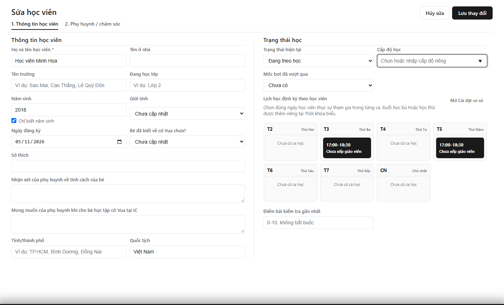

---
{
  "id": "HV-002",
  "title": "Đổi lịch học định kỳ của học viên",
  "summary": "Đổi các ngày và ca học trong hồ sơ, rồi kiểm tra lại lịch đã đăng ký.",
  "modules": [
    "hoc-vien",
    "thoi-khoa-bieu",
    "cai-dat-co-so"
  ],
  "order": 4,
  "revision": 3,
  "status": "EDITORIAL_PENDING",
  "keywords": [
    "đổi lịch",
    "đổi lịch học",
    "chuyển lớp",
    "chuyển ca",
    "lịch học định kỳ",
    "sửa học viên"
  ],
  "questions": [
    "Đổi lịch học thế nào?",
    "Làm sao chuyển lịch cho một học viên?",
    "Sửa ngày học ở đâu?",
    "Chọn một ngày trong ca hai ngày được không?"
  ],
  "related": [
    "CD-001",
    "HV-001",
    "DD-001",
    "LK-004",
    "DD-003"
  ]
}
---

## Mục đích

Thay đổi đăng ký ngày và ca học định kỳ cho một học viên. Bài này không hướng dẫn dời một buổi riêng lẻ hoặc xếp học bù.

## Trước khi bắt đầu

- Xác nhận lịch mới đã được thống nhất và đúng học viên, đúng cơ sở.
- Kiểm tra ca mới trong **Cài đặt cơ sở → Ca học / Lớp**, gồm ngày, giờ và trạng thái. Nếu cần thêm ca, xem [CD-001](CD-001.md).
- Chờ thông tin đăng ký học tải xong. Ghi lại lịch cũ để đối chiếu trước khi lưu.

## Các bước thực hiện

1. Mở **Học viên**, tìm đúng tên/mã học viên. Mở hồ sơ từ dòng học viên; trên desktop có thể nhấp đúp dòng.
2. Trong hồ sơ, chọn nút **Sửa hồ sơ** để mở **Sửa học viên**.
3. Ở **1. Thông tin học viên**, tìm **Lịch học định kỳ theo học viên** trong phần trạng thái học.
4. Bỏ chọn các ô ngày/ca không còn học. Chọn các ô ngày và giờ mới. Ví dụ, nếu học viên chỉ học thứ Ba trong ca thứ Ba–thứ Năm, chỉ chọn ô thứ Ba của ca đó.
5. Rà soát toàn bộ tuần để tránh giữ nhầm cả ca cũ lẫn ca mới. Không sửa danh mục Ca học chỉ để chuyển lịch cho riêng học viên này.
6. Chọn **Lưu thay đổi** và chờ phản hồi. Nếu dữ liệu có xung đột hoặc chưa tải được, xử lý theo thông báo; không coi form đã đóng là bằng chứng duy nhất.
7. Mở lại hồ sơ để kiểm tra ngày/ca đã lưu. Mở **Lịch làm việc tuần → 2. Ca học**, chọn tuần cần kiểm tra và làm mới dữ liệu nếu cần.
8. Khi đến buổi học, kiểm tra đúng học viên và ca trước khi [Điểm danh một buổi](DD-001.md).

## Kết quả mong đợi

Hồ sơ mở lại thể hiện đúng các ngày/ca đăng ký mới. Đây không phải lệnh sửa các buổi điểm danh đã chốt, tự xếp buổi học bù hoặc điều chỉnh học phí. Những trường hợp đó cần quy trình riêng.

## Lỗi thường gặp

- **Ca mới không có trong lưới:** kiểm tra danh mục và trạng thái ca, không chọn một khung giờ gần giống để thay thế.
- **Ca cũ không còn trong danh mục:** đọc cảnh báo liên kết cũ, kiểm tra nguồn trước khi chọn **Bỏ liên kết cũ**; hệ thống không tự suy ra ngày học.
- **Liên kết cũ cần rà soát:** chọn lại đúng ngày học thực tế trước khi lưu, không mặc định chọn mọi ngày của ca.
- **Chỉ muốn đổi một buổi:** chưa áp dụng bài này. Đọc [Buổi đột xuất và thông tin ca học](LK-004.md); nhánh [Học bù](DD-003.md) chưa có hướng dẫn vận hành được duyệt; chỉ đọc để hiểu điều kiện.

## Bài liên quan

- [CD-001 · Tạo hoặc chỉnh sửa Ca học](CD-001.md)
- [HV-001 · Thêm học viên mới](HV-001.md)
- [DD-001 · Điểm danh một buổi](DD-001.md)
- [LK-004 · Buổi đột xuất và thông tin ca học](LK-004.md)
- [DD-003 · Học bù và xử lý xung đột điểm danh](DD-003.md)
