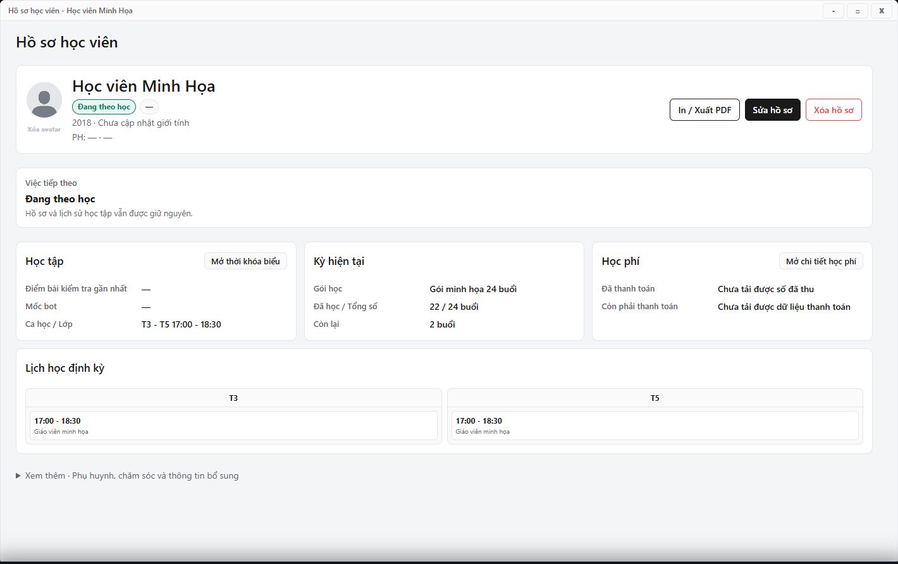

---
{
  "id": "HV-003",
  "title": "Tìm, lọc và đọc hồ sơ học viên",
  "summary": "Tìm đúng học viên trước khi sửa hồ sơ, tra lịch hoặc kiểm tra học phí.",
  "modules": [
    "hoc-vien"
  ],
  "order": 9,
  "revision": 2,
  "status": "EDITORIAL_PENDING",
  "keywords": [
    "Tìm, lọc và đọc hồ sơ học viên"
  ],
  "questions": [
    "Tìm học viên bằng số điện thoại ở đâu?",
    "Lọc học viên chưa phân lớp thế nào?",
    "Sắp xếp danh sách theo tên hoặc cấp độ thế nào?",
    "Xem phụ huynh và học phí trong hồ sơ ở đâu?"
  ],
  "related": [
    "HV-001",
    "HV-004",
    "HP-003"
  ]
}
---

## Mục đích

Tìm đúng học viên trước khi sửa hồ sơ, tra lịch hoặc kiểm tra học phí. Tìm kiếm và bộ lọc chỉ thay đổi danh sách đang xem; không dùng kết quả tìm kiếm để kết luận một hồ sơ đã bị xóa.

## Trước khi bắt đầu

- Kiểm tra đúng cơ sở trên Taskbar và chờ dữ liệu Học viên tải xong.
- Chuẩn bị tên học viên, tên phụ huynh hoặc số điện thoại đã ghi trong hồ sơ.

## Các bước thực hiện

1. Mở **Học viên**. Nhập tên vào **Tìm kiếm**; có thể tìm theo phụ huynh, trường hoặc ca học. Với số điện thoại, nhập ít nhất 6 chữ số để tìm theo số.
2. Chọn **Trạng thái**, **Cấp độ học** hoặc **Ca học / Lớp** để thu hẹp danh sách. Chọn **Chưa phân lớp** khi cần tìm học viên chưa có ca.
3. Bấm biểu tượng sắp xếp ở cột **Học viên** hoặc **Cấp độ**. Kiểm tra chiều sắp xếp sau mỗi lần bấm.
4. Nhấp đúp dòng học viên; khi dùng bàn phím, chọn dòng bằng phím Tab rồi nhấn Enter để mở hồ sơ.
5. Đọc tên, năm sinh và lịch định kỳ. Mở **Xem thêm · Phụ huynh, chăm sóc và thông tin bổ sung** để xem liên hệ và ghi chú.
6. Dùng **Mở thời khóa biểu** hoặc **Mở chi tiết học phí** khi cần đối chiếu tại nguồn. Đóng cửa sổ chi tiết để trở về danh sách.

## Kết quả mong đợi

Bạn tìm được đúng hồ sơ và mở được thông tin cần đối chiếu. Tìm kiếm, lọc và xem hồ sơ không sửa dữ liệu. Các số thống kê ở đầu danh sách có thể khác số dòng đang thấy sau khi lọc.

## Lỗi thường gặp

- **Không tìm thấy:** xóa từ tìm, đưa các bộ lọc về **Tất cả**, kiểm tra cơ sở và trạng thái tải trước khi thêm hồ sơ mới.
- **Tên giống nhau:** đối chiếu năm sinh và phụ huynh, không chỉ nhìn tên.
- **Học phí báo chưa tải được:** mở module Học phí và kiểm tra dữ liệu; không hiểu dòng thiếu dữ liệu là số tiền bằng 0.

## Bài liên quan

- [HV-001 · Thêm học viên mới](HV-001.md)
- [HV-004 · Sửa thông tin và trạng thái học viên](HV-004.md)
- [HP-003 · Đọc kỳ học phí và số buổi](HP-003.md)
