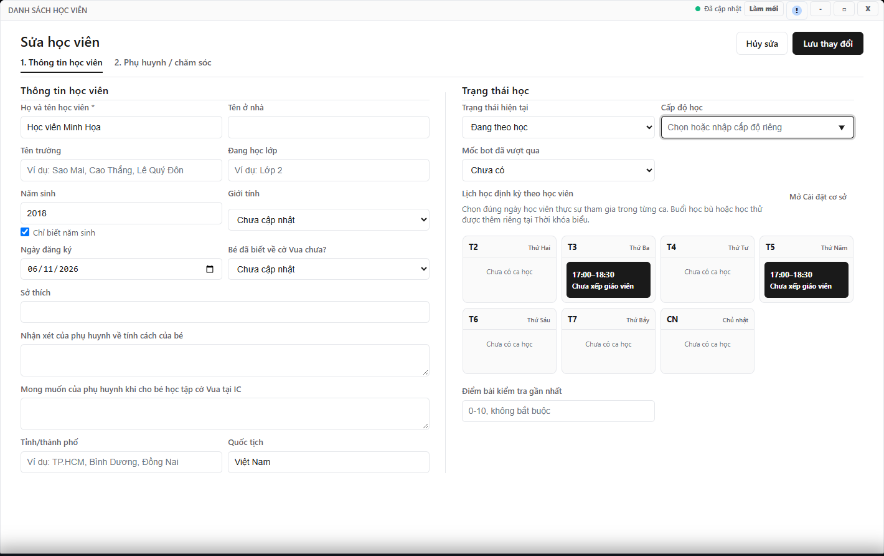

---
{
  "id": "HV-004",
  "title": "Sửa thông tin và trạng thái học viên",
  "summary": "Cập nhật thông tin, trạng thái học và tiến độ học tập của một hồ sơ đã có.",
  "modules": [
    "hoc-vien"
  ],
  "order": 10,
  "revision": 2,
  "status": "EDITORIAL_PENDING",
  "keywords": [
    "Sửa thông tin và trạng thái học viên"
  ],
  "questions": [
    "Sửa tên hoặc trường học của học viên ở đâu?",
    "Cho học viên bảo lưu hoặc ngưng học thế nào?",
    "Cập nhật cấp độ, mốc bot và điểm kiểm tra ở đâu?"
  ],
  "related": [
    "HV-003",
    "HV-002",
    "HP-004"
  ]
}
---

## Mục đích

Cập nhật thông tin, trạng thái học và tiến độ học tập của một hồ sơ đã có. Không dùng **Bảo lưu** hoặc **Ngưng học** như một lệnh hoàn tiền hay kết thúc kỳ học phí.

## Trước khi bắt đầu

- Tìm và kiểm tra đúng học viên theo [HV-003](HV-003.md).
- Cần quyền sửa Học viên tại cơ sở hiện tại, dữ liệu đã tải và thông tin cần sửa đã được xác nhận.
- Nếu đổi ngày học, đọc [HV-002](HV-002.md) trước khi thay các ô lịch định kỳ.

## Các bước thực hiện

1. Trong hồ sơ, chọn **Sửa hồ sơ**.
2. Ở **1. Thông tin học viên**, sửa tên, trường, lớp hoặc ngày sinh cần thay đổi. Chỉ biết năm sinh thì giữ **Chỉ biết năm sinh**, không điền ngày giả.
3. Kiểm tra **Trạng thái hiện tại**: **Đang theo học**, **Bảo lưu** hoặc **Ngưng học** theo tình trạng thực tế. Đây là thay đổi hồ sơ cần lưu.
4. Cập nhật **Cấp độ học**, **Mốc bot đã vượt qua** và **Điểm bài kiểm tra gần nhất** nếu có kết quả thực. Điểm phải trong khoảng 0–10.
5. Mở **2. Phụ huynh / chăm sóc** để bổ sung liên hệ. Tên ba/mẹ và số điện thoại tương ứng đi thành cặp; số điện thoại cần 10 chữ số. Có thể để trống cả cặp chưa biết.
6. Rà soát lịch định kỳ trước khi chọn **Lưu thay đổi**. Chọn **Hủy sửa** nếu chưa muốn ghi bản nhập này.
7. Sau thông báo thành công, tìm lại và mở hồ sơ để kiểm tra trường vừa sửa. Khi cần kiểm tra kỳ học hoặc tiền, mở Học phí riêng.

## Kết quả mong đợi

Sau thông báo lưu thành công, mở lại hồ sơ để kiểm tra thông tin vừa sửa. Nếu có lỗi, thông tin chưa được coi là đã lưu. Đổi trạng thái học không tự tạo khoản hoàn tiền hay kết thúc kỳ học phí.

## Lỗi thường gặp

- **Không có quyền sửa hoặc hồ sơ chỉ xem:** không tạo bản sao để vượt quyền; giữ nguyên hồ sơ và kiểm tra quyền tại đúng cơ sở.
- **Không thấy hồ sơ sau sửa trạng thái:** đưa bộ lọc trạng thái về **Tất cả**.
- **Lưu báo dữ liệu đã thay đổi:** kiểm tra bản mới trước khi nhập lại phần cần sửa, tránh ghi đè thay đổi của người khác.

## Bài liên quan

- [HV-003 · Tìm, lọc và đọc hồ sơ học viên](HV-003.md)
- [HV-002 · Đổi lịch học định kỳ](HV-002.md)
- [HP-004 · Đổi gói trước buổi đầu và kết thúc kỳ](HP-004.md)
