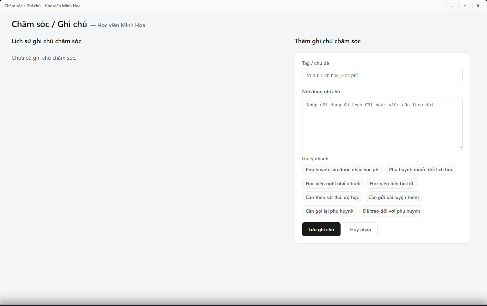

---
{
  "id": "HV-005",
  "title": "Ghi chú chăm sóc học viên",
  "summary": "Lưu một ghi chú chăm sóc gắn đúng học viên để đọc lại trong hồ sơ.",
  "modules": [
    "hoc-vien"
  ],
  "order": 11,
  "revision": 2,
  "status": "EDITORIAL_PENDING",
  "keywords": [
    "Ghi chú chăm sóc học viên"
  ],
  "questions": [
    "Ghi chú chăm sóc học viên ở đâu?",
    "Sửa hoặc xóa ghi chú học viên thế nào?"
  ],
  "related": [
    "KH-002",
    "HV-003"
  ]
}
---

## Mục đích

Lưu một ghi chú chăm sóc gắn đúng học viên để đọc lại trong hồ sơ. Ghi chú không thay thế điểm danh, giao dịch học phí hoặc lịch hẹn của Khách hàng.

## Trước khi bắt đầu

- Có quyền cập nhật Học viên tại cơ sở hiện tại; kiểm tra đúng tên và năm sinh.
- Chuẩn bị nội dung đã trao đổi. Chỉ ghi thông tin cần thiết cho việc chăm sóc.

## Các bước thực hiện

1. Mở hồ sơ → **Xem thêm · Phụ huynh, chăm sóc và thông tin bổ sung**.
2. Trong **Chăm sóc**, chọn **Mở chi tiết**.
3. Chọn hoặc nhập nhóm ghi chú nếu cần, rồi nhập nội dung. Các gợi ý chỉ hỗ trợ nhập chữ; rà soát lại trước khi lưu.
4. Chọn **Lưu ghi chú**. Nội dung trống sẽ bị chặn. **Hủy nhập** chỉ bỏ phần đang nhập.
5. Để sửa một ghi chú cũ, chọn **Sửa** ở chính ghi chú đó, chỉnh nội dung rồi **Lưu thay đổi**; **Hủy sửa** bỏ phần sửa đang nháp.
6. Chỉ chọn **Xóa** khi đã kiểm tra đúng ghi chú. Đọc hộp xác nhận **Xóa ghi chú chăm sóc này?**; hủy xác nhận nếu chưa chắc chắn.
7. Sau khi thao tác được xác nhận thành công, đọc lại lịch sử để kiểm tra nội dung hoặc việc xóa.

## Kết quả mong đợi

Sau thông báo thành công, lịch sử hiển thị đúng ghi chú đã thêm hoặc sửa; ghi chú bị xóa không còn trong danh sách. Nếu lưu báo lỗi, giữ nội dung đang nhập và đọc thông báo trước khi thử lại.

## Lỗi thường gặp

- **Bấm gợi ý rồi đóng cửa sổ:** chữ đã điền chưa phải ghi chú đã lưu.
- **Lưu báo lỗi:** giữ nội dung và kiểm tra thông báo; không bấm liên tiếp để tạo nhiều bản.
- **Muốn hẹn khách hoặc ghi kết quả gọi lại:** dùng bài [KH-002](KH-002.md) nếu công việc thuộc hồ sơ khách hàng.

## Bài liên quan

- [HV-003 · Tìm, lọc và đọc hồ sơ học viên](HV-003.md)
- [KH-002 · Chăm sóc khách hàng và đặt lịch hẹn](KH-002.md)
