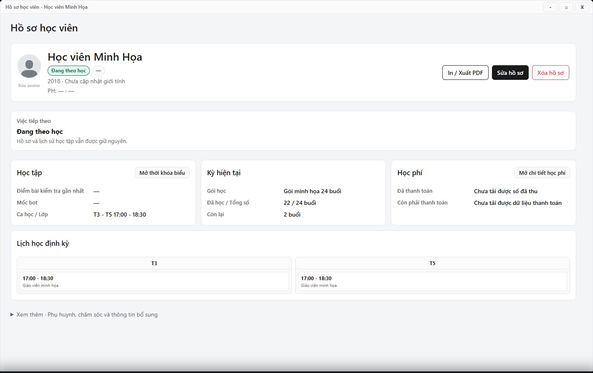

---
{
  "id": "HV-006",
  "title": "Ảnh, bản in và xóa hồ sơ",
  "summary": "Nhận biết công cụ ảnh, bản in và xóa hồ sơ.",
  "modules": [
    "hoc-vien"
  ],
  "order": 12,
  "revision": 2,
  "status": "EDITORIAL_PENDING",
  "keywords": [
    "Ảnh, bản in và xóa hồ sơ"
  ],
  "questions": [
    "Đổi ảnh đại diện học viên thế nào?",
    "In hồ sơ học viên ở đâu?",
    "Xóa hồ sơ có xóa học phí không?"
  ],
  "related": [
    "HV-004",
    "HP-003"
  ]
}
---

## Mục đích

Nhận biết công cụ ảnh, bản in và xóa hồ sơ. **Xóa hồ sơ** dùng để tạm ẩn khỏi danh sách chính, không dùng để xóa học phí hay lịch sử thanh toán.

> Phần ảnh và xóa hồ sơ chưa có hướng dẫn vận hành được duyệt. Bài giúp bạn nhận biết công cụ và kiểm tra hồ sơ; không thực hiện lưu ảnh hoặc xóa theo bài này. Việc khôi phục hồ sơ và kiểm tra dữ liệu sau xóa còn chưa được xác nhận đầy đủ.

## Trước khi bắt đầu

- Kiểm tra đúng học viên, đúng cơ sở và quyền cập nhật.
- Dùng ảnh được phép sử dụng; không đưa ảnh hoặc dữ liệu học viên thật vào bộ minh họa công khai.
- Không xóa hồ sơ chỉ vì tìm kiếm hoặc dữ liệu học phí đang tải lỗi.

## Các bước thực hiện

### Chỉ tra cứu và chuẩn bị

1. Mở đúng hồ sơ học viên, đối chiếu tên và năm sinh trước khi xem công cụ.
2. Khu vực ảnh có công cụ chọn ảnh và **Xóa avatar**. Chỉ nhận biết vị trí; chưa dùng bài này để thay hoặc xóa ảnh.
3. **In / Xuất PDF** là công cụ in hồ sơ. Khi xem một bản đã xuất, kiểm tra đúng học viên, ngày sinh và liên hệ; không chia sẻ bản thiếu hoặc sai thông tin.
4. **Xóa hồ sơ** có mục đích tạm ẩn, khác trạng thái **Ngưng học**. Bài này không hướng dẫn xác nhận xóa hoặc khôi phục; không dùng xóa để xử lý học phí.
5. Nếu chưa rõ kết quả một lần thao tác trước, giữ nguyên hồ sơ và kiểm tra lại danh sách. Không tạo học viên mới thay thế vì có thể làm trùng dữ liệu.

## Kết quả mong đợi

Bạn phân biệt được thay ảnh, in hồ sơ, ngưng học và tạm ẩn hồ sơ. Đọc bài không làm thay đổi hồ sơ, học phí hoặc lịch sử thanh toán. Những thao tác ảnh/xóa vẫn cần hướng dẫn được duyệt riêng.

## Lỗi thường gặp

- **Nhầm xóa hồ sơ với ngưng học:** trạng thái **Ngưng học** được sửa trong form hồ sơ, là tác vụ khác.
- **Ảnh hoặc PDF báo lỗi:** không coi tệp rỗng hay ảnh cũ là kết quả mới; giữ hồ sơ và chờ xác minh luồng cụ thể.
- **Cần khôi phục:** không tạo lại học viên để thay cho hồ sơ tạm ẩn vì có thể gây trùng dữ liệu.

## Bài liên quan

- [HV-004 · Sửa thông tin và trạng thái học viên](HV-004.md)
- [HP-003 · Đọc kỳ học phí và số buổi](HP-003.md)
