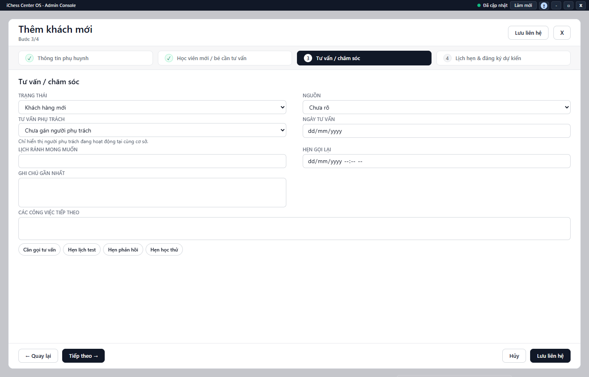

---
{
  "id": "KH-001",
  "title": "Tìm và thêm khách hàng",
  "summary": "Tìm hoặc tạo một hồ sơ tư vấn, ghi nhu cầu và người phụ trách.",
  "modules": [
    "khach-hang-tu-van"
  ],
  "order": 13,
  "revision": 2,
  "status": "EDITORIAL_PENDING",
  "keywords": [
    "Tìm và thêm khách hàng"
  ],
  "questions": [
    "Tìm khách hàng theo số điện thoại thế nào?",
    "Thêm khách tư vấn mới ở đâu?",
    "Giai đoạn khách hàng khác trạng thái tư vấn thế nào?",
    "Gán người tư vấn phụ trách ở đâu?"
  ],
  "related": [
    "KH-005",
    "KH-002",
    "KH-003",
    "KH-004"
  ]
}
---

## Mục đích

Tìm hoặc tạo một hồ sơ tư vấn, ghi nhu cầu và người phụ trách. Tạo khách hàng không tự tạo hồ sơ Học viên hoặc ghi nhận học phí.

## Trước khi bắt đầu

- Module Khách hàng phải khả dụng và dữ liệu cơ sở đã tải thành công. Tài khoản cần quyền ghi để lưu.
- Tìm tên và số điện thoại trước để tránh tạo trùng. Hồ sơ hiện từ Học viên có thể có cách tạo hoặc ghép hồ sơ tư vấn riêng.

## Các bước thực hiện

1. Mở **Khách hàng**, dùng **Tìm kiếm**, **Giai đoạn**, **Loại liên hệ**, **Trạng thái** và **Nguồn** để tìm khách đã có. Nhấp đúp dòng để mở chi tiết.
2. Nếu chưa có hồ sơ phù hợp, chọn **+ Thêm khách mới**.
3. Ở **Thông tin phụ huynh**, nhập tên và số điện thoại thực đã biết. Form yêu cầu ít nhất tên hoặc số điện thoại; thông tin xuất phiếu/thuế không bắt buộc, không điền dữ liệu đoán.
4. Sang **Học viên mới / bé cần tư vấn**, nhập tên bé, năm sinh và nhu cầu. Nếu bé đã có hồ sơ Học viên, lưu khách trước rồi dùng bước kiểm tra liên kết riêng.
5. Sang **Tư vấn / chăm sóc**, chọn trạng thái, nguồn và **Tư vấn phụ trách**. Danh sách người phụ trách chỉ gồm người đang hoạt động cùng cơ sở. Bổ sung ngày tư vấn, lịch rảnh, hẹn gọi lại và việc tiếp theo nếu có.
6. **Giai đoạn khách hàng** là nhóm tổng quát; **Trạng thái** diễn tả tình huống tư vấn cụ thể. Không chọn “đã đăng ký” để thay cho thao tác liên kết/chuyển đổi học viên.
7. Chọn **Lưu liên hệ**; với hồ sơ đang sửa là **Lưu thay đổi**. **Hủy** bỏ form. Chờ xác nhận rồi tìm và mở lại khách để kiểm tra.

## Kết quả mong đợi

Sau khi lưu thành công, tìm lại khách và kiểm tra tên, liên hệ, thông tin bé và người phụ trách. Chuyển qua các bước trong form chưa có nghĩa hồ sơ đã được lưu; tạo khách không tự tạo học viên hoặc khoản thu.

## Lỗi thường gặp

- **Không thấy nút hoạt động:** kiểm tra trạng thái tải, quyền và khả năng sử dụng của cơ sở; không kết luận chỉ cần tạo khách ở cơ sở khác.
- **Tên/SĐT bị khóa khi sửa:** dùng **Sửa thông tin liên hệ** trong chi tiết nếu có quyền; xem [KH-005](KH-005.md).
- **Không thấy người phụ trách:** không gõ tên để giả liên kết tài khoản; kiểm tra danh sách hợp lệ của cơ sở.

## Bài liên quan

- [KH-002 · Chăm sóc khách hàng và đặt lịch hẹn](KH-002.md)
- [KH-003 · Đặt lịch hẹn học thử](KH-003.md)
- [KH-004 · Chuyển đổi khách thành học viên](KH-004.md)
