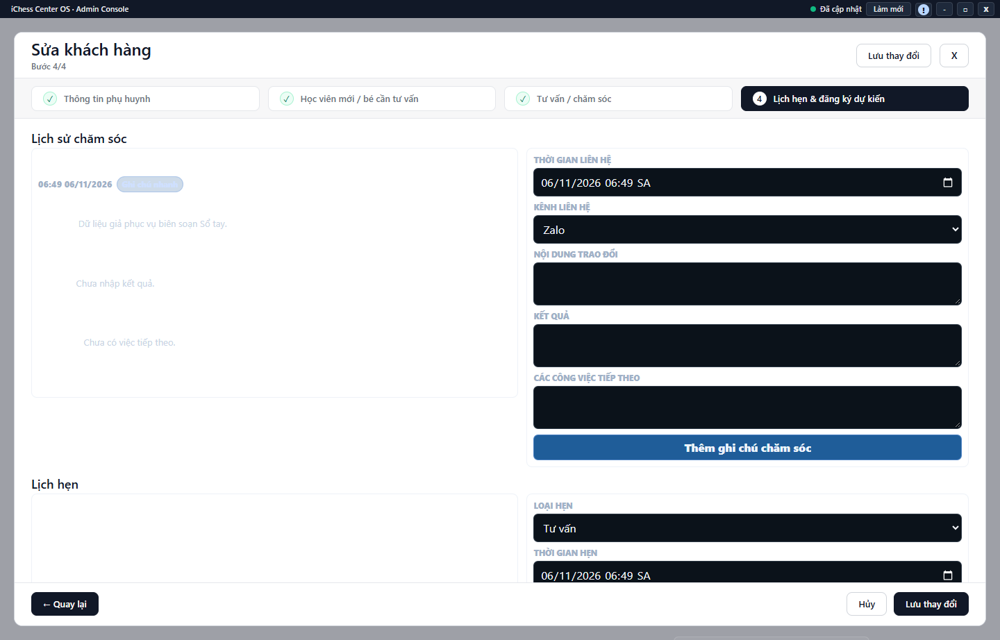

---
{
  "id": "KH-002",
  "title": "Chăm sóc khách hàng và đặt lịch hẹn",
  "summary": "Ghi lịch sử trao đổi và lịch hẹn của khách đã lưu.",
  "modules": [
    "khach-hang-tu-van"
  ],
  "order": 14,
  "revision": 2,
  "status": "EDITORIAL_PENDING",
  "keywords": [
    "Chăm sóc khách hàng và đặt lịch hẹn"
  ],
  "questions": [
    "Thêm ghi chú chăm sóc khách hàng thế nào?",
    "Hẹn gọi lại khách hàng ở đâu?",
    "Tạo, hoàn thành hoặc hủy lịch hẹn thế nào?"
  ],
  "related": [
    "KH-001",
    "KH-003",
    "LK-001"
  ]
}
---

## Mục đích

Ghi lịch sử trao đổi và lịch hẹn của khách đã lưu. Lịch hẹn tư vấn không phải một buổi học đã điểm danh.

## Trước khi bắt đầu

- Khách đã có hồ sơ tại cơ sở, dữ liệu đã tải và tài khoản có quyền ghi.
- Xác nhận nội dung trao đổi, thời gian và kênh hẹn thực tế. Tạo hồ sơ trước theo [KH-001](KH-001.md) nếu cần.

## Các bước thực hiện

1. Mở chi tiết khách. Để ghi ngắn, chọn **+ Thêm ghi chú**, nhập nội dung rồi dùng nút lưu trong hộp ghi chú.
2. Để ghi lịch sử đầy đủ, chọn **Sửa hồ sơ tư vấn** → **4. Lịch hẹn & đăng ký dự kiến**.
3. Trong **Lịch sử chăm sóc**, nhập thời gian liên hệ, kênh, nội dung trao đổi, kết quả và việc tiếp theo. Chọn **Thêm ghi chú chăm sóc** để gửi riêng ghi chú này.
4. Trong **Lịch hẹn**, chọn loại hẹn, thời gian, kênh, địa điểm và ghi chú. Chọn **Thêm lịch hẹn** để gửi lịch hẹn.
5. Với lịch đã có, thay trạng thái ở đúng thẻ lịch hẹn khi tình trạng thực thay đổi. Việc đổi trạng thái gọi lưu riêng; không chờ một nút Lưu chung mới có hiệu lực.
6. Nếu chỉ sửa **Hẹn gọi lại** hoặc **Các công việc tiếp theo** ở bước **Tư vấn / chăm sóc**, chọn **Lưu thay đổi** cho hồ sơ.
7. Đọc lại lịch sử sau thông báo thành công. **Hủy** form không hoàn tác ghi chú hoặc lịch hẹn đã được lưu riêng ở các bước trước.

## Kết quả mong đợi

Sau từng thông báo thành công, ghi chú hoặc lịch hẹn xuất hiện trong lịch sử của đúng khách. Kiểm tra lại trạng thái hẹn sau khi thay đổi. Hủy form ngoài không hoàn tác ghi chú hay lịch hẹn đã lưu riêng.

## Lỗi thường gặp

- **Không thấy form lịch sử khi tạo khách mới:** lưu hồ sơ trước rồi mở sửa; bước bốn của hồ sơ mới chỉ hiển thị tổng quan chưa có lịch sử.
- **Đổi trạng thái rồi bấm Hủy:** thao tác đã gửi riêng không bị hoàn tác bằng Hủy form.
- **Thiếu nội dung hoặc thời gian:** sửa trường được báo, không nhập giá trị giả để vượt kiểm tra.

## Bài liên quan

- [KH-001 · Tìm và thêm khách hàng](KH-001.md)
- [KH-003 · Đặt lịch hẹn học thử](KH-003.md)
- [LK-001 · Xem lịch tuần và phân biệt hai tab](LK-001.md)
