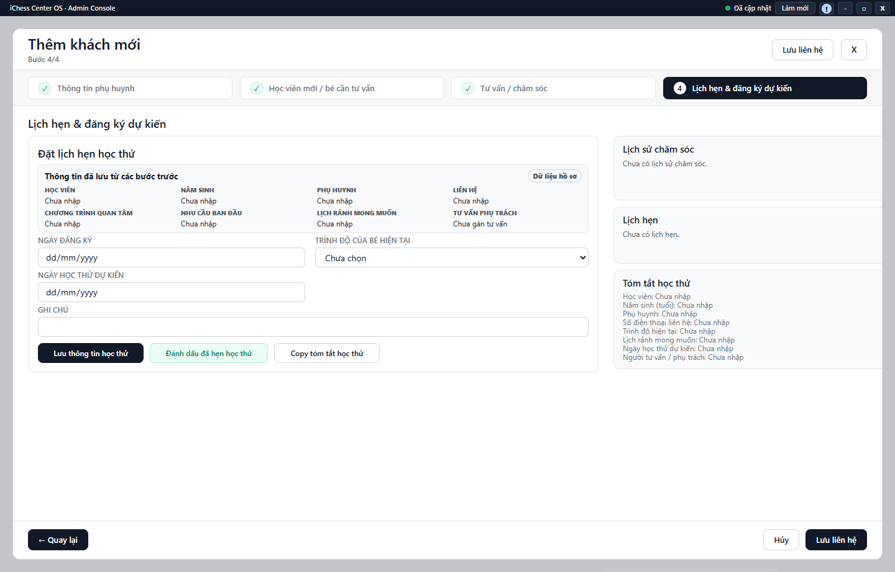

---
{
  "id": "KH-003",
  "title": "Đặt lịch hẹn học thử",
  "summary": "Ghi ngày học thử dự kiến và chuẩn bị tóm tắt cho người phụ trách.",
  "modules": [
    "khach-hang-tu-van"
  ],
  "order": 15,
  "revision": 2,
  "status": "EDITORIAL_PENDING",
  "keywords": [
    "Đặt lịch hẹn học thử"
  ],
  "questions": [
    "Đặt lịch học thử cho khách ở đâu?",
    "Sao chép tóm tắt học thử thế nào?"
  ],
  "related": [
    "KH-004",
    "KH-001",
    "LK-004"
  ]
}
---

## Mục đích

Ghi ngày học thử dự kiến và chuẩn bị tóm tắt cho người phụ trách. Đánh dấu đã hẹn học thử chưa có nghĩa bé đã học, đã nhập học hoặc đã thanh toán.

## Trước khi bắt đầu

- Kiểm tra đúng khách, tên bé, năm sinh và thông tin liên hệ đã biết.
- Cần quyền ghi và dữ liệu Khách hàng đã tải xong; chốt ngày dự kiến với người liên quan trước khi đánh dấu đã hẹn.

## Các bước thực hiện

1. Mở form khách → **4. Lịch hẹn & đăng ký dự kiến**.
2. Trong **Đặt lịch hẹn học thử**, đọc **Thông tin đã lưu từ các bước trước** để tránh hẹn nhầm bé.
3. Chọn **Trình độ của bé hiện tại**, nhập **Ngày học thử dự kiến** và ghi chú. Sửa thông tin nhận dạng ở bước trước nếu chưa đúng.
4. **Lưu thông tin học thử** dùng để lưu phần dự kiến. **Đánh dấu đã hẹn học thử** là thao tác riêng có kiểm tra điều kiện; chỉ chọn khi lịch hẹn thực sự đã thống nhất.
5. Sau khi lưu được xác nhận, kiểm tra nhãn **Đã hẹn học thử** và nội dung tóm tắt. Với form khách mới, thực hiện lưu hồ sơ khi form yêu cầu; không coi bản tóm tắt đang hiện là bằng chứng đã có khách trên hệ thống.
6. Chọn **Copy tóm tắt học thử** nếu cần tự chuyển nội dung cho người phụ trách. Nút này chỉ sao chép, không tự gửi thông báo.

## Kết quả mong đợi

Sau khi lưu thành công, thông tin dự kiến và nhãn hẹn học thử phản ánh đúng việc đã thống nhất. Nhãn Đã hẹn học thử không có nghĩa đã có buổi học, điểm danh hoặc gói học phí.

## Lỗi thường gặp

- **Không đánh dấu được:** đọc các trường còn thiếu, đặc biệt tên bé, thông tin liên hệ và ngày dự kiến.
- **Đã sao chép nhưng người khác chưa nhận:** thao tác không gửi; kiểm tra nội dung trước khi tự chia sẻ qua kênh phù hợp.
- **Bé bắt đầu học chính thức:** dùng [KH-004](KH-004.md) và kiểm tra riêng lịch học, gói học phí.

## Bài liên quan

- [KH-001 · Tìm và thêm khách hàng](KH-001.md)
- [KH-004 · Chuyển đổi khách thành học viên](KH-004.md)
- [LK-004 · Buổi đột xuất và thông tin ca học](LK-004.md)
