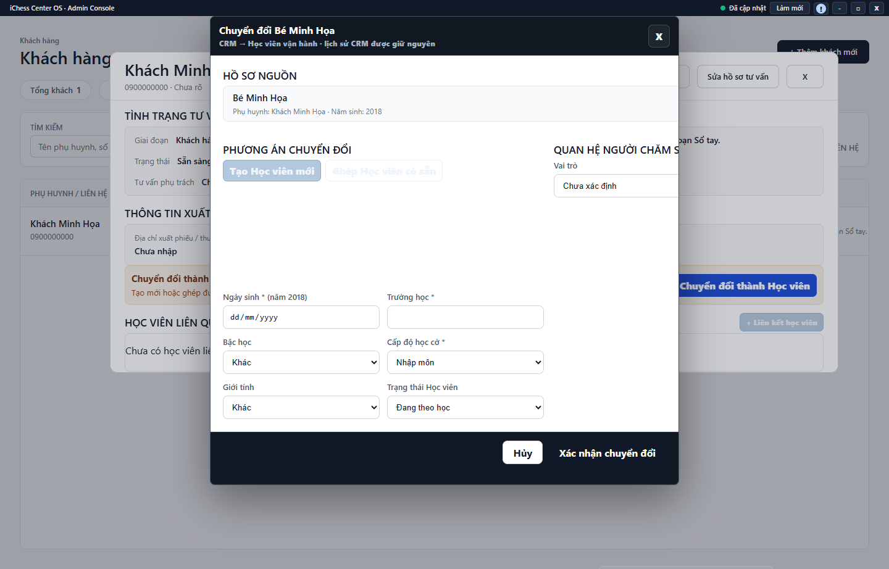

---
{
  "id": "KH-004",
  "title": "Chuyển đổi khách thành học viên",
  "summary": "Phân biệt chuyển đổi khách sang học viên với việc chỉ đổi trạng thái tư vấn.",
  "modules": [
    "khach-hang-tu-van"
  ],
  "order": 16,
  "revision": 2,
  "status": "EDITORIAL_PENDING",
  "keywords": [
    "Chuyển đổi khách thành học viên"
  ],
  "questions": [
    "Chuyển khách hàng thành học viên thế nào?",
    "Khách đã có học viên thì ghép ở đâu?"
  ],
  "related": [
    "KH-001",
    "HV-003",
    "HP-001"
  ]
}
---

## Mục đích

Phân biệt chuyển đổi khách sang học viên với việc chỉ đổi trạng thái tư vấn. Luồng có hai lựa chọn: tạo học viên mới hoặc ghép học viên có sẵn, giữ lịch sử tư vấn.

> Chưa có hướng dẫn vận hành được duyệt cho tạo hoặc ghép học viên từ khách hàng. Chưa xác nhận đủ kết quả chuyển đổi, chống trùng và xử lý khi lưu không thành công. Chỉ dùng bài để chuẩn bị và kiểm tra hồ sơ; không xác nhận chuyển đổi theo bài này.

## Trước khi bắt đầu

- Khách cần ở trạng thái **Sẵn sàng đăng ký**, có hồ sơ tư vấn và thông tin bé hợp lệ cùng cơ sở.
- Tìm học viên trước để tránh tạo trùng. Không thay trạng thái thành “Đã đăng ký” để bỏ qua bước kiểm tra liên kết.

## Các bước thực hiện

### Chỉ tra cứu và chuẩn bị

1. Mở chi tiết khách, kiểm tra đúng phụ huynh, bé và cơ sở.
2. Đọc trạng thái tư vấn. **Sẵn sàng đăng ký** là một điều kiện; chỉ đổi nhãn tư vấn không tự tạo học viên.
3. Tìm bé trong **Học viên** theo [HV-003](HV-003.md), đối chiếu năm sinh và liên hệ để nhận biết hồ sơ đã có. Không ghép chỉ vì tên giống nhau.
4. Công cụ **Chuyển đổi thành Học viên** phân biệt **Tạo Học viên mới** và **Ghép Học viên có sẵn**. Bài chưa hướng dẫn chọn hoặc xác nhận hai phương án này.
5. Ghi lại thông tin thật còn thiếu như ngày sinh, trường và cấp độ. Nếu đã mở form, dùng **Hủy** để rời trước khi gửi; không điền dữ liệu đoán để qua điều kiện.
6. Không tự đánh dấu đã nhập học, gán lịch hay thu tiền chỉ vì thấy nút chuyển đổi. Sau khi có quy trình được duyệt, việc kiểm tra lịch và gói vẫn là các bước riêng theo [HP-001](HP-001.md).

## Kết quả mong đợi

Bạn nhận biết được khách cần tạo học viên mới hay cần kiểm tra hồ sơ có sẵn, cùng thông tin còn thiếu. Bài không xác nhận chuyển đổi đã hoàn tất và không hướng dẫn ghi dữ liệu.

## Lỗi thường gặp

- **Khách chưa đủ điều kiện:** hoàn thiện thông tin thật và kiểm tra trạng thái, không tạo khách thứ hai để né chặn.
- **Tên học viên gần giống:** đối chiếu ngày sinh, liên hệ và cơ sở trước khi ghép.
- **Kết quả chưa rõ:** kiểm tra cả CRM và Học viên trước khi gửi lại thao tác để tránh tạo trùng.

## Bài liên quan

- [KH-001 · Tìm và thêm khách hàng](KH-001.md)
- [HV-003 · Tìm, lọc và đọc hồ sơ học viên](HV-003.md)
- [HP-001 · Thiết lập và gán gói học phí](HP-001.md)
