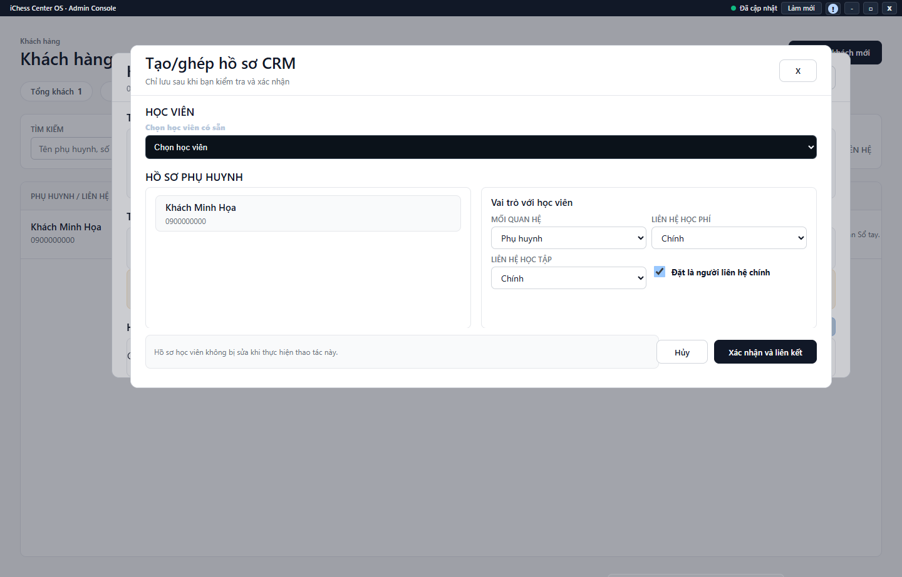

---
{
  "id": "KH-005",
  "title": "Liên kết và thông tin liên hệ phụ huynh",
  "summary": "Tra điểm vào quản lý quan hệ phụ huynh–học viên và danh tính liên hệ.",
  "modules": [
    "khach-hang-tu-van"
  ],
  "order": 17,
  "revision": 2,
  "status": "EDITORIAL_PENDING",
  "keywords": [
    "Liên kết và thông tin liên hệ phụ huynh"
  ],
  "questions": [
    "Liên kết phụ huynh với học viên có sẵn thế nào?",
    "Sửa số điện thoại phụ huynh ở đâu?",
    "Ngắt liên kết nhầm có xóa học viên không?",
    "In thông tin khách hàng ở đâu?"
  ],
  "related": [
    "KH-001",
    "KH-004",
    "HV-003"
  ]
}
---

## Mục đích

Tra điểm vào quản lý quan hệ phụ huynh–học viên và danh tính liên hệ. Liên kết quan hệ không phải tạo lại học viên, còn ngắt liên kết không phải xóa hồ sơ học viên.

> Phần lưu liên kết, sửa thông tin liên hệ và ngắt liên kết chưa có hướng dẫn vận hành được duyệt. Cần kiểm tra thêm dữ liệu sau lưu và các trường hợp hồ sơ bị khóa. Chỉ dùng các bước dưới để tra cứu, không xác nhận thay đổi quan hệ theo bài này.

## Trước khi bắt đầu

- Cần đúng khách và đúng học viên cùng cơ sở, quyền ghi và nguồn liên hệ sẵn sàng.
- Đối chiếu tên, số điện thoại và năm sinh; không lấy việc trùng tên làm căn cứ ghép.

## Các bước thực hiện

### Chỉ tra cứu và chuẩn bị

1. Mở chi tiết khách → **Học viên liên quan**, đọc các học viên đã liên kết nếu tải được dữ liệu.
2. Đối chiếu tên, năm sinh và số điện thoại của đúng người. Không lấy tên trùng hoặc số điện thoại dùng chung làm căn cứ gộp hồ sơ.
3. **+ Liên kết học viên**, **Sửa liên kết** và **Ngắt liên kết** là các công cụ thay đổi quan hệ. Bài này không hướng dẫn xác nhận chúng; ngắt quan hệ khác xóa hồ sơ học viên.
4. Nếu tên, SĐT hoặc email bị khóa trong **Sửa hồ sơ tư vấn**, công cụ **Sửa thông tin liên hệ** có điều kiện quyền và dữ liệu riêng. Chỉ kiểm tra xem công cụ có xuất hiện; không sửa ở hồ sơ khác để lách khóa.
5. Hồ sơ có dòng **Tạo/ghép hồ sơ CRM** cần quy trình riêng trước khi ghi. Không tạo khách trùng để thay cho bước kiểm tra quan hệ.
6. Chọn **In/PDF thông tin** để mở bản in; kiểm tra đúng tên khách, tên trẻ và năm sinh. Nếu phiên đang bảo vệ thông tin liên hệ, bản in cũng không hiện phần đó. Hủy hộp in nếu chưa đúng; in không lưu quan hệ. Dùng **Hủy** hoặc **Đóng** nếu đã mở form xem mà chưa muốn thay đổi.

## Kết quả mong đợi

Bạn tìm được quan hệ đang hiển thị và nhận biết giới hạn của tài khoản. Việc đọc hồ sơ không tạo hoặc ngắt liên kết. Các thao tác thay đổi thông tin và quan hệ vẫn cần hướng dẫn được duyệt.

## Lỗi thường gặp

- **Không có nút sửa liên hệ:** có thể thiếu dữ liệu danh tính hoặc quyền; không sửa số điện thoại ở hồ sơ khác để lách khóa.
- **Liên kết nhầm:** dừng các thao tác phụ thuộc và kiểm tra quan hệ thực; không xóa học viên để xử lý lỗi quan hệ.
- **Số điện thoại dùng chung:** cần xác định đúng người và quan hệ, không tự gộp hồ sơ.

## Bài liên quan

- [KH-001 · Tìm và thêm khách hàng](KH-001.md)
- [KH-004 · Chuyển đổi khách thành học viên](KH-004.md)
- [HV-003 · Tìm, lọc và đọc hồ sơ học viên](HV-003.md)
