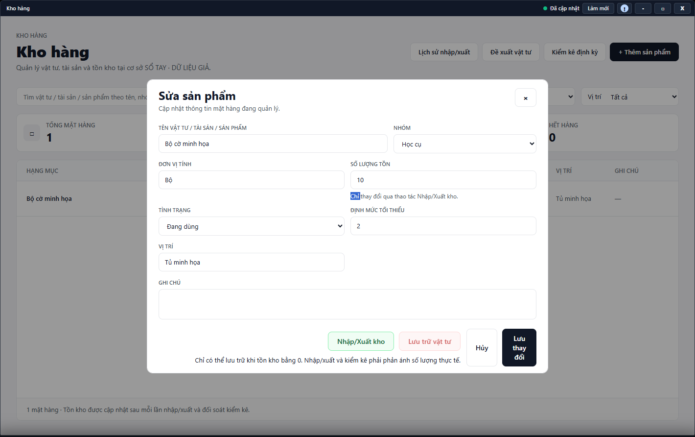

---
{
  "id": "KO-001",
  "title": "Tra cứu và quản lý sản phẩm",
  "summary": "Tìm vật tư, tạo mặt hàng và sửa thông tin mô tả.",
  "modules": [
    "kho-hang"
  ],
  "order": 40,
  "revision": 2,
  "status": "EDITORIAL_PENDING",
  "keywords": [
    "Tra cứu và quản lý sản phẩm",
    "tồn kho"
  ],
  "questions": [
    "Tìm vật tư sắp hết ở đâu?",
    "Thêm sản phẩm vào kho thế nào?",
    "Sửa sản phẩm hoặc lưu trữ vật tư thế nào?"
  ],
  "related": [
    "KO-002",
    "KO-003",
    "KO-004"
  ]
}
---

## Mục đích

Tìm vật tư, tạo mặt hàng và sửa thông tin mô tả. Không sửa trực tiếp số tồn của sản phẩm đã có để thay cho nghiệp vụ nhập/xuất hoặc kiểm kê.

## Trước khi bắt đầu

- Kho hàng phải khả dụng và tải được dữ liệu tại cơ sở; tài khoản cần quyền ghi khi thêm/sửa.
- Kiểm tra mặt hàng đã tồn tại chưa, chuẩn bị tên, nhóm, đơn vị và số tồn đầu kỳ thực tế.

## Các bước thực hiện

1. Mở **Kho hàng**, dùng **Tìm kiếm**, **Nhóm**, **Tình trạng**, **Vị trí**. Đọc nhãn tồn của mặt hàng và thống kê **Sắp hết**, **Hết hàng**; không đồng nhất nhãn tồn với tình trạng vật tư.
2. Chọn **+ Thêm sản phẩm** nếu chưa có mặt hàng cần dùng.
3. Nhập **Tên vật tư / tài sản / sản phẩm**, **Nhóm**, **Đơn vị tính**, **Số lượng tồn đầu kỳ**, **Tình trạng**, **Định mức tối thiểu** và vị trí. Tồn và định mức phải là số nguyên không âm.
4. Chọn **Lưu sản phẩm**; **Hủy** bỏ nháp. Sau xác nhận thành công, tìm lại mặt hàng để kiểm tra đơn vị và tồn.
5. Muốn sửa, nhấp đúp dòng sản phẩm, chỉnh thông tin rồi **Lưu thay đổi**. **Số lượng tồn** trong form sửa chỉ đọc; dùng **Nhập/Xuất kho** để ghi thay đổi thực.
6. Đơn vị có thể bị khóa khi đã có lịch sử nhập/xuất. Không đổi tên đơn vị trong ghi chú để giả rằng lịch sử đã được quy đổi.
7. **Lưu trữ vật tư** chỉ dùng khi tồn bằng 0. Kiểm tra trước khi xác nhận; không xuất khống cho về 0 chỉ để mở nút lưu trữ.

## Kết quả mong đợi

Sau khi lưu thành công, tìm lại mặt hàng để kiểm tra tên, đơn vị và số tồn. Khi sửa thông tin sản phẩm, số tồn không được thay trực tiếp. Lưu trữ vật tư giữ lịch sử và chỉ thực hiện được khi đáp ứng điều kiện hiển thị.

## Lỗi thường gặp

- **Đang tải hoặc chưa tải được Kho hàng:** không đọc số hiện tại như số đã xác nhận; kiểm tra lại nguồn trước khi ghi.
- **Muốn chọn “Hết hàng” thủ công:** hết hàng được xác định từ số tồn, không phải cách thay tồn.
- **Sắp hết nhưng không thấy ở bộ lọc tình trạng:** nhãn tồn và tình trạng là hai thông tin khác nhau.

## Bài liên quan

- [KO-002 · Nhập, xuất kho và xem lịch sử](KO-002.md)
- [KO-003 · Đề xuất vật tư và theo dõi xử lý](KO-003.md)
- [KO-004 · Kiểm kê định kỳ](KO-004.md)
