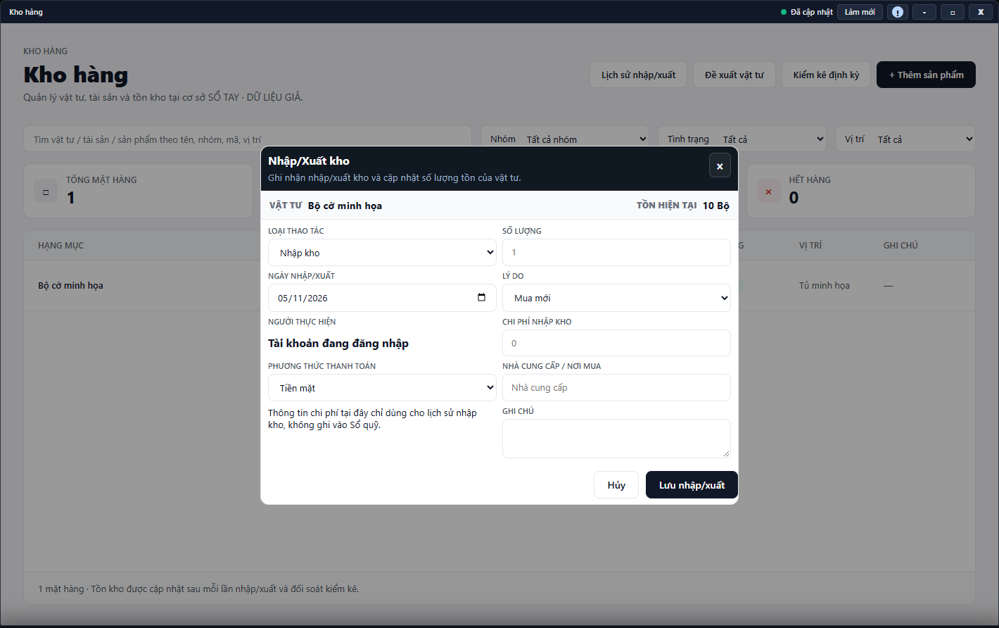

---
{
  "id": "KO-002",
  "title": "Nhập, xuất kho và xem lịch sử",
  "summary": "Ghi nhận vật tư thực nhập/xuất và đối chiếu số tồn.",
  "modules": [
    "kho-hang"
  ],
  "order": 41,
  "revision": 2,
  "status": "EDITORIAL_PENDING",
  "keywords": [
    "Nhập, xuất kho và xem lịch sử"
  ],
  "questions": [
    "Nhập hoặc xuất kho thế nào?",
    "Điều chỉnh số lượng tồn bằng cách nào?",
    "Xem lịch sử nhập xuất ở đâu?",
    "Chi phí nhập kho có tự tạo khoản chi không?"
  ],
  "related": [
    "TC-002",
    "KO-001",
    "KO-004"
  ]
}
---

## Mục đích

Ghi nhận vật tư thực nhập/xuất và đối chiếu số tồn. **Chi phí nhập kho chỉ dùng cho lịch sử nhập kho, không ghi vào Sổ quỹ.**

## Trước khi bắt đầu

- Mặt hàng đã có, đúng đơn vị và nguồn Kho hàng sẵn sàng; tài khoản có quyền ghi.
- Xác nhận số lượng, ngày và lý do thực. Không dùng nhập/xuất giả để làm khớp số liệu hoặc mở nút lưu trữ.

## Các bước thực hiện

1. Mở **Kho hàng**, nhấp đúp sản phẩm → **Nhập/Xuất kho**.
2. Kiểm tra **Vật tư** và **Tồn hiện tại**, chọn **Loại thao tác** Nhập kho hoặc Xuất kho.
3. Nhập số lượng nguyên lớn hơn 0, ngày nhập/xuất và lý do. Xuất không được quá tồn hiện tại; lý do điều chỉnh tăng/giảm vẫn cần phản ánh sự việc thật.
4. Với nhập kho, ghi chi phí, phương thức và nhà cung cấp nếu có. Đọc lưu ý không ghi vào Sổ quỹ; nếu cần ghi khoản chi thực, kiểm tra giao dịch đã có rồi làm riêng theo [TC-002](TC-002.md).
5. Rà soát tồn trước/sau theo số lượng dự định rồi **Lưu nhập/xuất**. **Hủy** bỏ form chưa lưu; không phải lệnh đảo ngược một lần nhập/xuất đã ghi.
6. Sau xác nhận thành công, kiểm tra tồn sản phẩm. Phần **Lịch sử nhập/xuất** chưa có hướng dẫn đối chiếu hoàn chỉnh; khi xem được dữ liệu, cần đối chiếu vật tư, số lượng, ngày, người và lý do.
7. Nếu lịch sử hoặc nguồn tải lỗi, chưa được coi bước đối chiếu là hoàn tất. Phần tra lịch sử còn chờ kiểm tra đầy đủ; không tự điền kết quả đối chiếu khi chưa xem được dữ liệu.

## Kết quả mong đợi

Sau thông báo lưu thành công, số tồn của sản phẩm phản ánh số lượng vừa nhập hoặc xuất. Chi phí nhập kho không tự tạo khoản chi trong Sổ quỹ. Phần tra lịch sử còn cần hướng dẫn bổ sung; không coi đã đối chiếu xong nếu chưa xem được lịch sử.

## Lỗi thường gặp

- **Xuất quá tồn:** kiểm tra hàng thực và dữ liệu mới nhất, không sửa số tồn trực tiếp để vượt chặn.
- **Chi phí không hiện Thu chi:** đây là điều đã được nêu ngay trên form, không phải bằng chứng mất giao dịch tự động.
- **Kết quả ghi chưa rõ:** kiểm tra tồn/lịch sử trước khi gửi lại, tránh cộng/trừ hai lần.

## Bài liên quan

- [KO-001 · Tra cứu và quản lý sản phẩm](KO-001.md)
- [KO-004 · Kiểm kê định kỳ](KO-004.md)
- [TC-002 · Thêm, sửa và xóa giao dịch thủ công](TC-002.md)
