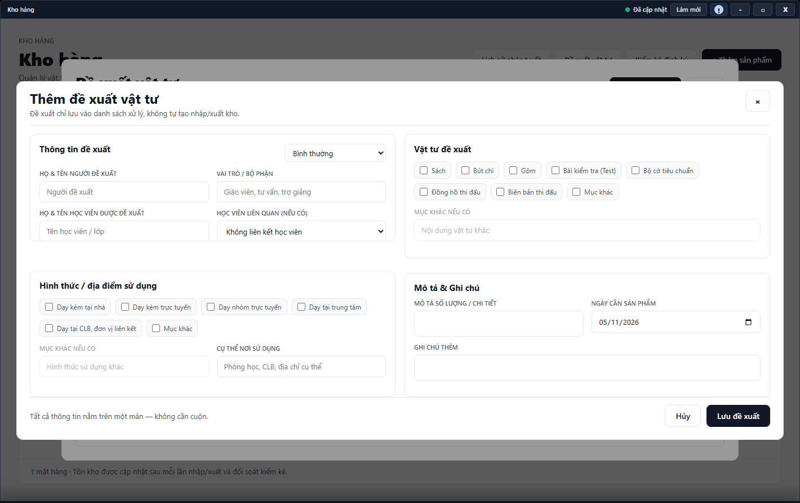

---
{
  "id": "KO-003",
  "title": "Đề xuất vật tư và theo dõi xử lý",
  "summary": "Gửi một đề xuất dụng cụ và theo dõi tình trạng xử lý.",
  "modules": [
    "kho-hang"
  ],
  "order": 42,
  "revision": 2,
  "status": "EDITORIAL_PENDING",
  "keywords": [
    "Đề xuất vật tư và theo dõi xử lý"
  ],
  "questions": [
    "Đề xuất dụng cụ cho học viên ở đâu?",
    "Theo dõi và đổi trạng thái đề xuất vật tư thế nào?"
  ],
  "related": [
    "KO-002",
    "KO-001"
  ]
}
---

## Mục đích

Gửi một đề xuất dụng cụ và theo dõi tình trạng xử lý. Đề xuất, kể cả khi đánh dấu hoàn tất, không tự tạo nhập/xuất hoặc trừ tồn kho.

## Trước khi bắt đầu

- Dữ liệu Kho hàng sẵn sàng và tài khoản có quyền ghi tại cơ sở.
- Chuẩn bị người đề xuất, học viên/lớp, vật tư, số lượng mô tả, nơi sử dụng và ngày cần thực tế.

## Các bước thực hiện

1. Mở **Kho hàng → Đề xuất vật tư**. Tìm theo từ khóa, trạng thái hoặc **Ngày cần** trước khi thêm để tránh đề xuất trùng.
2. Chọn **+ Thêm đề xuất**. Nhập người đề xuất, vai trò/bộ phận và tên học viên được đề xuất; chọn liên kết học viên nếu có hồ sơ đúng.
3. Chọn hình thức/địa điểm sử dụng và ghi **Cụ thể nơi sử dụng**. Chọn ít nhất một dụng cụ/sản phẩm, bổ sung mục khác khi phù hợp.
4. Nhập **Mô tả số lượng / chi tiết**, **Ngày cần sản phẩm**, mức ưu tiên và ghi chú cần thiết.
5. Chọn **Lưu đề xuất** và chờ xác nhận; **Hủy** bỏ bản nhập chưa gửi. Tìm lại đề xuất trong danh sách sau lưu.
6. Phần đổi trạng thái đề xuất đã lưu chưa có hướng dẫn vận hành được duyệt. Chỉ đọc trạng thái hiện tại nếu tải được; không chọn **Cập nhật trạng thái** theo bài này. **Đóng** không tự lưu phần đang sửa.
7. Nếu đã thực cấp hàng, ghi xuất kho riêng theo [KO-002](KO-002.md); không coi trạng thái **Đã hoàn tất** là đã giảm tồn.

## Kết quả mong đợi

Sau thông báo lưu thành công, đề xuất xuất hiện trong danh sách với đúng người, vật tư, nơi sử dụng và ngày cần. Đề xuất không tự tạo nhập/xuất kho. Phần cập nhật trạng thái đề xuất đã lưu chưa có hướng dẫn hoàn chỉnh trong bài này.

## Lỗi thường gặp

- **Thiếu mô tả/ngày/nơi dùng:** bổ sung thông tin thực theo lỗi, không dùng lựa chọn bất kỳ để qua form.
- **Tồn không đổi khi hoàn tất:** cần thao tác nhập/xuất thực riêng.
- **Nhập tên người đề xuất khác tài khoản thao tác:** đây là thông tin nghiệp vụ; người thực ghi/xử lý còn được hệ thống xác nhận riêng.

## Bài liên quan

- [KO-001 · Tra cứu và quản lý sản phẩm](KO-001.md)
- [KO-002 · Nhập, xuất kho và xem lịch sử](KO-002.md)
