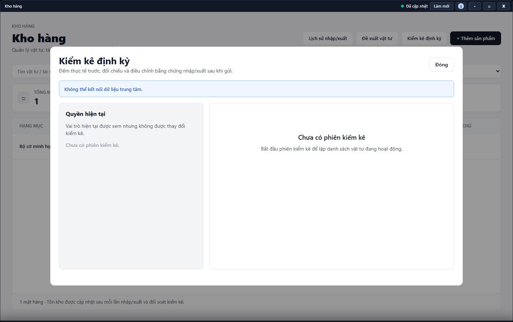

---
{
  "id": "KO-004",
  "title": "Kiểm kê định kỳ",
  "summary": "Hiểu các giai đoạn kiểm kê: đếm thực tế, gửi số đếm, giải thích chênh lệch và đối soát.",
  "modules": [
    "kho-hang"
  ],
  "order": 43,
  "revision": 2,
  "status": "EDITORIAL_PENDING",
  "keywords": [
    "Kiểm kê định kỳ"
  ],
  "questions": [
    "Bắt đầu kiểm kê kho ở đâu?",
    "Gửi kết quả đếm và xử lý chênh lệch thế nào?",
    "Hủy phiên kiểm kê khác đóng cửa sổ thế nào?"
  ],
  "related": [
    "KO-001",
    "KO-002"
  ]
}
---

## Mục đích

Hiểu các giai đoạn kiểm kê: đếm thực tế, gửi số đếm, giải thích chênh lệch và đối soát. Kiểm kê không phải cách tự điền số hệ thống để có kết quả khớp.

> Phần kiểm kê chưa có hướng dẫn vận hành được duyệt. Chỉ đọc để hiểu quy trình; không thực hiện lưu, gửi số đếm hoặc đối soát theo bài này. Chưa kiểm tra đầy đủ việc mở phiên, xử lý chênh lệch và cập nhật tồn kho.

## Trước khi bắt đầu

- Cơ sở phải có khả năng kiểm kê, nguồn đã tải, mặt hàng hoạt động và quyền ghi phù hợp.
- Chuẩn bị người đếm, nơi đếm và ngày đến hạn. Không bắt đầu phiên khác để né một phiên đang mở.

## Các bước thực hiện

### Chỉ tra cứu và chuẩn bị

1. Mở **Kho hàng → Kiểm kê định kỳ** để đọc trạng thái. Nếu không tải được hoặc thiếu quyền, dừng; có nút trên màn hình chưa có nghĩa được bắt đầu phiên.
2. Phân biệt **Đang đếm**, **Chờ đối soát**, **Đã hoàn tất** và **Đã hủy**. Đang đếm nghĩa là chưa hoàn tất kiểm kê.
3. Số đếm cần phản ánh hàng thực tế, không chép số tồn để cho khớp. Chuẩn bị người đếm, nơi đếm và thông tin mặt hàng; bài chưa hướng dẫn nhập hoặc gửi số đếm.
4. Chênh lệch cần được kiểm tra và giải thích trước khi đối soát. Bài chưa hướng dẫn chọn **Giải thích & đối soát** hoặc **Hoàn tất kiểm kê**.
5. **Đóng** chỉ rời màn hình, khác **Hủy phiên**. Bài không hướng dẫn hủy phiên hoặc mở phiên mới; hãy giữ nguyên trạng thái khi chưa rõ kết quả một thao tác trước.

## Kết quả mong đợi

Bạn hiểu các giai đoạn và biết rằng đóng cửa sổ không hủy phiên. Việc đọc bài không tạo phiên, gửi kết quả hay điều chỉnh tồn; chưa có quy trình thao tác kiểm kê được duyệt trong bản này.

## Lỗi thường gặp

- **Không có quyền hoặc nguồn chưa sẵn sàng:** không chuyển sang nhập/xuất giả để thay kiểm kê.
- **Ô số đếm trống:** đây là chủ ý để đếm độc lập, không phải yêu cầu chép số tồn đang thấy.
- **Đóng cửa sổ tưởng đã hủy:** kiểm tra lại trạng thái phiên trước khi làm tiếp.

## Bài liên quan

- [KO-001 · Tra cứu và quản lý sản phẩm](KO-001.md)
- [KO-002 · Nhập, xuất kho và xem lịch sử](KO-002.md)
