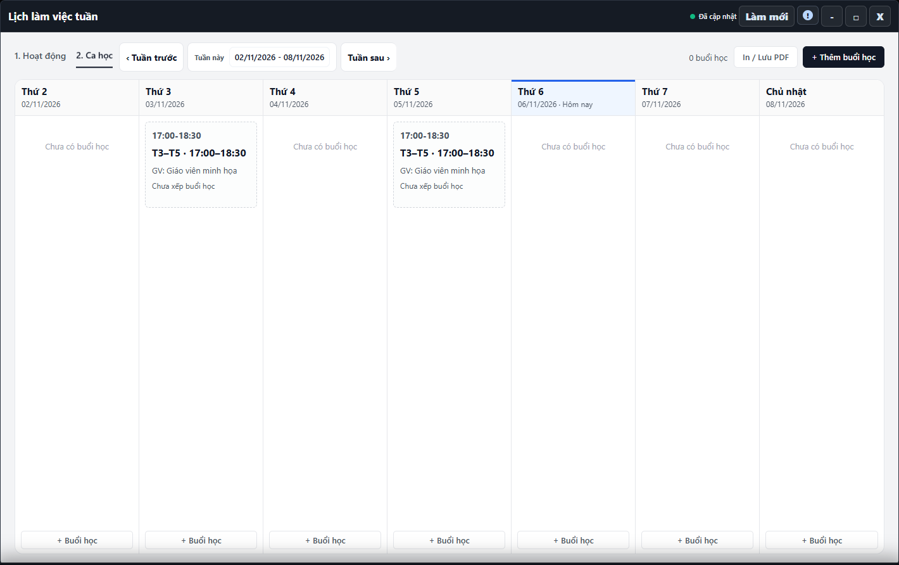

---
{
  "id": "LK-001",
  "title": "Xem lịch tuần và phân biệt hai tab",
  "summary": "Xem lịch làm việc trong tuần và phân biệt hoạt động cơ sở với ca/buổi học.",
  "modules": [
    "thoi-khoa-bieu"
  ],
  "order": 27,
  "revision": 2,
  "status": "EDITORIAL_PENDING",
  "keywords": [
    "Xem lịch tuần và phân biệt hai tab"
  ],
  "questions": [
    "Xem lịch tuần trước hoặc tuần sau thế nào?",
    "Hoạt động khác Ca học thế nào?",
    "In lịch làm việc tuần ở đâu?"
  ],
  "related": [
    "HV-002",
    "CD-001",
    "DD-001",
    "LK-002"
  ]
}
---

## Mục đích

Xem lịch làm việc trong tuần và phân biệt hoạt động cơ sở với ca/buổi học. Đổi tuần đang xem không làm đổi lịch của học viên.

## Trước khi bắt đầu

- Kiểm tra cơ sở và tuần hiển thị. Dữ liệu lịch phải tải xong.
- Lịch định kỳ theo từng học viên được chọn trong hồ sơ; danh mục ca nằm ở Cài đặt cơ sở.

## Các bước thực hiện

1. Mở **Lịch làm việc tuần**. Chọn **1. Hoạt động** để xem hội họp, sự kiện và hoạt động cơ sở; chọn **2. Ca học** để xem ca và buổi học.
2. Dùng **Tuần trước**, **Tuần sau** để đổi khoảng ngày. Nút giữa hiển thị **Tuần này** hoặc **Về tuần này**, giúp trở lại tuần hiện tại.
3. Bấm một thẻ để đọc chi tiết. Với ca, kiểm tra ngày, giờ, giáo viên, phòng và danh sách học viên khi có dữ liệu.
4. Thẻ **Chưa xếp buổi học** cho biết ca chưa có thông tin buổi tương ứng; không được coi đó là buổi đã học hoặc đã điểm danh.
5. Trong Hoạt động, mở **Lọc hoạt động** nếu cần lọc loại hoặc nhãn. Nếu hiện chưa tải/chưa khả dụng, kiểm tra trạng thái nguồn; danh sách trống khi đó chưa chứng minh cơ sở không có hoạt động.
6. Chọn **In / Lưu PDF** để mở luồng in lịch hiện tại. Kiểm tra tab, khoảng ngày và nội dung trên bản in; thao tác này không ghi lịch mới.

## Kết quả mong đợi

Lịch hiển thị đúng tuần và đúng tab bạn chọn. Bản in cần có cùng khoảng ngày và các hoạt động hoặc ca đang xem. Xem hoặc in lịch không thay thế việc lưu điểm danh.

## Lỗi thường gặp

- **Không thấy học viên trong ca:** kiểm tra các ngày học đã chọn trên hồ sơ, ca đang dùng và nguồn tải; không thêm nhiều buổi trùng để bù danh sách.
- **Muốn đổi ngày học thường xuyên:** dùng [HV-002](HV-002.md), không sửa hoạt động cơ sở.
- **Đã thấy lịch nhưng chưa có điểm danh:** mở Bảng điểm danh để kiểm tra riêng.

## Bài liên quan

- [CD-001 · Tạo hoặc chỉnh sửa Ca học](CD-001.md)
- [HV-002 · Đổi lịch học định kỳ](HV-002.md)
- [DD-001 · Điểm danh một buổi](DD-001.md)
- [LK-002 · Thêm, sửa và xóa hoạt động](LK-002.md)
