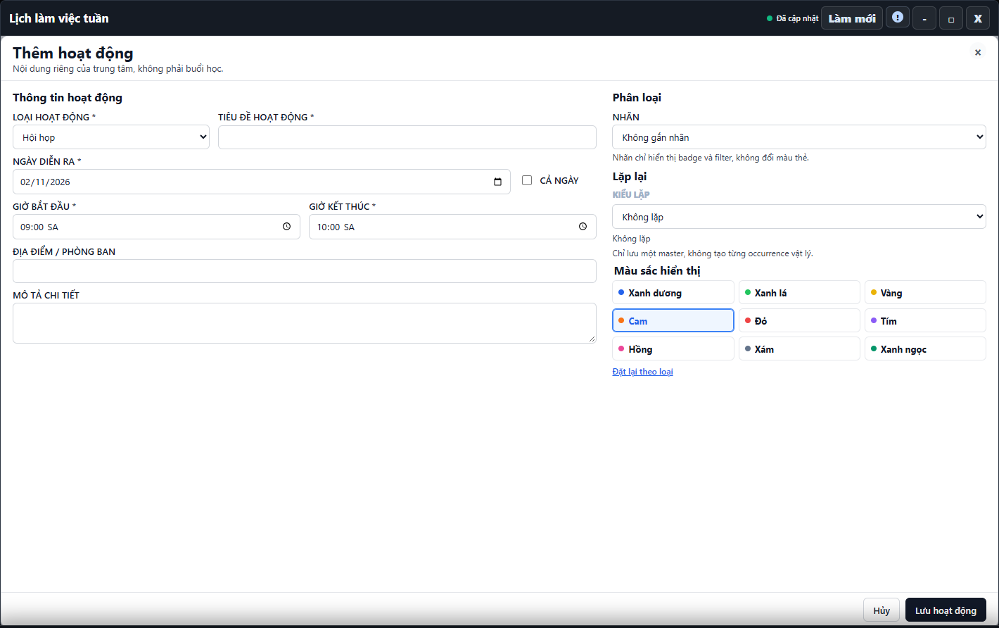

---
{
  "id": "LK-002",
  "title": "Thêm, sửa và xóa hoạt động",
  "summary": "Đặt hội họp, sự kiện hoặc hoạt động của cơ sở lên lịch tuần.",
  "modules": [
    "thoi-khoa-bieu"
  ],
  "order": 28,
  "revision": 2,
  "status": "EDITORIAL_PENDING",
  "keywords": [
    "Thêm, sửa và xóa hoạt động"
  ],
  "questions": [
    "Thêm hoạt động của cơ sở thế nào?",
    "Sửa hoặc xóa hoạt động ở đâu?",
    "Hoạt động trùng lịch thì xử lý thế nào?"
  ],
  "related": [
    "LK-003",
    "LK-001"
  ]
}
---

## Mục đích

Đặt hội họp, sự kiện hoặc hoạt động của cơ sở lên lịch tuần. Không dùng hoạt động để thay thế buổi học, danh sách học viên hay điểm danh.

## Trước khi bắt đầu

- Cần quyền ghi và nguồn Hoạt động đã tải thành công tại đúng cơ sở.
- Chuẩn bị tiêu đề, ngày, giờ và địa điểm thực. Kiểm tra lịch phòng trước khi đặt.

## Các bước thực hiện

1. Mở **Lịch làm việc tuần → 1. Hoạt động → + Thêm hoạt động**.
2. Chọn **Loại hoạt động**, nhập **Tiêu đề hoạt động** và **Ngày diễn ra**.
3. Chọn **Cả ngày** nếu đúng tính chất hoạt động; nếu không, nhập giờ bắt đầu và kết thúc. Kiểm tra ngày/giờ hiển thị, đặc biệt khi khoảng giờ có thể đi qua nửa đêm.
4. Nhập **Địa điểm / Phòng ban**, mô tả và nhãn nếu cần. Màu là lựa chọn hiển thị, không làm hoạt động trở thành một buổi học.
5. Với một hoạt động riêng lẻ, giữ **Không lặp**. Chọn **Lưu hoạt động**; **Hủy** bỏ bản nhập chưa lưu.
6. Nếu có cảnh báo trùng lịch, đọc danh sách và **Quay lại chỉnh sửa**. Trùng phòng với lớp/buổi học có thể bị chặn hoàn toàn; không đổi tên phòng để vượt chặn. Phần xử lý trùng lịch chưa có hướng dẫn hoàn chỉnh; không dùng **Vẫn lưu** theo bài này khi chưa kiểm tra rõ phạm vi.
7. Sau khi hệ thống xác nhận, mở lại thẻ kiểm tra. Muốn sửa, mở thẻ → **Chỉnh sửa**; muốn xóa, chọn **Xóa hoạt động** và kiểm tra hộp xác nhận. Xóa là thao tác ghi, **Hủy** trong hộp xác nhận giữ hoạt động.

## Kết quả mong đợi

Sau thông báo lưu thành công, mở lại hoạt động để kiểm tra ngày, giờ và địa điểm. Sau xác nhận xóa thành công, hoạt động không còn trên lịch. Nếu có cảnh báo trùng lịch, dừng để rà soát; chưa coi hoạt động là đã được lưu.

## Lỗi thường gặp

- **Nút thêm bị khóa:** nguồn chưa sẵn sàng hoặc thiếu quyền; không coi có nút là có khả năng lưu.
- **Muốn sửa lịch học viên:** dùng hồ sơ học viên hoặc ca học đúng loại, không sửa hoạt động.
- **Định sửa một lần trong chuỗi:** dừng và đọc [LK-003](LK-003.md), vì công cụ có thể áp dụng toàn bộ chuỗi.

## Bài liên quan

- [LK-001 · Xem lịch tuần và phân biệt hai tab](LK-001.md)
- [LK-003 · Nhãn và hoạt động lặp tuần](LK-003.md)
