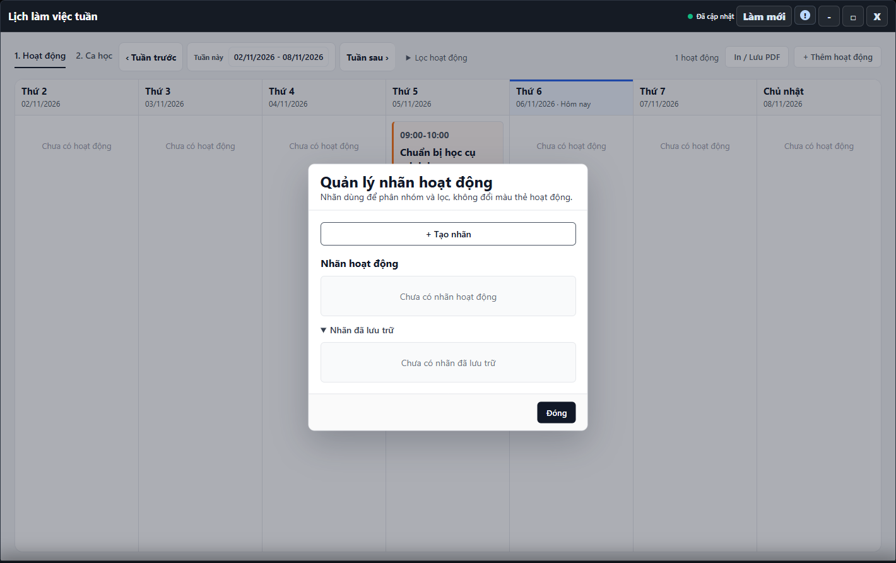

---
{
  "id": "LK-003",
  "title": "Nhãn và hoạt động lặp tuần",
  "summary": "Tra cứu cách phân loại hoạt động bằng nhãn và phạm vi tác động của lịch lặp.",
  "modules": [
    "thoi-khoa-bieu"
  ],
  "order": 29,
  "revision": 2,
  "status": "EDITORIAL_PENDING",
  "keywords": [
    "Nhãn và hoạt động lặp tuần"
  ],
  "questions": [
    "Lọc lịch theo nhãn ở đâu?",
    "Tạo hoặc lưu trữ nhãn hoạt động thế nào?",
    "Đặt hoạt động lặp hằng tuần thế nào?"
  ],
  "related": [
    "HV-002",
    "LK-002"
  ]
}
---

## Mục đích

Tra cứu cách phân loại hoạt động bằng nhãn và phạm vi tác động của lịch lặp. Nhãn không đổi màu thẻ; sửa một chuỗi có thể ảnh hưởng nhiều tuần.

> Phần tạo/lưu trữ nhãn và thay đổi chuỗi lặp chưa có hướng dẫn vận hành được duyệt. Cần đối chiếu thêm phạm vi ngày, trường hợp ngoại lệ và kết quả sau lưu. Phần lọc dưới đây chỉ thay danh sách đang xem.

## Trước khi bắt đầu

- Hoạt động tại cơ sở đã tải thành công. Quyền ghi cần thiết khi quản lý nhãn hoặc sửa chuỗi.
- Xác định cần thay một hoạt động riêng lẻ hay toàn chuỗi trước khi thao tác.

## Các bước thực hiện

### Chỉ tra cứu và chuẩn bị

1. Trong **Lịch làm việc tuần → 1. Hoạt động**, mở **Lọc hoạt động**.
2. Chọn **Loại hoạt động** hoặc **Nhãn** để thu hẹp danh sách. Dùng **Xóa bộ lọc** trước khi kết luận một hoạt động bị mất.
3. Công cụ **Quản lý nhãn** cho xem nhãn hiện có. Nhãn dùng để phân loại/lọc, không thay màu thẻ; bài chưa hướng dẫn tạo, sửa, lưu trữ hoặc khôi phục nhãn.
4. Phần **Lặp lại** phân biệt hoạt động riêng lẻ và **Hàng tuần**. Các công cụ có chữ **toàn bộ chuỗi** có thể ảnh hưởng nhiều tuần; không dùng để đổi riêng một buổi theo bài này.
5. Nếu đã mở form mà chưa rõ phạm vi, dùng **Hủy** hoặc **Quay lại chỉnh sửa** trước khi gửi. Muốn thay lịch học định kỳ của học viên, đọc [HV-002](HV-002.md).

## Kết quả mong đợi

Bộ lọc thay những hoạt động đang hiển thị, không sửa lịch. Bạn nhận biết được thao tác nào liên quan toàn chuỗi. Các thay đổi nhãn/lặp vẫn cần hướng dẫn được duyệt trước khi lưu.

## Lỗi thường gặp

- **Lọc xong không có thẻ:** xóa bộ lọc trước khi kết luận mất hoạt động.
- **Nhãn đã lưu trữ vẫn hiện trên hoạt động cũ:** đó không phải bằng chứng hoạt động bị xóa.
- **Muốn học viên học một ngày cố định:** dùng [HV-002](HV-002.md), không tạo hoạt động lặp để thay lịch học.

## Bài liên quan

- [LK-002 · Thêm, sửa và xóa hoạt động](LK-002.md)
- [HV-002 · Đổi lịch học định kỳ](HV-002.md)
