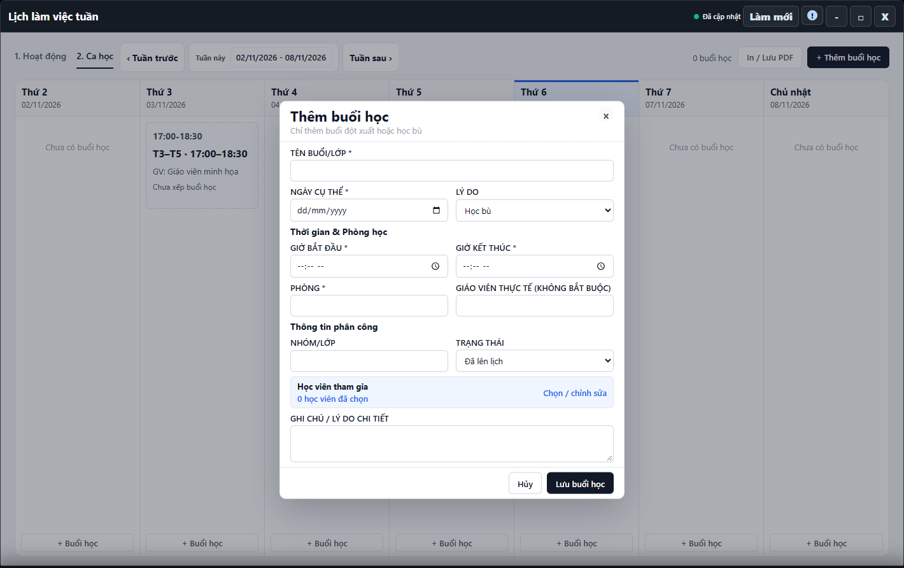

---
{
  "id": "LK-004",
  "title": "Buổi đột xuất và thông tin ca học",
  "summary": "Phân biệt một buổi học riêng lẻ với thông tin phân công của ca định kỳ.",
  "modules": [
    "thoi-khoa-bieu"
  ],
  "order": 30,
  "revision": 2,
  "status": "EDITORIAL_PENDING",
  "keywords": [
    "Buổi đột xuất và thông tin ca học"
  ],
  "questions": [
    "Thêm buổi học đột xuất hoặc học thử ở đâu?",
    "Sửa phòng và thông tin một ca học thế nào?",
    "Xóa buổi học có xóa ca trong Cài đặt không?"
  ],
  "related": [
    "DD-003",
    "HV-002",
    "CD-001",
    "DD-001"
  ]
}
---

## Mục đích

Phân biệt một buổi học riêng lẻ với thông tin phân công của ca định kỳ. Không dùng **+ Thêm buổi học** để đăng ký lịch hằng tuần cho học viên.

## Trước khi bắt đầu

- Quyền ghi lịch và dữ liệu học viên/ca phải sẵn sàng tại cơ sở.
- Chuẩn bị ngày, giờ, phòng, lý do và học viên tham gia; kiểm tra lịch trùng trước khi lưu.
- Nếu là học bù, việc tạo buổi đích chưa hoàn tất liên kết buổi vắng; xem [DD-003](DD-003.md), hiện còn chờ xác minh.

## Các bước thực hiện

1. Mở **Lịch làm việc tuần → 2. Ca học → + Thêm buổi học** hoặc **+ Buổi học** tại ngày cần thêm.
2. Nhập **Tên buổi/lớp**, **Ngày cụ thể**, **Lý do**, giờ bắt đầu/kết thúc và **Phòng**. Các lý do có học bù, học thử, học thêm và buổi học khác.
3. Bổ sung giáo viên thực tế nếu biết, nhóm/lớp và ghi chú. Trong **Học viên tham gia**, chọn **Chọn / chỉnh sửa** để kiểm tra đúng danh sách.
4. Kiểm tra **Trạng thái**; không chọn **Đã học** chỉ để buổi hiện lên hoặc để thay điểm danh. Chọn **Lưu buổi học** và chờ xác nhận; **Hủy** bỏ nháp.
5. Với ca đã có, mở thẻ → **Chỉnh sửa lịch**. Form ca định kỳ lấy ngày/giờ từ Cài đặt; danh sách định kỳ theo học viên có cơ chế riêng, không mặc định sửa tự do tại đây.
6. Phần xóa buổi/phân công chưa có hướng dẫn vận hành được duyệt. **Xóa buổi học**, **Xóa phân công** và **Ngưng lặp lịch cũ** có phạm vi khác nhau; chỉ nhận biết tên, không xác nhận xóa theo bài này và không dùng chúng để xóa danh mục ca.
7. Sau lưu thành công, mở lại thẻ đúng ngày và kiểm tra phòng, danh sách. Khi buổi đã diễn ra, điểm danh tại Bảng điểm danh theo điều kiện hiện hành.

## Kết quả mong đợi

Sau thông báo lưu thành công, mở lại thẻ đúng ngày để kiểm tra giờ, phòng và học viên tham gia. Việc thêm buổi không xác nhận học viên đã có mặt; điểm danh là thao tác riêng.

## Lỗi thường gặp

- **Muốn đổi lịch thường xuyên:** sửa các ngày học đã chọn tại [HV-002](HV-002.md).
- **Ca hiển thị nhưng chưa có thông tin buổi:** kiểm tra phân công và nguồn lịch, không tạo buổi trùng liên tiếp.
- **Buổi có điểm danh bị chặn sửa/xóa:** giữ lịch sử và đọc thông báo; không xóa điểm danh để vượt điều kiện bị chặn.

## Bài liên quan

- [CD-001 · Tạo hoặc chỉnh sửa Ca học](CD-001.md)
- [HV-002 · Đổi lịch học định kỳ](HV-002.md)
- [DD-001 · Điểm danh một buổi](DD-001.md)
- [DD-003 · Học bù và xử lý xung đột điểm danh](DD-003.md)
