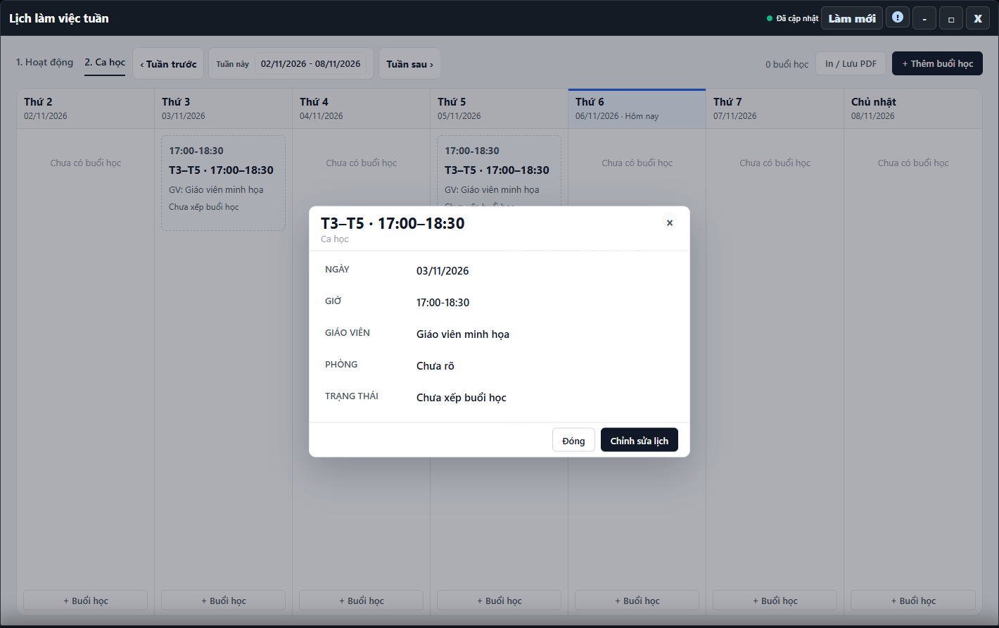

---
{
  "id": "LK-005",
  "title": "Giáo viên chính và giáo viên từng buổi",
  "summary": "Phân biệt đổi giáo viên chính từ một ngày hiệu lực với đổi giáo viên thực tế cho một buổi.",
  "modules": [
    "thoi-khoa-bieu"
  ],
  "order": 31,
  "revision": 2,
  "status": "EDITORIAL_PENDING",
  "keywords": [
    "Giáo viên chính và giáo viên từng buổi"
  ],
  "questions": [
    "Đổi giáo viên chính từ một ngày thế nào?",
    "Đổi giáo viên dạy thay một buổi ở đâu?"
  ],
  "related": [
    "LK-001",
    "LK-004",
    "CD-001"
  ]
}
---

## Mục đích

Phân biệt đổi giáo viên chính từ một ngày hiệu lực với đổi giáo viên thực tế cho một buổi. Tên hiển thị trong ca không thay thế lịch sử phân công giáo viên.

> Phần đổi giáo viên chưa có hướng dẫn vận hành được duyệt. Cần đối chiếu thêm lịch sử phụ trách, ngày áp dụng và kết quả sau lưu. Chỉ đọc thông tin dưới đây, không xác nhận thay giáo viên theo bài này.

## Trước khi bắt đầu

- Lịch sử giáo viên phải tải thành công cùng cơ sở và có giáo viên đủ điều kiện để chọn.
- Cần quyền ghi lịch, xác nhận đúng ca hoặc đúng ngày buổi dạy thay.

## Các bước thực hiện

### Chỉ tra cứu và chuẩn bị

1. Mở **Lịch làm việc tuần → 2. Ca học**, xem đúng ca và ngày cần kiểm tra.
2. Phân biệt giáo viên chính của ca với giáo viên thực tế dạy một buổi. Tên giáo viên hiển thị ở Cài đặt không thay thế thông tin phân công này.
3. **Đổi giáo viên chính** liên quan ngày hiệu lực; **Đổi giáo viên buổi này** chỉ liên quan ngày đang xem. Không thấy công cụ có thể do quyền hoặc lịch sử chưa tải đủ.
4. **Dùng giáo viên của lớp** có ý nghĩa bỏ thay thế riêng của buổi, không phải thêm một giáo viên nữa. Bài chưa hướng dẫn xác nhận thay đổi đó.
5. Nếu đã mở form khi chưa rõ phạm vi, dùng **Hủy**. Ghi lại ca, ngày và thông tin còn thiếu để kiểm tra trước khi thao tác theo một quy trình được duyệt.

## Kết quả mong đợi

Bạn phân biệt được thay giáo viên chính với dạy thay một buổi. Việc đọc thông tin không đổi phân công; không coi tên trên một thẻ là đã xác nhận toàn bộ lịch sử phụ trách.

## Lỗi thường gặp

- **Danh sách giáo viên trống:** không nhập một tên tùy ý để thay cho phân công hợp lệ.
- **Lịch sử đang tải/lỗi:** làm mới theo thông báo và kiểm tra lại, không sửa bằng dữ liệu cũ.
- **Dạy thay một ngày nhưng chọn đổi chính:** hủy form và kiểm tra đúng công cụ trước khi ghi.

## Bài liên quan

- [LK-001 · Xem lịch tuần và phân biệt hai tab](LK-001.md)
- [LK-004 · Buổi đột xuất và thông tin ca học](LK-004.md)
- [CD-001 · Tạo hoặc chỉnh sửa Ca học](CD-001.md)
