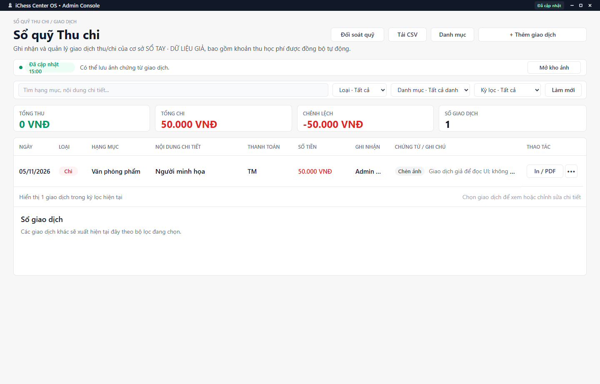

---
{
  "id": "TC-001",
  "title": "Tra cứu Thu chi và xuất CSV",
  "summary": "Tìm giao dịch, đọc tổng theo kỳ và xuất danh sách CSV để đối chiếu.",
  "modules": [
    "nhom-tai-chinh"
  ],
  "order": 32,
  "revision": 3,
  "status": "EDITORIAL_PENDING",
  "keywords": [
    "Tra cứu Thu chi và xuất CSV"
  ],
  "questions": [
    "Tìm giao dịch theo tháng hoặc khoảng ngày thế nào?",
    "Tổng thu tổng chi và chênh lệch nghĩa là gì?",
    "Tải CSV giao dịch ở đâu?"
  ],
  "related": [
    "TC-004",
    "TC-002",
    "BC-001"
  ]
}
---

## Mục đích

Tìm giao dịch, đọc tổng theo kỳ và xuất danh sách CSV để đối chiếu. Chênh lệch Thu–Chi không tự đồng nghĩa số tiền mặt đang có trong ngăn kéo.

## Trước khi bắt đầu

- Kiểm tra đúng cơ sở, ngày/kỳ cần xem và trạng thái dữ liệu Thu chi.
- Không xem số 0 khi nguồn tải lỗi là bằng chứng không phát sinh giao dịch.

## Các bước thực hiện

1. Mở **Sổ quỹ Thu chi** ở phần **Giao dịch**.
2. Nhập từ tìm, chọn **Loại** Thu/Chi và **Danh mục** nếu cần.
3. Chọn **Kỳ lọc**: tất cả, ngày, tuần, tháng, quý, năm hoặc khoảng ngày. Điền khoảng tương ứng và đọc lại phạm vi đang hiển thị.
4. Đọc **Tổng thu**, **Tổng chi**, **Chênh lệch** và **Số giao dịch** sau lọc. Đây là số liệu giao dịch, không chỉ riêng phương thức Tiền mặt.
5. Mở dòng cần kiểm tra, đối chiếu ngày, số tiền, phương thức, người ghi nhận và nguồn. Giao dịch Học phí có đường xem riêng với giao dịch thủ công.
6. Chọn **Tải CSV** để xuất danh sách theo bộ lọc. Kiểm tra nội dung tệp và phạm vi ngày trước khi chia sẻ; xuất không tạo hay sửa giao dịch.
7. Để kiểm quỹ tiền mặt, dùng **Đối soát quỹ** theo [TC-004](TC-004.md).

## Kết quả mong đợi

Tệp CSV được tải theo bộ lọc đang chọn. Mở tệp và xác nhận kỳ, ngày, số giao dịch và số tiền trước khi chia sẻ. Tra cứu và xuất tệp không tạo hoặc sửa giao dịch.

## Lỗi thường gặp

- **Tổng không giống kỳ cần báo cáo:** kiểm tra Kỳ lọc và ngày, không sửa giao dịch để làm khớp một khoảng đang chọn sai.
- **Mất giao dịch khi lọc:** đưa Loại/Danh mục/Kỳ về Tất cả, xóa từ tìm và kiểm tra dữ liệu tải.
- **Khoản học phí chưa xuất hiện:** kiểm tra thanh toán tại Học phí và trạng thái nguồn; không nhập lại khoản thu chỉ vì đang lọc sai.

## Bài liên quan

- [TC-002 · Thêm, sửa và xóa giao dịch thủ công](TC-002.md)
- [TC-004 · Thiết lập và đối soát quỹ tiền mặt](TC-004.md)
- [BC-001 · Đọc báo cáo ngày, tuần và giao dịch nguồn](BC-001.md)
