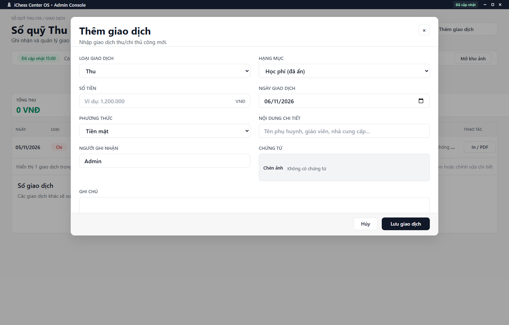

---
{
  "id": "TC-002",
  "title": "Thêm, sửa và xóa giao dịch thủ công",
  "summary": "Ghi một khoản thu/chi thủ công thực tế và sửa sai ở đúng giao dịch.",
  "modules": [
    "nhom-tai-chinh"
  ],
  "order": 33,
  "revision": 2,
  "status": "EDITORIAL_PENDING",
  "keywords": [
    "Thêm, sửa và xóa giao dịch thủ công",
    "nhập khoản chi"
  ],
  "questions": [
    "Nhập khoản chi thủ công ở đâu?",
    "Sửa hoặc xóa giao dịch thủ công thế nào?",
    "Học phí đã thu có cần nhập thêm giao dịch không?"
  ],
  "related": [
    "TC-003",
    "TC-001",
    "TC-005",
    "HP-002"
  ]
}
---

## Mục đích

Ghi một khoản thu/chi thủ công thực tế và sửa sai ở đúng giao dịch. Không nhập thêm khoản thu học phí đã được ghi nhận tại Học phí vì có thể ghi trùng tiền.

## Trước khi bắt đầu

- Có quyền ghi, nguồn Thu chi sẵn sàng tại đúng cơ sở.
- Xác minh khoản tiền thực, ngày, phương thức và chứng từ. Tìm giao dịch trước khi thêm để tránh trùng.

## Các bước thực hiện

1. Mở **Sổ quỹ Thu chi → + Thêm giao dịch**.
2. Chọn **Loại giao dịch** Thu hoặc Chi và **Hạng mục** phù hợp.
3. Nhập **Số tiền** lớn hơn 0, **Ngày giao dịch**, **Phương thức**, **Nội dung chi tiết** và **Người ghi nhận**. Không đổi phương thức chỉ để làm khớp quỹ.
4. Bổ sung ghi chú và ảnh chứng từ khi có dữ liệu hợp lệ; xem giới hạn tại [TC-003](TC-003.md).
5. Rà soát lại khoản tiền rồi chọn **Lưu giao dịch**. Đây là bước ghi vào sổ; **Hủy** bỏ bản nhập chưa lưu.
6. Muốn sửa giao dịch thủ công đã có, nhấp đúp dòng, kiểm tra đúng giao dịch rồi sửa và **Lưu giao dịch**. Giao dịch nguồn Học phí không áp dụng form sửa thủ công này.
7. Nếu cần xóa giao dịch thủ công, chọn **Xóa giao dịch** trong form sửa, đọc xác nhận và chỉ tiếp tục khi đã kiểm tra hậu quả. Xóa có thể làm thay đổi tổng và kết quả đối soát; hủy xác nhận nếu chưa chắc.
8. Sau thông báo thành công, tìm lại giao dịch và kiểm tra tổng ở đúng kỳ. Nếu đang ghi hoặc báo lỗi, không bấm thêm nhiều lần.

## Kết quả mong đợi

Sau thông báo lưu thành công, giao dịch xuất hiện đúng ngày, loại, số tiền và phương thức; tổng Thu chi của kỳ được cập nhật tương ứng. Xóa giao dịch cần xác nhận riêng. Nếu báo lỗi hoặc chưa rõ kết quả, kiểm tra giao dịch cũ trước khi nhập lại.

## Lỗi thường gặp

- **Đã thu học phí:** kiểm tra Học phí và giao dịch nguồn trước, không nhập lại thủ công.
- **Lỗi số tiền/ngày:** sửa trường được báo, không dùng số tiền tượng trưng để vượt kiểm tra.
- **Dữ liệu bị thay đổi trong lúc sửa:** kiểm tra bản hiện hành trước khi gửi lại, tránh ghi đè người khác.

## Bài liên quan

- [TC-001 · Tra cứu Thu chi và xuất CSV](TC-001.md)
- [TC-003 · Danh mục và ảnh chứng từ](TC-003.md)
- [TC-005 · Khoản thu học phí và điều chỉnh sai sót](TC-005.md)
- [HP-002 · Ưu đãi định kỳ và gia hạn học phí](HP-002.md)
