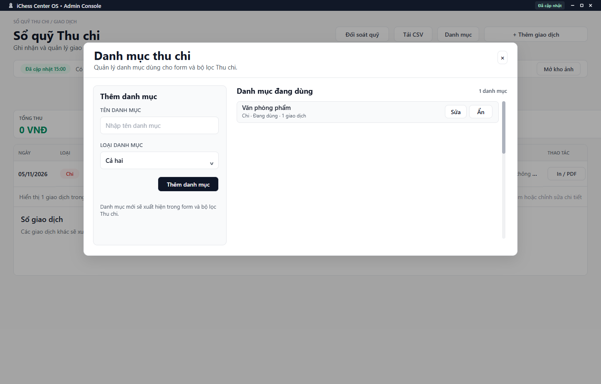

---
{
  "id": "TC-003",
  "title": "Danh mục và ảnh chứng từ",
  "summary": "Tra cứu danh mục nhập liệu và ảnh chứng từ giao dịch.",
  "modules": [
    "nhom-tai-chinh"
  ],
  "order": 34,
  "revision": 2,
  "status": "EDITORIAL_PENDING",
  "keywords": [
    "Danh mục và ảnh chứng từ"
  ],
  "questions": [
    "Thêm hoặc ngưng dùng danh mục Thu chi ở đâu?",
    "Đính kèm ảnh chứng từ giao dịch thế nào?",
    "Xem hoặc in chứng từ giao dịch ở đâu?"
  ],
  "related": [
    "TC-002",
    "TC-001"
  ]
}
---

## Mục đích

Tra cứu danh mục nhập liệu và ảnh chứng từ giao dịch. Đính kèm ảnh không tạo khoản thu/chi mới và không chứng minh một giao dịch đã được lưu.

> Phần thay đổi danh mục, lưu/xóa ảnh và in chứng từ chưa có hướng dẫn hoàn chỉnh được duyệt. Cần kiểm tra thêm quyền, kết quả lưu và bản chứng từ. Các bước dưới chỉ giúp tra cứu điều kiện; không thêm, ẩn hoặc gửi ảnh theo bài này.

## Trước khi bắt đầu

- Cần quyền ghi và dữ liệu Thu chi hiện hành; ảnh còn phụ thuộc khả năng sử dụng kho ảnh của cơ sở.
- Chuẩn bị chứng từ đúng giao dịch. Không dùng ảnh chứa dữ liệu thật làm ví dụ công khai.

## Các bước thực hiện

### Chỉ tra cứu và chuẩn bị

1. Trong **Sổ quỹ Thu chi**, mở **Danh mục** để đọc tên và loại Thu/Chi/Cả hai.
2. **Ẩn** danh mục có mục đích ngưng đưa vào lựa chọn thường dùng, không phải xóa giao dịch cũ. Bài chưa hướng dẫn xác nhận thêm, sửa hoặc ẩn danh mục.
3. Khi chuẩn bị ảnh, kiểm tra đúng giao dịch và định dạng JPEG/PNG/WebP, dung lượng tối đa 1 MB theo công cụ trên form. Không đổi đuôi tệp để giả định dạng.
4. Ảnh đang xem trước chưa chứng minh đã lưu vào giao dịch. Chưa có hướng dẫn đủ cho lưu, tải hoặc xóa ảnh trong bài này; không gửi ảnh theo các bước tra cứu.
5. **Chèn ảnh**, **In / PDF** và **Mở kho ảnh** là các đường riêng, phụ thuộc dữ liệu/quyền. Nếu đã mở form xem, dùng **Hủy** hoặc đóng trước khi ghi; tham khảo [TC-002](TC-002.md) cho giao dịch thủ công.

## Kết quả mong đợi

Bạn biết danh mục và ảnh chứng từ phục vụ việc gì, cùng điều kiện tệp cần chuẩn bị. Xem ảnh không tạo khoản thu/chi và không xác nhận chứng từ đã được lưu. Phần ghi/xóa vẫn cần hướng dẫn được duyệt.

## Lỗi thường gặp

- **Tên danh mục trùng:** kiểm tra danh mục hiện có trước khi thêm.
- **Ảnh quá lớn hoặc sai loại:** chuẩn bị bản ảnh hợp lệ, không đổi đuôi tệp để giả định dạng.
- **Có ảnh nhưng giao dịch chưa lưu:** kiểm tra thông báo và mở lại giao dịch, không dựa vào ảnh xem trước.

## Bài liên quan

- [TC-002 · Thêm, sửa và xóa giao dịch thủ công](TC-002.md)
- [TC-001 · Tra cứu Thu chi và xuất CSV](TC-001.md)
