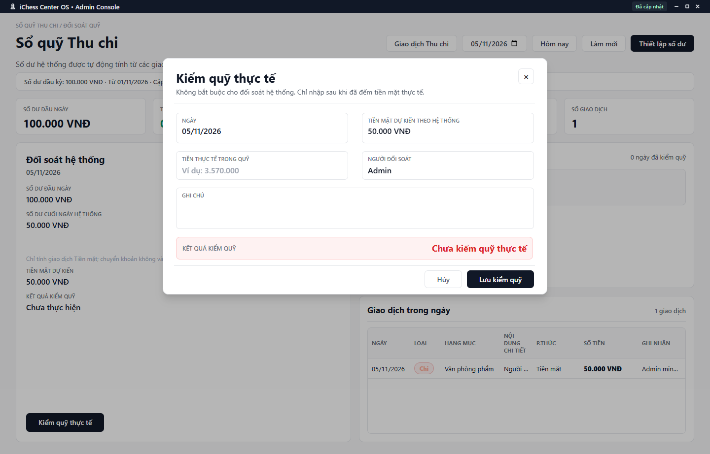

---
{
  "id": "TC-004",
  "title": "Thiết lập và đối soát quỹ tiền mặt",
  "summary": "Thiết lập số dư đầu kỳ và so tiền mặt thực đếm với tiền mặt dự kiến.",
  "modules": [
    "nhom-tai-chinh"
  ],
  "order": 35,
  "revision": 2,
  "status": "EDITORIAL_PENDING",
  "keywords": [
    "Thiết lập và đối soát quỹ tiền mặt"
  ],
  "questions": [
    "Thiết lập số dư đầu kỳ ở đâu?",
    "Kiểm quỹ thực tế và chốt sổ ngày thế nào?",
    "Vì sao tiền chuyển khoản không vào tiền mặt dự kiến?"
  ],
  "related": [
    "TC-001",
    "TC-002"
  ]
}
---

## Mục đích

Thiết lập số dư đầu kỳ và so tiền mặt thực đếm với tiền mặt dự kiến. Kiểm quỹ thực tế là bước riêng; không nhập số dự kiến thay cho việc đếm tiền.

## Trước khi bắt đầu

- Có quyền ghi, nguồn Thu chi hiện hành và đúng cơ sở/ngày.
- Xác nhận số dư bắt đầu và ngày áp dụng trước khi sửa; thay số dư ảnh hưởng phép tính các ngày liên quan.
- Đếm tiền mặt thật trước khi kiểm quỹ. Chuyển khoản không nằm trong ngăn kéo tiền mặt.

## Các bước thực hiện

1. Mở **Sổ quỹ Thu chi → Đối soát quỹ**. Chọn **Ngày** hoặc **Hôm nay**.
2. Đọc số dư đầu/cuối ngày, tổng Thu/Chi và giao dịch trong ngày. Phần **Đối soát hệ thống** khác **Kiểm quỹ thực tế**.
3. Khi cần thiết lập hoặc sửa số dư bắt đầu, mở **Thiết lập số dư**. Nhập số dư không âm, ngày bắt đầu hợp lệ và người cập nhật; kiểm tra kỹ trước khi lưu. **Hủy** bỏ form chưa lưu.
4. Chọn **Kiểm quỹ thực tế**. Nhập **Tiền thực tế trong quỹ**, **Người đối soát** và ghi chú giải thích nếu cần.
5. Chọn **Lưu kiểm quỹ** và chờ xác nhận. Hệ thống tính chênh lệch từ tiền thực đếm và tiền mặt dự kiến; không phải tự sửa số thực để hiện “Khớp”.
6. Sau khi đã có kết quả kiểm quỹ, công cụ **Chốt sổ ngày này** có thể xuất hiện. Chỉ chốt sau khi rà soát khoản chênh lệch và đọc xác nhận; bước chốt là ghi dữ liệu riêng.
7. Kiểm tra **Lịch sử kiểm quỹ thực tế**. Nếu giao dịch thay đổi sau khi kiểm/chốt, màn hình có thể cảnh báo số dự kiến đã thay đổi; cần kiểm tra lại trước khi dùng số liệu.

## Kết quả mong đợi

Sau thông báo lưu kiểm quỹ thành công, lịch sử có số tiền thực đếm, số dự kiến và chênh lệch của đúng ngày. Chốt sổ không khóa mọi giao dịch về sau; nếu có cảnh báo số liệu thay đổi, cần đối chiếu lại.

## Lỗi thường gặp

- **Cộng cả chuyển khoản vào tiền thực đếm:** kiểm tra riêng giao dịch Tiền mặt.
- **Quỹ lệch:** kiểm tra ngày, số dư đầu và giao dịch thật; không tạo giao dịch giả để làm khớp.
- **Ngày đã chốt nhưng có cảnh báo thay đổi:** đối chiếu lại nguồn, không bỏ qua chỉ vì đã có nhãn chốt.

## Bài liên quan

- [TC-001 · Tra cứu Thu chi và xuất CSV](TC-001.md)
- [TC-002 · Thêm, sửa và xóa giao dịch thủ công](TC-002.md)
