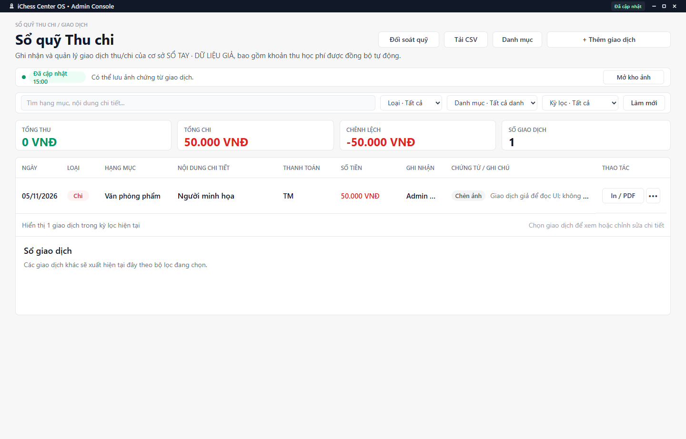

---
{
  "id": "TC-005",
  "title": "Khoản thu học phí và điều chỉnh sai sót",
  "summary": "Nhận biết giao dịch được đồng bộ từ Học phí và cách tránh ghi trùng khi xử lý sai sót.",
  "modules": [
    "nhom-tai-chinh"
  ],
  "order": 36,
  "revision": 2,
  "status": "EDITORIAL_PENDING",
  "keywords": [
    "Khoản thu học phí và điều chỉnh sai sót"
  ],
  "questions": [
    "Sửa giao dịch đồng bộ từ Học phí được không?",
    "Hủy thanh toán học phí ghi nhầm ở đâu?"
  ],
  "related": [
    "HP-002",
    "HP-005",
    "HP-006",
    "TC-002"
  ]
}
---

## Mục đích

Nhận biết giao dịch được đồng bộ từ Học phí và cách tránh ghi trùng khi xử lý sai sót. Giao dịch gắn kỳ học và Phiếu Thu không phải một dòng thu thủ công độc lập.

> Chưa có hướng dẫn vận hành được duyệt cho hủy khoản thu Học phí. Chưa đối chiếu đủ điều kiện hủy và tác động tới kỳ học, Phiếu Thu và Sổ quỹ. Chỉ tra cứu khoản thu; không hủy hoặc tạo giao dịch bù theo bài này.

## Trước khi bắt đầu

- Kiểm tra học viên, kỳ, khoản thực nhận, Phiếu Thu và giao dịch cùng cơ sở.
- Không tạo một giao dịch âm, chi bù hoặc khoản thu mới chỉ để làm số tổng có vẻ đúng.

## Các bước thực hiện

### Chỉ tra cứu và chuẩn bị

1. Mở **Sổ quỹ Thu chi**, tìm giao dịch theo ngày và học viên/nội dung liên quan.
2. Mở chi tiết nếu dữ liệu sẵn sàng. Nhãn **Đồng bộ từ Học phí** cho biết khoản thu gắn với Học phí, không phải giao dịch thủ công độc lập.
3. Đối chiếu số tiền, phương thức, học viên và kỳ. Nếu chứng từ chưa tải được, chưa kết luận khoản thu đã đúng hoặc đã bị hủy.
4. Nếu có sai sót, ghi lại thông tin khoản cũ và đọc chi tiết Học phí trước khi xử lý. Bài này không chỉ dẫn vị trí hoặc xác nhận lệnh hủy.
5. Không dùng **+ Thêm giao dịch**, giao dịch âm hoặc khoản chi bù để làm tổng có vẻ đúng. Đóng phần xem khi đã kiểm tra; chỉ điều chỉnh theo quy trình đã được duyệt.

## Kết quả mong đợi

Bạn nhận biết được khoản thu gắn với Học phí và tránh nhập trùng khi kiểm tra sai sót. Bài không xác nhận đã hủy khoản thu, đổi kỳ hay điều chỉnh Phiếu Thu.

## Lỗi thường gặp

- **Không sửa được như giao dịch thường:** đó có thể là ràng buộc nguồn Học phí, không phải lý do xóa bằng cách khác.
- **Đã trả trước iChess:** số nguồn không tự thành một khoản thu mới của ngày hiện tại.
- **Không rõ đã hủy chưa:** kiểm tra trạng thái trước khi gửi thêm lệnh, tránh tạo sai lệch kép.

## Bài liên quan

- [HP-002 · Ưu đãi định kỳ và gia hạn học phí](HP-002.md)
- [HP-005 · Thông báo học phí và Phiếu Thu](HP-005.md)
- [HP-006 · Tiếp quản học phí từ dữ liệu ban đầu](HP-006.md)
- [TC-002 · Thêm, sửa và xóa giao dịch thủ công](TC-002.md)
